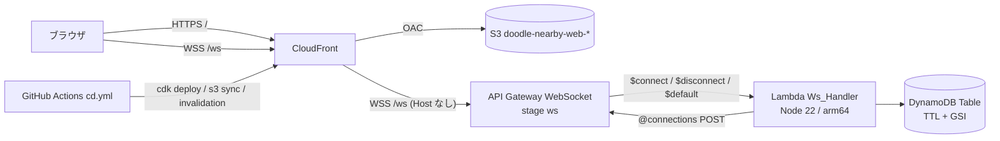
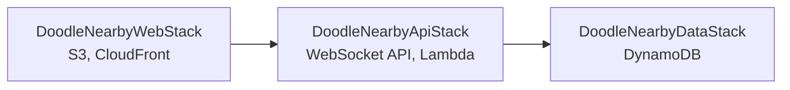
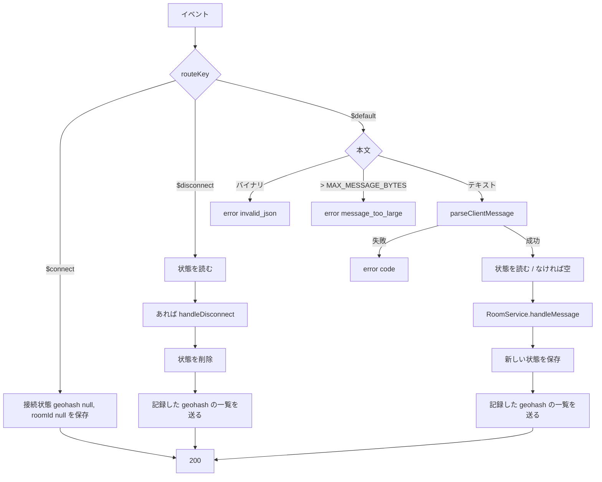

# Design Document

## Overview

local-prototype の `RoomService` を、API Gateway WebSocket + Lambda + DynamoDB の上でそのまま動かし、画面は S3 + CloudFront で配る。新しく書くコードは、`RoomStore` の DynamoDB 実装、Lambda の薄いハンドラー、CDK の3スタック、スモークテストである。

### 設計判断の要約

| # | 判断 | 理由 |
|---|---|---|
| 1 | 画面の `/ws` を CloudFront の behavior で API Gateway WebSocket に転送する(同じオリジン) | 画面は `location` から `wss://<host>/ws` を作る(local-prototype の要件 12.4)。画面のコードも `cd.yml` も変えずに済む。WebSocket の URL を画面のビルドに渡す手段が `cd.yml` にないため |
| 2 | WebSocket のステージ名を `ws` にする | CloudFront の `/ws` がそのままオリジンの `/ws` になる。パスの書き換え(CloudFront Function)が要らない |
| 3 | `DynamoDbRoomStore` は `backend/lambdas` に置く | `packages/core` に AWS SDK を入れない。core は画面(ブラウザ)からも読まれる |
| 4 | Lambda は1関数・3ルート(`$connect`、`$disconnect`、`$default`) | 処理は `RoomService` への委譲だけ。関数を分けても得るものがなく、コールドスタートが増える |
| 5 | テーブルは1つ(単一テーブル設計)、GSI は1つ | アクセスパターンが少ない。オンデマンド課金で、使わない間は費用がほぼ 0 |
| 6 | スタックを Data / Api / Web の3つに分ける | 保存データを持つスタックを分け、終了保護と RETAIN を付けるため。参照は一方向(Web → Api → Data) |
| 7 | Lambda の esbuild は `@doodle-nearby/core` を `src` から読む | `cd.yml` は `cdk deploy` のあとで core をビルドする。`dist` を前提にするとデプロイが失敗する |
| 8 | 管理 API の宛先は、受信したイベントの `domainName` と `stage` から作る | 環境変数に API の URL を渡すと、Lambda と API が循環参照になる |

### 調査で確認した事項

| 事項 | 内容 | 出典 |
|---|---|---|
| WebSocket API の上限 | フレーム 32KB(超えると `1009` で切断)、メッセージ 128KB、アイドル 10 分、接続は最長 2 時間、新規接続 500/秒/アカウント/Region | API Gateway の WebSocket の quotas |
| CloudFront の WebSocket | 専用のスイッチはない。キャッシュ無効 + `Upgrade` と `Sec-WebSocket-*` を転送すれば通る。アイドルは 10 分で切れる | CloudFront の quotas、AWS ブログ(CloudFront と WebSocket) |
| CloudFront の背後に API Gateway WebSocket を置く例 | CloudFront Function でパスを書き換えて API Gateway WebSocket に転送する構成が AWS のブログにある | AWS for Industries ブログ |
| プラン | このアカウントは Paid プラン(`accountPlanType: PAID`)。使うサービス(API Gateway、Lambda、DynamoDB、S3、CloudFront、CloudFormation、CloudWatch Logs)はすべて対応済み | `GetAccountPlanState`、対応サービスの一覧 |
| SCP | `iam:CreateRole` などを拒否するのは `role/managed/*` だけ。CDK が作る Lambda の実行ロールは対象外 | プロジェクトの SCP の文書 |
| ブートストラップ | `CDKToolkit` は作成済み(ap-southeast-2、バージョン 34)。`GithubOidcStack` も作成済み | `ListStacks`、SSM |
| Lambda の同時実行 | アカウントの上限は **1,000**(10 から引き上げ済み。`GetAccountSettings` で確認)。予約は設定しない | `GetAccountSettings` |
| CDK の WebSocket | `aws-cdk-lib/aws-apigatewayv2` の `WebSocketApi` / `WebSocketStage` と、`aws-apigatewayv2-integrations` の `WebSocketLambdaIntegration` が使える | CDK の README |
| 疎通 ①(CloudFront 経由) | `wss://<配信>/ws` で往復できた(2026-11-27、ap-southeast-2) | 使い捨てスタックでの疎通確認 |
| 疎通 ②(管理 API の宛先) | Lambda の `domainName` は、CloudFront 経由でも execute-api のドメインで、`stage` は `ws`。`postToConnection` は成功した。管理 API の宛先を `domainName` と `stage` から作る設計(設計判断 8)の根拠になる(2026-11-27) | 同上 |
| 疎通 ③(ヘッダー) | `Origin` ヘッダーは `$connect` に届いた。`Host` は転送されなかった(`ALL_VIEWER_EXCEPT_HOST_HEADER` が効いた。`Host` は execute-api のもの)(2026-11-27) | 同上 |
| 疎通 ④(直接接続) | 直接の `wss://<apiId>.execute-api.<region>.amazonaws.com/ws` でも往復できた(2026-11-27) | 同上 |
| 疎通 ⑤(権限) | `grantManageConnections` は循環参照なしで `synth` でき、この API だけに許可された(`execute-api:ManageConnections`)(2026-11-27) | 同上 |

### 未確認の点(実装の最初に確認する)

1. **【確認済み 2026-11-27】CloudFront 経由の WebSocket が、API Gateway(ステージ `ws`)まで通ること。** 空のハンドラーで疎通を確かめ、往復できた(結果は上の「疎通 ①〜⑤」)。決定事項 1 の代替案は使わない
2. `node_modules` が未インストールの作業環境では、CDK のバージョンと `esbuild` の有無を確認できなかった。実装の最初に `npm ci` して、`aws-cdk-lib` のバージョンと `OriginRequestPolicy.ALL_VIEWER_EXCEPT_HOST_HEADER`、`NodejsFunction` の `esbuildArgs` を確認する
3. 契約テストのスイート `runRoomStoreContract` は、S 側の `@doodle-nearby/core/testing` にすでにある。この Spec は使うだけで、作らない。`deletesImmediately` のオプションは S 側で追加される予定で、追加されるまで、タスク 3.5、3.6 は保留にする(タスク 2.2 で確認する)。`deleteExpired` は TTL に任せ、契約は `deletesImmediately: false` で通す。決定事項 4 を参照
4. `RoomService` が `ports.roomsChanged` を `await` するか。この設計は、どちらでも動くようにしてある。`roomsChanged` は geohash を記録するだけで、一覧の送信はハンドラーが接続状態の保存のあとに行う。`send` の完了は `pending` で待つ(下の「ポートの実装」)

---

## Architecture

### 全体構成



### スタックと参照



| スタック | 主なリソース | 出力 |
|---|---|---|
| `DoodleNearbyDataStack` | `Table`(オンデマンド、TTL、GSI)。終了保護あり、`RETAIN` | `TableName` |
| `DoodleNearbyApiStack` | `WebSocketApi`、ステージ `ws`、`NodejsFunction`(Ws_Handler)、ログ保持 | `WebSocketUrl` |
| `DoodleNearbyWebStack` | S3 バケット、CloudFront(既定 behavior = S3、`/ws` = API Gateway)、レスポンスヘッダーポリシー | `WebBucketName`、`WebDistributionId`、`PublicUrl` |

- 参照は、Data → Api は `Table` オブジェクト、Api → Web は `apiId` の文字列だけを渡す。
- **一度作った参照は消さない**。スタック間の参照を後から外すと、エクスポートが使用中のため `cdk deploy` が止まる(CDK の「deadly embrace」)。外す必要が出たら、参照の強さを弱める手順を踏む。
- CD は `cdk deploy 'DoodleNearby*'` で3つを依存順に更新する。`GithubOidcStack` は対象外で変更しない。

### フォルダとファイル

| パス | 内容 |
|---|---|
| `infra/lib/constants.ts` | 既存に追記: `WS_STAGE_NAME = 'ws'`、スタック名、`TTL_MARGIN_SECONDS = 3600`、`CONNECTION_TTL_SECONDS = 10800` |
| `infra/lib/data-stack.ts` | `DoodleNearbyDataStack` |
| `infra/lib/api-stack.ts` | `DoodleNearbyApiStack` |
| `infra/lib/web-stack.ts` | `DoodleNearbyWebStack` |
| `infra/bin/infra.ts` | 既存に3スタックを追加(`GithubOidcStack` はそのまま) |
| `backend/lambdas/src/index.ts` | `export const handler`(実体の組み立て) |
| `backend/lambdas/src/handler.ts` | `createWsHandler(deps)`。依存を注入できる形(テスト用) |
| `backend/lambdas/src/ports.ts` | `ServicePorts` の実装(`send`、`roomsChanged`) |
| `backend/lambdas/src/dynamodb-room-store.ts` | `DynamoDbRoomStore` |
| `backend/lambdas/src/connection-store.ts` | `ConnectionStore` interface と DynamoDB 実装(`ConnectionState` の保存、購読者の検索) |
| `backend/lambdas/src/dynamo-keys.ts` | キーの組み立てと、項目 ↔ `Room` / `StoredDrawing` の変換(純関数) |
| `tests/smoke/run.ts` | スモークテスト(`npm run smoke`) |
| `docs/deploy.md`、`docs/judges.md` | 英語の運用手順と審査員向けの手順 |

`packages/core`、`apps/local-server`、`apps/web` は、この Spec では変更しない。契約テストのスイート `runRoomStoreContract`(`@doodle-nearby/core/testing`)は S 側にあるものを使い、`./testing` の export や `coreAlias` も足さない(決定事項 4)。

---

## Components and Interfaces

### 1. DynamoDB のテーブル

#### 1.1 スキーマ

| 項目 | 値 |
|---|---|
| 課金 | オンデマンド(`PAY_PER_REQUEST`) |
| キー | `pk`(S)、`sk`(S) |
| TTL 属性 | `ttl`(N、epoch 秒) |
| GSI | `gsi1`(`gsi1pk` S、`gsi1sk` S)、射影は `ALL` |
| 暗号化 | AWS 所有キー(既定) |
| PITR | 無効(データは3時間で消える。費用を避ける) |
| 保護 | `deletionProtection: true`、`removalPolicy: RETAIN` |

#### 1.2 項目

| 項目 | `pk` | `sk` | 主な属性 | `gsi1pk` / `gsi1sk` |
|---|---|---|---|---|
| 部屋 | `ROOM#<roomId>` | `META` | `roomCode`、`geohash`(位置なしは省略)、`createdAt`、`expiresAt`(ミリ秒)、`participants`(Map: `connectionId` → `{color, icon, joinedAt}`)、`identities`(String Set: `color:icon`)、`nextSeq`(N)、`ttl` | `geohash` があるときだけ `GEO#<geohash>` / `ROOM#<roomId>` |
| 絵 | `ROOM#<roomId>` | `DRAWING#<seq を10桁ゼロ埋め>` | `drawingId`、`seq`、`sender`(`{color, icon}`)、`imageData` または `imageKey`、`createdAt`、`ttl` | なし |
| 部屋番号の予約 | `CODE#<roomCode>` | `LOCK` | `roomId`、`expiresAt`、`ttl` | なし |
| 接続状態 | `CONN#<connectionId>` | `STATE` | `geohash`(省略可)、`roomId`(省略可)、`ttl` | `geohash` があり、かつ `roomId` がないときだけ `GEO#<geohash>` / `CONN#<connectionId>` |

- 部屋と接続は同じ GSI に入るが、`gsi1sk` の接頭辞(`ROOM#`、`CONN#`)で `begins_with` で分けて引く。
- 接続の GSI キーは、部屋に入ると外れる(スパース)。「部屋に入っていない購読者」だけが GSI に残る。
- 項目は小さい(部屋は 8 人分で 1KB 未満、絵は最大約 30KB)。DynamoDB の項目上限 400KB に余裕がある。
- 緯度経度、IP、名前は、どの項目にも入れない(要件 6.4、4.9)。

#### 1.3 `RoomStore` の各メソッドの写し方

| メソッド | 操作 | 原子性と競合 |
|---|---|---|
| `createRoom(room, now)` | 先に `CODE#<code>` を `GetItem`(強い読み取り)。期限切れの予約があれば、古い部屋の `META` の削除をトランザクションに含める。`TransactWriteItems` で ①部屋 `META` を `attribute_not_exists(pk)` 付きで `Put`、②予約を `attribute_not_exists(pk) OR expiresAt <= :now` 付きで `Put`。キャンセル理由が②の条件失敗なら `code_taken`。成功後、古い部屋の絵を `Query` して `BatchWriteItem` で消す(ベストエフォート) | 部屋番号の一意性は予約項目の条件で保つ |
| `getRoomById` | `GetItem`(`ConsistentRead`)。`META` を `Room` に変換。参加者は `joinedAt` 昇順 | — |
| `getRoomByCode` | `CODE#<code>` を `GetItem` → `roomId` → 部屋を `GetItem`。予約があっても部屋がなければ `null` | 2回の強い読み取り |
| `listRoomsByGeohashes` | 各 geohash(最大9)を `Query`(`gsi1pk = GEO#g`、`gsi1sk begins_with ROOM#`)。並列で引き、ページをたどって連結。期限切れも返してよい | GSI は結果整合(下の「リスク」) |
| `listActiveRoomCodes(now)` | `Scan`(`begins_with(pk, "CODE#") AND expiresAt > :now`、`pk` だけ射影)。20回の番号衝突のあとにだけ使う稀な経路 | — |
| `addParticipant` | `UpdateItem`: `SET participants.#c = :p ADD identities :idset`。条件 `attribute_exists(pk) AND attribute_not_exists(participants.#c) AND size(participants) < :max AND NOT contains(identities, :id)`。失敗時は `ReturnValuesOnConditionCheckFailure: ALL_OLD` で旧項目を見て理由を決める(項目なし → `not_found`、すでに参加 → `added: false` で成功、`size >= max` → `full`、それ以外 → `identity_taken`)。成功時は `ALL_NEW` を `Room` に変換 | 1回の更新で原子的。定員と識別の競合は条件で決まる |
| `removeParticipant` | `GetItem` で識別を調べ、`UpdateItem`: `REMOVE participants.#c DELETE identities :idset`、条件 `attribute_exists(participants.#c)`。条件失敗(すでに外れている)なら読み直して返す。項目がなければ `null` | 識別は接続ごとに固定なので、読み取りと更新の間にずれない |
| `appendDrawing` | `UpdateItem`: `ADD nextSeq :one`、条件 `attribute_exists(pk)`、`ReturnValues: ALL_NEW` で `seq` と `ttl` を得る。続けて絵を `Put`(`ttl` は部屋と同じ)。`seq > maxDrawings` なら `seq - maxDrawings` の絵を `DeleteItem` | `seq` の割り当ては原子的。割り当てのあと `Put` の前に落ちると、欠番ができる(許容。並びは `seq` で決まる) |
| `listDrawings` | `Query`(`pk`、`sk begins_with DRAWING#`、昇順、`ConsistentRead`)。**`LastEvaluatedKey` が返らなくなるまで `ExclusiveStartKey` で繰り返し、全ページを連結して全件を返す**。1回の `Query` が返すのは最大 1MB で、50枚 × 約 30KB = 約 1.5MB の部屋は1回では収まらないため。途中で止めたり、`Limit` で切ったりしない。`listRoomsByGeohashes` と `listActiveRoomCodes`(`Scan`)も同じ | — |
| `deleteExpired(now)` | **TTL に任せる。** 何も消さず `[]` を返す実装にする。読み取れる期限切れの部屋を消すかどうかは任意で、この Spec では入れない(期限切れの部屋は、`RoomService` が読み取り時に隠す)。契約テストは `deletesImmediately: false` で通す(決定事項 4) | — |

`ExpressionAttributeNames` / `Values` は、純関数で組み立てる(`dynamo-keys.ts`)。接続 ID は `#c` で渡し、式に直接埋め込まない。

#### 1.4 TTL

- 部屋、絵、予約: `ttl = ceil(expiresAt / 1000) + TTL_MARGIN_SECONDS`(1時間)。
- 接続状態: `ttl = floor(now / 1000) + CONNECTION_TTL_SECONDS`(3時間)。状態を保存するたびに更新する。API Gateway の接続は最長2時間なので、`$disconnect` を取りこぼしても3時間以内に消える。
- DynamoDB の TTL による削除は遅れることがある。だから `RoomService` が読み取り時に `expiresAt <= now` を判定する(要件 6.3)。

### 2. Lambda ハンドラー

```ts
// handler.ts
export type WsEvent = {
  requestContext: { routeKey: string; connectionId: string; domainName: string; stage: string };
  body?: string | null;
  isBase64Encoded?: boolean;
};
export type HandlerDeps = {
  service: RoomService;
  connections: ConnectionStore;
  sender: (endpoint: string) => { post(connectionId: string, data: string): Promise<void> };
  clock: Clock;
  log: (line: string) => void;
};
export function createWsHandler(deps: HandlerDeps): (event: WsEvent) => Promise<{ statusCode: number }>;
```



- **サイズの検査**: `Buffer.byteLength(body)` を、パースの前に測る。ちょうど `MAX_MESSAGE_BYTES` は受け付ける(local-server と同じ)。
- **バイナリ**: `isBase64Encoded === true` のとき、`invalid_json` として返す。
- **例外**: `try/catch` で全体を囲み、本人へ `internal_error` を送る(送れなければ無視)。常に `statusCode: 200` を返す(API Gateway がエラー応答を接続に返さないように)。
- **直列化がない**: local-server は全接続を1本のキューで直列化するが、Lambda は並行する。同じ接続の2通が同時に処理されると、接続状態の読み書きが競合しうる。画面は `room_joined` を待ってから絵を送るので、通常は起きない。部屋の中の整合性(定員、識別、`seq`)は、`RoomStore` の原子的な更新が守る。
- **ログ**: `type`、バイト数、エラーコード、接続 ID の先頭8文字だけ(要件 3.10)。

#### 2.1 ポートの実装

一覧の再送は、local-server と同じ順序にする。`roomsChanged` は変わった geohash を**記録するだけ**にし、一覧の送信は、ハンドラーが**接続状態を保存したあと**に行う。こうすると、操作した本人の状態(部屋に入った、`roomId` が入った)が先に保存され、本人は購読者(部屋に入っていない接続)から外れているので、部屋に入った直後の本人に不要な `room_list` が届かない。

```ts
// ports.ts
export type RoomListFlusher = {
  /** 変わった geohash の一覧(重複なし) */
  changed: Set<string>;
  /** 記録した geohash の近傍にいる購読者へ一覧を送る。接続状態の保存のあとに呼ぶ */
  flush(): Promise<void>;
};

export function createPorts(args: {
  endpoint: string;                 // https://<domainName>/<stage>
  sender: HandlerDeps['sender'];
  connections: ConnectionStore;
  buildRoomList: (geohash: string) => Promise<RoomList>;
  pending: Promise<unknown>[];      // send の完了を待つための一覧
}): { ports: ServicePorts; flusher: RoomListFlusher };
```

- `send(connectionId, message)`: `JSON.stringify` して `postToConnection`。`GoneException`(410)と他の失敗は、その接続だけ無視する。接続が消えていた場合は、その接続状態を削除する(要件 5.4)。送ったメッセージが `MAX_MESSAGE_BYTES` を超えるときは、送らずにログだけ残す(起きない想定。絵は 30,000 文字以内に制限済み)。返した `Promise` は `pending` にも積む。
- **送信用クライアント**: `ApiGatewayManagementApiClient` は、宛先(`endpoint`)ごとに1回だけ作って使い回す(`sender` の内部でキャッシュする)。計測では、最初の送信が約 970ms、2回目が約 150ms だった。送信のたびに作ると、毎回この差を払う。
- `roomsChanged(geohash)`: `changed` に geohash を足すだけ。DynamoDB にも API Gateway にも触れず、すぐ戻る。
- `flusher.flush()`:
  1. `changed` の各 geohash について、`neighborCells(geohash)` の各マスで `connections.listSubscribers(cell)`(GSI、`CONN#`)を引く。
  2. 購読者を `connectionId` で重複なしにまとめ、その接続の `geohash` ごとに分けて、`buildRoomList` を1回ずつ呼ぶ。
  3. 最大10接続ずつ並行して送る(要件 5.5)。
  4. 終わったら `changed` を空にする。

ハンドラーでの呼び出し順(`$default`):

1. 接続状態を読む → `handleMessage`(この間、`roomsChanged` は記録だけ)→ **新しい接続状態を保存**。
2. `flusher.flush()`(購読者は、保存後の状態で引く)。
3. `pending` を `allSettled` で待つ。
4. `return`。

`$disconnect` では、`handleDisconnect` → **接続状態を削除** → `flush()` → `pending` を待つ。`handleMessage` が例外を投げた場合も、状態を保存できる範囲で保存してから `flush()` する(記録された geohash があれば)。`RoomService` が `roomsChanged` を `await` してもしなくても、記録だけなので結果は変わらない。
#### 2.2 接続状態の保存(`ConnectionStore`)

```ts
export interface ConnectionStore {
  get(connectionId: string): Promise<ConnectionState | null>;
  put(state: ConnectionState, nowMs: number): Promise<void>;     // GSI キーは geohash あり && roomId なし のときだけ付ける
  delete(connectionId: string): Promise<void>;
  /** 部屋に入っていない、この geohash の接続 */
  listSubscribers(geohash: string): Promise<ConnectionState[]>;
}
```

### 3. 組み立て(`index.ts`)

- モジュールのスコープで、DynamoDB クライアント(`DynamoDBDocumentClient`)と `DynamoDbRoomStore`、`ConnectionStore` を1回だけ作る(ウォーム再利用)。
- `RoomService` は、イベントごとに `createPorts` が変わる(宛先の `endpoint` と `pending` が違う)ので、**イベントごとに作る**。`RoomService` は状態を持たない(状態は `RoomStore` と `ConnectionState`)ので、作るコストは小さい。
- `orderRooms` には core の `orderRoomSummaries` を渡す。`clock`、`random`、`newId` は既定(`systemClock`、`Math.random`、`crypto.randomUUID`)。
- 環境変数は `TABLE_NAME` だけ。`AI_MODE` はこの Spec では使わない。
- AWS SDK v3(`@aws-sdk/client-dynamodb`、`lib-dynamodb`、`client-apigatewaymanagementapi`)は、Node.js 22 の Lambda ランタイムに入っているものを使い、バンドルしない。`backend/lambdas/package.json` の `dependencies` には、型とローカルのテストのために書く(バージョンは固定)。

### 4. CDK

#### 4.1 `DoodleNearbyDataStack`

`Table` を上の 1.1 のとおりに作る。`terminationProtection: true`。出力 `TableName`。

#### 4.2 `DoodleNearbyApiStack`

```ts
const handler = new NodejsFunction(this, 'WsHandler', {
  entry: path.join(repoRoot, 'backend/lambdas/src/index.ts'),
  handler: 'handler',
  runtime: Runtime.NODEJS_22_X,
  architecture: Architecture.ARM_64,
  memorySize: 256,
  timeout: Duration.seconds(15),
  environment: { TABLE_NAME: table.tableName },
  logGroup: new LogGroup(this, 'WsHandlerLogs', { retention: RetentionDays.TWO_WEEKS, removalPolicy: RemovalPolicy.DESTROY }),
  projectRoot: repoRoot,
  depsLockFilePath: path.join(repoRoot, 'package-lock.json'),
  bundling: {
    minify: true,
    target: 'node22',
    externalModules: ['@aws-sdk/*'],
    forceDockerBundling: false,
    esbuildArgs: { '--alias:@doodle-nearby/core': path.join(repoRoot, 'packages/core/src/index.ts') },
  },
});
table.grantReadWriteData(handler);
```

- 出力形式は CJS(既定)にする。core の依存 `ngeohash` は CommonJS なので、ESM 出力にすると `require` の問題が出うる。
- `esbuild` を `infra/package.json` の `devDependencies` に固定バージョンで足す。入っていないと CDK は Docker でのバンドルに切り替え、Docker のない CI の `synth` が落ちる(`forceDockerBundling: false` でも、esbuild がなければ Docker に落ちる)。
- `WebSocketApi`: `connectRouteOptions`、`disconnectRouteOptions`、`defaultRouteOptions` に同じ `WebSocketLambdaIntegration` を渡す。`routeSelectionExpression` は `$request.body.action`(既定)のままでよい。JSON でない本文は `$default` に行く。
- `WebSocketStage`: `stageName: 'ws'`、`autoDeploy: true`、`throttle: { rateLimit: 20, burstLimit: 40 }`。
- **IAM**: `webSocketApi.grantManageConnections(handler)` で `execute-api:ManageConnections` を許可する。この API の `@connections` だけが対象になる。
  - API ID を使う権限は、Lambda → 権限 → API → 統合 → Lambda の循環参照になる可能性がある。**実装時に `cdk synth` で確認する。** 循環参照のエラーが出たら、次の `*` の案に戻す: `arn:aws:execute-api:<region>:<account>:*/ws/POST/@connections/*`(API ID だけ `*`。ステージ `ws`、メソッド `POST`、パス `@connections/*`、アカウントと Region で絞る)。戻した場合は、この項と決定事項 9 に理由を記録する。
  - どちらの案でも、管理 API の宛先は環境変数ではなく、イベントの `domainName` と `stage` から作る(設計判断 8)。
- 出力 `WebSocketUrl`(= `stage.url`)。

#### 4.3 `DoodleNearbyWebStack`

```ts
const bucket = new Bucket(this, 'WebBucket', {
  bucketName: `${WEB_BUCKET_PREFIX}${Aws.ACCOUNT_ID}-${Aws.REGION}`,
  blockPublicAccess: BlockPublicAccess.BLOCK_ALL,
  enforceSSL: true,
  encryption: BucketEncryption.S3_MANAGED,
  removalPolicy: RemovalPolicy.DESTROY,
  autoDeleteObjects: true,
});
```

- バケット名は `doodle-nearby-web-*` の接頭辞が必須(`GithubOidcStack` の S3 権限が、この接頭辞に一致するバケットだけに許可されているため)。アカウント ID と Region は、環境非依存で `synth` できるように疑似パラメーターを使う。
- `autoDeleteObjects` は、スタックを消すときにバケットが空でなくて失敗しないために付ける。Web の中身は毎回再生成できるので、消えてよい。
- `Distribution`:
  - 既定 behavior: `S3BucketOrigin.withOriginAccessControl(bucket)`、`ViewerProtocolPolicy.REDIRECT_TO_HTTPS`、`CachePolicy.CACHING_OPTIMIZED`、圧縮あり、レスポンスヘッダーポリシー(下記)。`defaultRootObject: 'index.html'`。
  - `/ws`: `HttpOrigin('<apiId>.execute-api.<region>.amazonaws.com', { protocolPolicy: HTTPS_ONLY })`、`HTTPS_ONLY`、`CachePolicy.CACHING_DISABLED`、`OriginRequestPolicy.ALL_VIEWER_EXCEPT_HOST_HEADER`、`AllowedMethods.ALLOW_GET_HEAD`。パスの書き換えはしない(ステージ名 `ws` と一致している)。
  - `httpVersion: HTTP2_AND_3`、`priceClass: PRICE_CLASS_ALL`(審査員は世界中から来うる。転送量が少ないので差は小さい)、`minimumProtocolVersion: TLS_V1_2_2021`。
- レスポンスヘッダーポリシー: HSTS(1年)、`X-Content-Type-Options`、`Referrer-Policy: no-referrer`、`X-Frame-Options: DENY`、`Permissions-Policy: geolocation=(self), camera=(), microphone=()`(カスタムヘッダー)。CSP は、Safari が `connect-src 'self'` で `wss:` を許可しない場合があるため、この Spec では入れない。
- 出力: `WebBucketName`、`WebDistributionId`、`PublicUrl`(`https://<distributionDomainName>`)。

#### 4.4 `infra/bin/infra.ts`

`env` の扱いは既存のまま(アカウントと Region が両方あるときだけ渡す)。Region はコードに書かない(要件 7.1)。既存の `GithubOidcStack` の行は変えない。

### 5. CD との整合

| `cd.yml` のステップ | この Spec の側 | 確認 |
|---|---|---|
| `cdk deploy 'DoodleNearby*'` | 3スタックを依存順に更新。esbuild が `packages/core/src` を直接読む | `dist` なしで `synth` できる(CI の synth が同じ条件) |
| 出力の読み取り | `DoodleNearbyWebStack` に `WebBucketName` と `WebDistributionId` | CDK のテストで確認 |
| Web のビルド | 画面は `wss://<host>/ws` を使う。環境変数は不要 | — |
| `aws s3 sync --delete` | バケット名が `doodle-nearby-web-*` | `GithubOidcStack` の S3 権限に一致 |
| CloudFront の無効化 | 配信 ID は出力から取る | 権限は `distribution/*` に付与済み |

CD ロールが AWS に対して持つ権限は、既存のまま(ブートストラップロールの引き受け、`DescribeStacks`、S3、`CreateInvalidation`)で足りる。リソースの作成は、ブートストラップの CloudFormation 実行ロールが行う。

**初回のデプロイ**は、所有者が自分の認証情報で `cdk deploy 'DoodleNearby*'` を手動で行うことを勧める(CloudFront の作成に数分〜15分かかり、失敗したときの原因が見やすい)。そのあと `DEPLOY_ENABLED` を `'true'` にする。手順は `docs/deploy.md` に書く。

---

## Data Models

### ConnectionState と ServerMessage

`ConnectionState`、`ClientMessage`、`ServerMessage` は core の定義をそのまま使う。この Spec は型を足さない。

### 設定値

| 名前 | 値 | 場所 |
|---|---|---|
| ステージ名 | `ws` | `infra/lib/constants.ts` |
| Lambda のメモリ / タイムアウト | 256MB / 15秒 | `api-stack.ts` |
| ステージのスロットリング | 20 req/秒、バースト 40(リスク 9 の決定) | `api-stack.ts` |
| ログ保持 | 14日 | `api-stack.ts` |
| `TTL_MARGIN_SECONDS` | 3,600 | `constants.ts` |
| `CONNECTION_TTL_SECONDS` | 10,800 | `constants.ts` |
| 一斉送信の並行数 | 10 | `ports.ts` |
| `TABLE_NAME` | 環境変数 | Lambda |

---

## Correctness Properties

*A property is a characteristic or behavior that should hold true across all valid executions of a system. Properties bridge human-readable specifications and machine-verifiable guarantees.* 保存の振る舞い(競合、定員、`seq`、期限切れ)は、local-prototype の契約テスト(Property 12 など)が検査する。ここには、この Spec で新しく書く純粋なロジックだけを挙げる。

### Property 1: 項目と値の変換はラウンドトリップする

*For any* 有効な `Room`(参加者 0〜8 人、`geohash` あり / なし)、`StoredDrawing`、`ConnectionState`、`dynamo-keys.ts` の「項目へ」→「値へ」の変換は元の値に戻る。**Validates: 要件 4.1、4.9**

### Property 2: TTL の範囲

*For any* `expiresAt`(ミリ秒)、部屋、絵、予約の `ttl`(秒)は `expiresAt / 1000` 以上、`expiresAt / 1000 + TTL_MARGIN_SECONDS + 1` 以下である。接続状態の `ttl` は `now / 1000` より大きく、`now / 1000 + CONNECTION_TTL_SECONDS` 以下である。**Validates: 要件 5.1、6.2**

### Property 3: 一覧の宛先

*For any* 接続の集合(`geohash`、`roomId` を持つ)と変更された `geohash`、`roomsChanged` の送信先は、「`roomId` がなく、`geohash` が `neighborCells(変更された geohash)` に含まれる接続」の集合と等しい。位置なしの接続と部屋の中の接続には送らない。**Validates: 要件 3.7、5.3**

### Property 4: ハンドラーは例外を投げない

*For any* 文字列の本文(不正な JSON、空、非常に長いもの、バイナリのフラグ付きを含む)、`$default` の処理は例外を投げず、部屋の状態を変えない場合にはエラーメッセージを1通だけ送信者に送る。**Validates: 要件 3.4、3.5、3.8**

### Property 5: 送信するメッセージの大きさ

*For any* `RoomService` が送るメッセージ(`imageData` が 30,000 文字以内の `drawing_added` を含む)、`ports.send` が送る JSON のバイト数は `MAX_MESSAGE_BYTES` 以下である。**Validates: 要件 3.9**

### Property 6: ログに出さない値

*For any* メッセージ(`geohash`、`roomCode`、`imageData` を含む)を処理したあと、ハンドラーが出したログのどの行にも、その `geohash`、`roomCode`、`imageData` の文字列が含まれない。**Validates: 要件 3.10、6.4**

---

## Error Handling

| 状況 | 動作 |
|---|---|
| 本文が `MAX_MESSAGE_BYTES` 超 | `message_too_large` を本人へ。接続は保つ。API Gateway のフレーム上限(32KB)を超えるものは、API Gateway が `1009` で接続を閉じる(local-server の `ws` の 1 MiB と同じ位置づけ) |
| 不正な JSON、型、フィールド | パーサーのコードを本人へ。状態は変えない |
| `RoomService` の例外 | `internal_error` を本人へ。ログには型だけ |
| DynamoDB の一時的な失敗(スロットル) | AWS SDK の既定の再試行に任せる。それでも失敗したら `internal_error` |
| `postToConnection` が 410 | その接続を無視し、接続状態を削除 |
| `$disconnect` で状態が見つからない | 何もしない(`$connect` の書き込みが失敗した、または TTL で消えた) |
| Lambda の同時実行がアカウントの上限(1,000)に達する | API Gateway のその呼び出しが失敗する。画面は応答が返らない。スロットリング(20 req/秒)× 約 0.4 秒 ≒ 約 8 同時なので、通常は届かない(リスク 1) |
| CloudFront / API Gateway が 10 分間アイドルで切断、または2時間で切断 | 画面の「接続が切れた」表示(`Back to start`)。`docs/judges.md` に書く |

---

## 費用の見積もり

**使われないとき**: ほぼ 0。S3 の保存(数 MB)、CloudWatch Logs(ほぼ書かない)、DynamoDB の保存(3時間で消えるデータ)だけ。時間課金のリソース(NAT、VPC、プロビジョニング済みの容量)はない。

**メッセージの数え方**: API Gateway は、クライアントから受けたメッセージと、`postToConnection` で送り出すメッセージのどちらも、1通ずつ課金する(32KB ごとに1通。絵は 30,000 文字以内なので1通)。8人の部屋で絵を1枚送ると、受信1通 + 送信8通(送信者本人を含む)= **9通**になる。ほかに、参加時の `room_joined` と `participant_joined`、保持している絵の再送(参加者ごとに最大 50 通)、一覧の再送、退出の通知がある。

**使われたとき**(米国の定価を基にした概算。ap-southeast-2 は1〜2割高いことがある。単価は実装時に確認する。API Gateway: メッセージ 1.00 USD/100万、接続 0.25 USD/100万分。DynamoDB オンデマンド: 書き込み 0.625 USD/100万 WRU、読み取り 0.125 USD/100万 RRU。Lambda arm64: 約 0.0000133 USD/GB秒)。

| 前提 | 2端末、3分、絵10枚 | 8人の部屋、5分、1人5枚(絵40枚) |
|---|---|---|
| API Gateway のメッセージ | 約 50 通(絵 10 × 3 通 + 参加・一覧など) | 約 650 通(絵 40 × 9 = 360 + 参加通知 36 + 絵の再送 最大約 160 + 一覧 約 50 + 退出 36) |
| API Gateway の料金 | 約 0.00005 USD | 約 0.00065 USD |
| DynamoDB の書き込み | 約 400 WRU(絵 1 枚 = 約 30KB で約 30 WRU) | 約 1,400 WRU |
| DynamoDB の読み取り | 約 300 RRU | 約 1,600 RRU(参加時に絵を読む。30KB の強い読み取りは 1 枚 8 RRU) |
| DynamoDB の料金 | 約 0.0003 USD | 約 0.0011 USD |
| Lambda(1回約 0.3 秒 × 256MB) | 約 0.0001 USD | 約 0.0003 USD |
| **1回の合計** | **約 0.0005 USD** | **約 0.002 USD** |
| **1,000回で** | **約 0.5 USD** | **約 2 USD** |

- CloudFront と S3(Web 約 200KB × 端末数)は、1,000回でも数セント以下。
- 費用の主な項目は DynamoDB の絵の書き込み(1枚 約 30 WRU)と、絵1枚ごとの 9 通のメッセージ。

**悪用されたとき**: ステージのスロットリング(**20 req/秒、バースト 40**)が、受け付けるメッセージ数の上限を決める。Lambda の同時実行の上限は 1,000 に引き上げ済みで、Lambda の上限は実質的に効かない(20 req/秒 × 約 0.4 秒 ≒ 約 8 同時)。スロットリングはクライアントから受けるメッセージだけを数え、`postToConnection` の送信は数えない。そのため、8人の部屋への `drawing_submit` 1通が 9 通の課金になる。最悪の場合は、20 回/秒がすべて 8人の部屋への `drawing_submit`(約 30KB)で、30日(259万2千秒)続く場合で、次のとおり。

| 項目 | 計算 | 1 か月の上限の目安 |
|---|---|---|
| API Gateway のメッセージ | 20 回/秒 × 9 通 × 259万2千秒 = 約 4.7億通 | 約 470 USD |
| DynamoDB の書き込み | 20 回/秒 × 約 31 WRU × 259万2千秒 = 約 16億 WRU | 約 1,000 USD |
| Lambda | 20 回/秒 × 約 0.4 秒 × 0.25GB = 2 GB秒/秒 → 約 520万 GB秒、リクエスト 約 5,200万回 | 約 80 USD |
| 合計 | | **約 1,550 USD** |

- 同時実行の上限が 1,000 になったので、受け付ける量の上限を決めるのはスロットリング(20 回/秒)だけである。引き上げの前(上限 10、約 25 回/秒)も、スロットリングのほうが低かったので、上限の金額は同じ約 1,550 USD である。
- 前の案(50 req/秒)のままなら、承認後の上限は約 3,900 USD になる。20 req/秒で、その約 4 割に抑える。
- スロットリングは API 全体に対して1つで、接続ごとではない。1人の攻撃者が上限を使い切ると、ほかの利用者のメッセージもスロットリングで拒否される(可用性の低下)。通常の利用(1人が数秒に1枚)では、20 req/秒に達しない。
- 現実にこうなるには、8接続を自分で作った攻撃者が、1か月ずっと続ける必要がある。最終的な歯止めは AWS Settings の**支出上限(spend limit)**(要件 8.6)。上限を超えるとプロジェクトが止まるので、止まった場合の確認手順を `docs/deploy.md` に書く。
- DynamoDB の書き込みが費用の約3分の2を占める。さらに下げたくなった場合は、接続ごとの絵の送信間隔を `RoomService` で制限する案がある(local-prototype の変更になるので、この Spec では入れない)。
- API Gateway には CloudFront を経由せず直接つなげるので、CloudFront の側で制限しても上限は変わらない。
**Budgets は作らない**: 通知の設定にプロジェクトの SCP による制限がある(`notifications:*` の一部が拒否されている)。

---

## Testing Strategy

| 対象 | 方法 | 場所 |
|---|---|---|
| `dynamo-keys.ts` | 例示テストと Property 1、2(fast-check) | `backend/lambdas/src/dynamo-keys.test.ts` |
| `DynamoDbRoomStore` | S 側の契約テスト `runRoomStoreContract` を、`deletesImmediately: false` で、一時テーブル(実際の DynamoDB)で実行。`RUN_AWS_INTEGRATION=1` のときだけ | `backend/lambdas/src/dynamodb-room-store.integration.test.ts` |
| `handler.ts`、`ports.ts` | 偽の `ConnectionStore` と偽の送信、`MemoryRoomStore` + 実物の `RoomService` で、Property 3〜6 と要件 3、5 | `backend/lambdas/src/handler.test.ts` |
| CDK | Template の細かいアサーション(要件 10.2)、Region が固定されていないこと。**`/ws` の behavior が `Host` ヘッダーを転送しない**ことの確認(下記)。ManageConnections の権限が、`grantManageConnections` の場合は この API の ARN に、`*` に戻した場合は `@connections/*` に絞られていること | `infra/lib/*.test.ts` |
| 全体 | `npm run smoke -- <PublicUrl>`(手動。デプロイのあと) | `tests/smoke/run.ts` |

- **DynamoDB の実物でテストする理由**: 条件式(`size(...)`、`contains`、`attribute_not_exists`、トランザクションのキャンセル理由)の間違いが、このストアの主なリスクで、モックでは検出できない。DynamoDB Local は Java と配布物のダウンロードが要り、CI が壊れやすい。一時テーブルの作成と削除は数秒で、費用は数セント未満。初回のデプロイの前に1回実行する(タスクのチェックポイントに入れる)。
- **`Host` を転送しないことの確認**: テンプレートの `AWS::CloudFront::Distribution` で、`CacheBehaviors` のうち `PathPattern` が `/ws` の behavior を取り出し、`OriginRequestPolicyId` が管理ポリシー `AllViewerExceptHostHeader`(`b689b0a8-53d0-40ab-baf2-68738e2966ac`)であることを確かめる。あわせて、`CachePolicyId` がキャッシュ無効の管理ポリシー(`4135ea2d-6df8-44a3-9df3-4b5a84be39ad`)であることも確かめる。`Host` を転送すると、API Gateway が自分のドメイン以外の `Host` を拒否して、接続が失敗するため。独自のポリシーに変えた場合は、そのポリシーの `HeadersConfig` に `Host` が含まれないことを検査する形に直す。
- **統合テストの大きい絵のケース**: 契約テストに加えて、次のケースを実際の DynamoDB に対して実行する。1つの部屋に、約 30KB の絵(`imageData` が 30,000 文字)を 50 枚 `appendDrawing` し、`listDrawings` が 50 枚すべてを `seq` の昇順(1〜50)で返し、各 `imageData` が送った内容と一致することを確かめる。合計は約 1.5MB で、1回の `Query` の上限(1MB)を超えるので、`LastEvaluatedKey` をたどっていないと 50 枚に足りず失敗する。51枚目を追加したら、`seq` 1 の絵が消えて 50 枚のままであることも確かめる。
- 一時テーブルの名前は `doodle-nearby-it-<ランダム>`、`finally` で削除する。失敗した場合に残ったテーブルを見つけられるよう、名前の接頭辞をテストの出力に出す。
- スモークテストは、2つの WebSocket クライアントで `create_room`(位置なし)→ `join_by_code` → `drawing_submit`(1×1 の PNG)→ 両方が `drawing_added` を受信 → `leave` を確認する。接続先は CloudFront の `wss://<host>/ws`。
- 既存の CI(lint、typecheck、test、synth)は変えない。統合テストとスモークテストは CI で動かさない。

---

## リスクと確認が必要な点(AWS のレビューで見てほしい)

| # | リスク | 影響 | 対応案 |
|---|---|---|---|
| 1 | Lambda の同時実行の上限は 1,000 に引き上げ済み(以前は 10)。予約は設定しない | 通常の利用ではスロットリング(20 req/秒 × 約 0.4 秒 ≒ 約 8 同時)が先に効くので、上限には届かない。届いた場合は、その呼び出しが失敗する | 追加の対応は不要。7.2 で `GetAccountSettings` を再確認する。上限が下がっていた場合は、Service Quotas で再申請する |
| 2 | GSI は結果整合 | 部屋の作成や人数の変化の直後に、一覧の再送が古い内容になることがある(通常は数十ミリ秒)。次の変化で直る | 許容する。許容できない場合は、一覧用の項目を本表に持ち、更新を同じトランザクションにする(書き込みが増える) |
| 3 | CloudFront 経由の WebSocket が未検証 | 通らなければ、画面が WebSocket につながらない | 最初のタスクで疎通。通らなければ決定事項 1 の代替案 |
| 4 | 同じ接続の2通が並行して処理される | 状態の読み書きが競合しうる | 画面の送信順で通常は起きない。起きても、部屋の整合性はストアが守る |
| 5 | アイドル 10 分、接続 2 時間で切断。画面に自動再接続はない | 審査員が放置すると切れる | `docs/judges.md` に書く。ping の追加は決定事項 3 |
| 6 | `RETAIN` のテーブルがスタック削除後に残る | 課金は保存量だけで小さいが、残り続ける | コンテスト終了後の手順を `docs/deploy.md` に書き、削除は所有者に確認する |
| 7 | API Gateway に直接つなげる | CloudFront を使わずに接続できる。同じ Lambda に届く | スロットリングで上限を決める。出所の確認(秘密のヘッダー)は、費用の効果が小さいので入れない |
| 9 | 送信のメッセージ数が増幅する(受信1通 → 8人の部屋で送信8通)。ステージのスロットリングは受信だけを数える | 悪用されると、1か月の理論上の上限が約 1,550 USD(費用の見積もりを参照)。1人の攻撃者がスロットリングを使い切ると、ほかの利用者のメッセージも拒否される | **決定: ステージのスロットリングを 20 req/秒、バースト 40 にする。** 支出上限(spend limit)を設定する。接続ごとの送信間隔の制限は入れない |
| 8 | 位置情報のない1端末では、1人でしか絵が出ない | 審査員が1台で試すと、他の参加者がいない | AI ボットは別の Spec(product.md の原則)。`docs/judges.md` に、2つのタブで試す手順を書く |

---

## 決定事項

| # | 決定 |
|---|---|
| 1 | WebSocket は CloudFront の `/ws` を経由する(同じオリジン)。**代替案**: 直接 `wss://<apiId>.execute-api.ap-southeast-2.amazonaws.com/ws` につなぎ、画面に `VITE_WS_URL` を足し、`cd.yml` の Web ビルドの前に `WebSocketUrl` の出力を環境変数に渡す。この案は画面と `cd.yml` の変更が要る。CloudFront 経由が通らないときだけ、所有者の了承を得て採る |
| 2 | `DynamoDbRoomStore` と `ConnectionStore` は `backend/lambdas` に置き、core に AWS SDK を入れない |
| 3 | 画面からの keep-alive(`ping`)は、この Spec では足さない。メッセージ型を変えるため。10 分の放置で切れる制限は、文書に書く。足す場合は local-prototype に近い別の小さな Spec で行う |
| 4 | 契約テストのスイート `runRoomStoreContract` は S 側(`@doodle-nearby/core/testing`)にあり、この Spec は使うだけにする。`./testing` の export と `coreAlias` も S 側にあるものを使い、この Spec では足さない。**`deleteExpired` は TTL に任せ、読める期限切れの部屋を消すかどうかは任意とする(この Spec の実装は何も消さず `[]` を返す)。契約は `deletesImmediately: false` で通す(`DynamoDbRoomStore` は false で呼ぶ)。** 期限切れの `roomCode` の置き換え(`createRoom`)で古い部屋と絵を消すことは、`deleteExpired` とは別で、契約が求めるなら実装する。S 側の契約テストに足りないケースは、S 側に依頼するか、統合テストの追加ケースとして書く |
| 5 | Lambda の予約同時実行は設定しない(予約する必要がない)。同時実行の上限は 1,000 に引き上げ済み(`GetAccountSettings` で確認)。受け付ける量の上限は、スロットリング 20 req/秒、バースト 40 が決める(リスク 9) |
| 6 | Budgets と CloudWatch アラームは作らない。支出上限は AWS Settings で所有者が設定する |
| 7 | API Gateway のアクセスログは有効にしない(アカウント全体の設定が要る)。ログは Lambda だけ |
| 8 | CSP ヘッダーは入れない(Safari の `connect-src 'self'` と `wss:` の扱いの違いが不確かなため) |
| 9 | `ManageConnections` は `webSocketApi.grantManageConnections(handler)` で、この API だけに許可する。`cdk synth` で循環参照が出たら、`*/ws/POST/@connections/*` の案に戻し、理由をここに書く |
| 10 | tasks.md を作るときは、最初のタスクを「CloudFront 経由の WebSocket の疎通(空のハンドラー)」にし、**ほかのタスクに依存させない**。内容: 空のハンドラー(接続を受けて `echo` を返すだけ)の Lambda、WebSocket API(ステージ `ws`)、`/ws` の behavior を持つ最小の CloudFront を一時的に作り、`wss://<host>/ws` で往復を確かめる。通らなければ決定事項 1 の代替案を所有者に相談する。確認できたら、その構成を本実装に置き換える(使い捨てのスタックは削除する) |

## 要件との対応表

| 要件 | 主な設計の箇所 |
|---|---|
| 1 | 4.3 |
| 2 | 4.3、決定事項 1、2、未確認の点 1 |
| 3 | 2、2.1、4.2 |
| 4 | 1.2、1.3、1.4、Testing Strategy |
| 5 | 1.2、2.1、2.2 |
| 6 | 1.4、Property 2、6 |
| 7 | 4.2(esbuild)、4.4、5 |
| 8 | 4.2、費用の見積もり、決定事項 5〜7 |
| 9 | スタックと参照、4.1〜4.4、5 |
| 10 | Testing Strategy |
| 11 | フォルダとファイル(`docs/`) |
