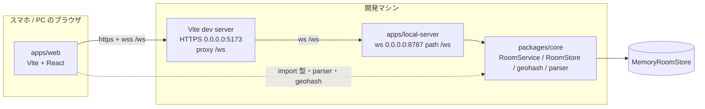
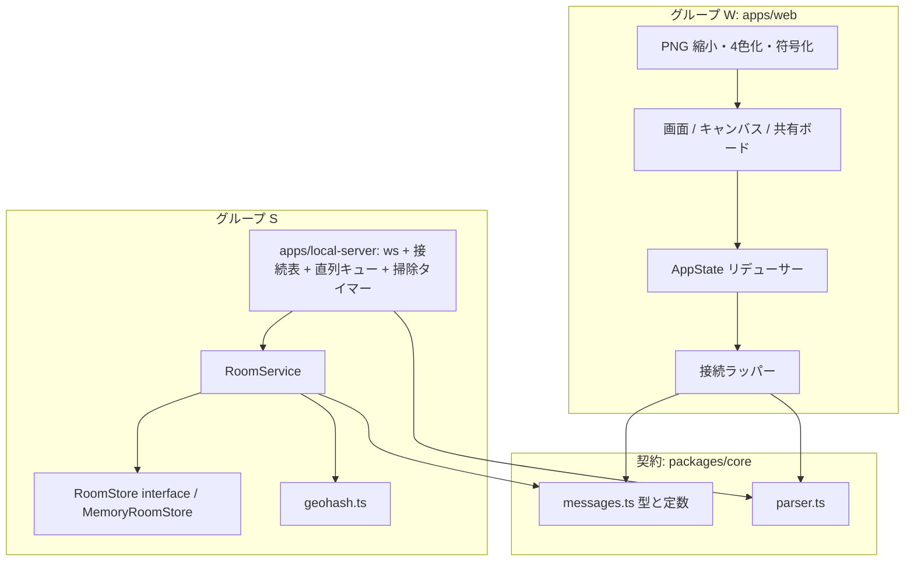
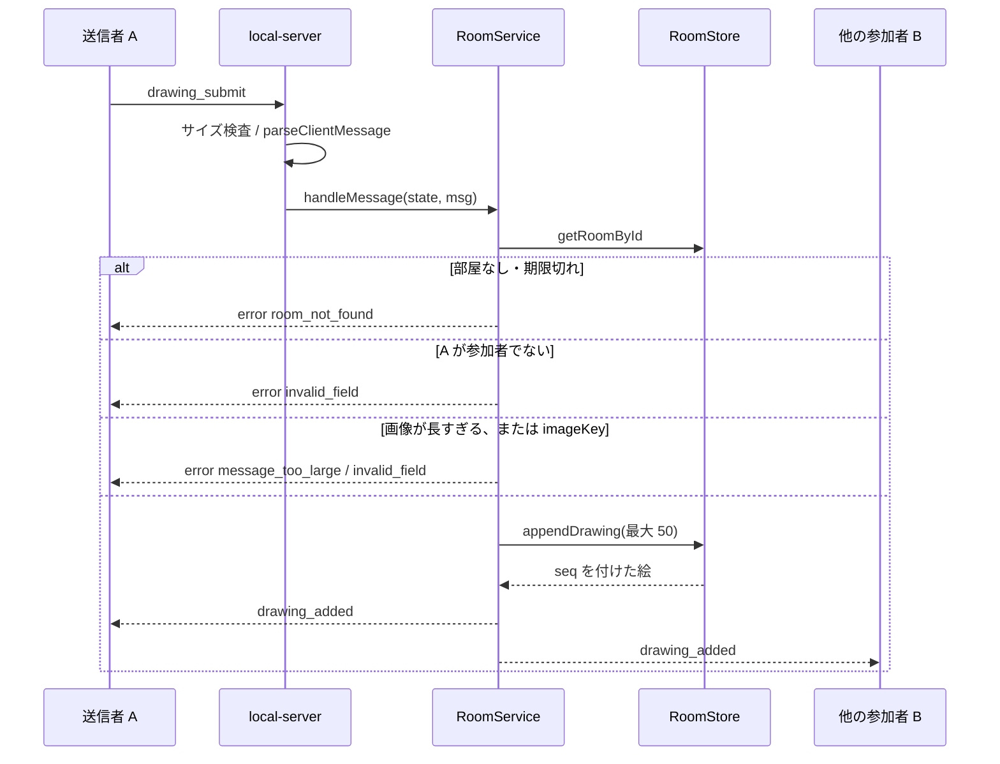
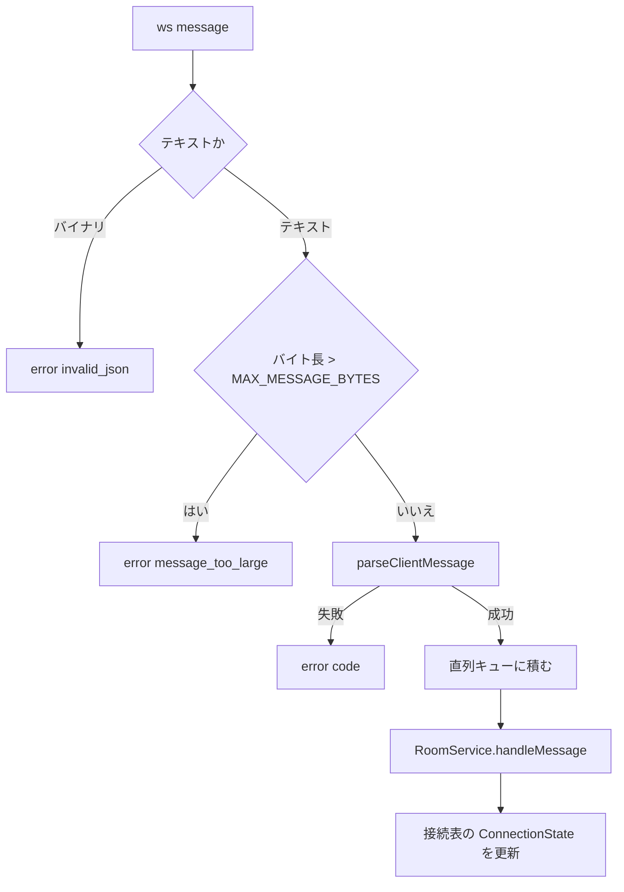
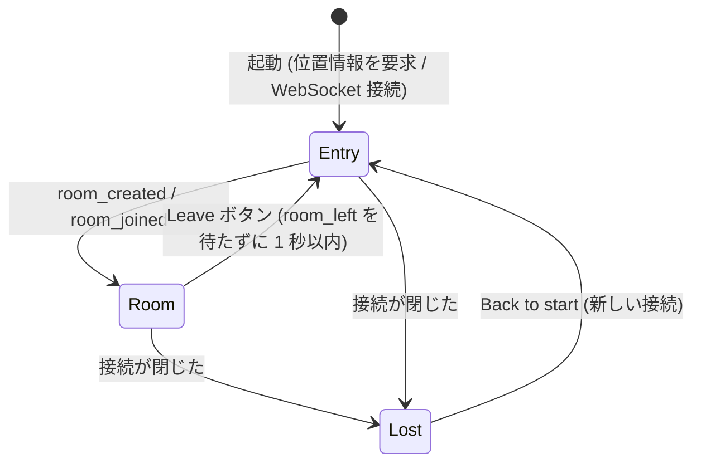

# Design Document

## Overview

この Spec は、AWS を使わずに「近くの部屋が一覧に出る → 入る → 手描きの絵が相手の画面に出る」までをスマホ2台で動かすローカル試作の設計である。Spec 0「repo-and-ci」の土台(モノレポ、tsconfig、ESLint、Prettier、Vitest、CI)の上に実装を足す。土台の設定は作り直さない。

作業は2グループに分かれる。両者の契約は `packages/core` のメッセージ型(`messages.ts`)とパーサー(`parser.ts`)である。

| グループ | 範囲 | 主なパッケージ |
|---|---|---|
| W(画面) | 要件 1〜5 | `apps/web` |
| S(サーバー) | 要件 6〜10 | `packages/core`(部屋ロジック)、`apps/local-server` |
| 共通 | 要件 11〜14 | 契約(メッセージ型)、HTTPS、テスト、プライバシー |

### 設計判断の要約

| # | 判断 | 結論 | 理由 |
|---|---|---|---|
| 1 | 既存メッセージ | **1つも変えない**。新しいメッセージを8種類足す(クライアント発2、サーバー発6) | 3人で合意済みの約束を守る。要件 11.2 の「任意フィールドのみ追加」も使わずに済む |
| 2 | 位置なしの扱い | 位置なし用の新メッセージ `join_by_code` と、`geohash: string \| null` を持つ `create_room` を足す | 予約値の geohash は実在のマスと衝突し、`Join.geohash` の意味を変える |
| 3 | 絵の送り方 | **(b) 絵を小さくする**。ペンの色だけの4色パレット PNG にして 30,000 文字(base64)以内に収める | 実測で 512px の4色 PNG は 2〜12KB。本番(Lambda、32KB)でも同じメッセージがそのまま使える。`imageKey` の経路はメッセージ型に残る |
| 4 | 画面の文言 | 英語のみ。日本語の補足は Spec 4 で検討する | 要件 1.4(英語)を守る。この Spec の範囲を小さくする |
| 5 | 部屋ロジックの置き場所 | `packages/core` の `RoomService` が `RoomStore`(非同期 interface)と `ServicePorts`(送信先の抽象)だけを使う | 同じコードを `ws` サーバーと将来の Lambda から呼べる(tech.md の重要ルール) |
| 6 | geohash | `ngeohash` を **`"0.6.3"` に完全固定**(`^`、`~` なし)して使い、`packages/core/src/geohash.ts` の薄いラッパー経由にする | 0.6.4 の配布物に作業記録が混入している(下記)。入口検証と重複排除はラッパーが行う |
| 7 | ローカルの直列化 | `local-server` は `RoomService` の呼び出しを全接続で1本のキューに並べる | 競合(参加直後の絵の順序など)をローカルでは起こさない。Lambda では `seq` と `drawingId` で耐える |
| 8 | 画面の状態 | `useReducer` 1つ(純関数のリデューサー)。外部の状態管理ライブラリは入れない | 画面は2つ、状態は小さい |
| 9 | 名札アイコン | 絵文字(Unicode 9 以前の動物)を色付きの丸に入れる | 外部アセット不要。1か所(`identity-view.ts`)で差し替えられる |

### 調査で確認した事項

2026-11-23 に実際に確認した。

- **`ngeohash`**: 最新版 0.6.4(2026-07-25 公開)は、0.6.3(2018-12)以来の更新である。0.6.4 の配布物には、AI エージェントの作業記録と思われる `.pi-subagents/`(約230KB、レビュー用の入出力・トランスクリプト)が混入している。`install` スクリプトはなく、`main.js` にネットワーク・`child_process` の呼び出しもない。`main.js` の差分は `decode_bbox_int` の奇数ビット対応と `bboxes` の引数検査だけで、この Spec が使う `encode` と `neighbors` の結果は 0.6.3 と同じだった(ランダムな2万セルで差0、非対称0)。公式の公開物として不自然なので、**0.6.3 に完全固定**(`"ngeohash": "0.6.3"`、`^` や `~` を付けない)。`npm audit` は 0 件。型定義は `@types/ngeohash@0.6.8`(`export =` 形式)。CJS(`module.exports = geohash`)なので、Node ESM の名前付き import は使えず、**既定 import**(`import ngeohash from 'ngeohash'`)で使う。ライセンスは MIT、依存なし。
- **`ngeohash` の動作**(0.6.3 / 0.6.4 共通): `encode` は入力を検査しない(`NaN` で `5bpbpb`、緯度91で `gzzzzz` を返す)。経度の端(`xypzpg`)は反対側(`8n0p…`)へ回り込む。北端(`upzpgx`)・南端(`h0p058`)の `neighbors` は、自分自身と重複を含む8要素を返す。重複排除すると自分を含めて6マスになる。ラッパーで入力検査と重複排除を行う。
- **`ws`**: `maxPayload` を超えると `ws` は接続を閉じる(`1009`、エラー `WS_ERR_UNSUPPORTED_MESSAGE_LENGTH`)。実測した。つまり `maxPayload` を `MAX_MESSAGE_BYTES` にすると、要件 9.6(`message_too_large` を返して接続を保つ)を満たせない。アプリ側でサイズを検査し、`maxPayload` は大きな backstop(1 MiB)にする。`ws` 8.23.0 は既にロックファイルにある(jsdom の依存)。
- **API Gateway WebSocket**: メッセージは128KBまで、フレームは32KBまで。32KBを超えるメッセージは32KB以下のフレームに分ける必要があり、それより大きいフレームを受けると接続が `1009` で閉じる([Quotas](https://docs.aws.amazon.com/apigateway/latest/developerguide/apigateway-execution-service-websocket-limits-table.html)、[Important notes](https://docs.aws.amazon.com/apigateway/latest/developerguide/api-gateway-known-issues.html))。ブラウザの `WebSocket.send` は、アプリ側でフレームを分けられない。実質、ブラウザからは1メッセージ32KBが上限である。`MAX_MESSAGE_BYTES`(32,768)を上げる案は本番で使えない。
- **PNG サイズ**: 下の「絵の送り方」の表。合成した手描き風の絵で実測した。
- **`@vitejs/plugin-basic-ssl`**: 2.3.0(2026-05)。peerDependencies は `vite ^6 || ^7 || ^8` で、リポジトリの Vite 8.3.8 と合う。証明書は自己署名で、警告を通過すればページを開ける、と README にある。**実際に `vite` を起動しての確認は、実装時に行う**(後述の「未確認の点」)。
- **Windows の起動ガード**: `apps/local-server/src/index.ts` の `import.meta.url === new URL(process.argv[1], 'file:///').href` は Windows では一致しない(`C:\…` が URL のスキームとして解釈され、`file:///C:/…` と一致しない。実測した)。そのため Windows では `npm start` が何も出力せずに終わる。`pathToFileURL(process.argv[1]).href` に直す。

### 未確認の点(実装時に確認する)

| 点 | 確認方法 |
|---|---|
| `@vitejs/plugin-basic-ssl` 2.3.0 が Vite 8.3.8 で動くこと、LAN の IP で開けること | `npm run dev -w apps/web` を起動し、PC の `https://localhost:5173` とスマホの `https://<LAN の IP>:5173` で開く |
| iOS Safari / Android Chrome で、自己署名証明書の警告を通過した後に `navigator.geolocation` が使えること | 実機。使えない場合は部屋番号の経路で代替できる(要件 5.5) |
| 実機の手描きの絵で、4色パレット PNG のサイズが予算に収まること | 開発ビルドで、送信ごとにサイズをコンソールへ出す(位置や画像本体は出さない) |
| Vite の dev で、リンクされた `packages/core` から `ngeohash`(CJS)が正しく事前バンドルされること | `optimizeDeps.include: ['@doodle-nearby/core > ngeohash']` を設定し、初回起動でリロードが起きないことを確認する |
| Lambda 実装時、サーバーから32KB近いメッセージを `@connections` で送れること | 後続 Spec。この Spec のメッセージは最大でも約30.3KB(32,000バイト未満)に収める |

## Architecture

### 全体構成



### 層と責務



### フォルダとファイルの境界

`packages/core/src` に追加するファイル(S 担当。`messages.ts` と `parser.ts` は契約で、変更は3人のレビュー対象):

| ファイル | 内容 | 担当 |
|---|---|---|
| `messages.ts`(追加) | 新メッセージ型、`ParticipantIdentity`、定数(`MAX_PARTICIPANTS` など) | 契約 |
| `parser.ts`(追加) | 新メッセージのパーサー | 契約 |
| `geohash.ts` | `encodeGeohash`、`neighborCells`、`InvalidCoordinateError`、`InvalidGeohashError` | S(W は `encodeGeohash` を使う。署名は固定) |
| `participant-identity.ts` | `pickIdentity`(空きからランダムに選ぶ純関数) | S |
| `room-types.ts` | `Room`、`Participant`、`StoredDrawing`、`ConnectionState` | S |
| `room-constants.ts` | `ROOM_RETENTION_MS`、`SWEEP_INTERVAL_MS` | S |
| `room-store.ts` | `RoomStore` interface と結果型 | S |
| `memory-room-store.ts` | `MemoryRoomStore` | S |
| `room-service.ts` | `RoomService`、`ServicePorts`、`Clock` | S |
| `clock.ts` | `Clock`、`systemClock`、`createManualClock`(テスト用の時計) | S |
| `testing/room-store-contract.ts` | 再利用できる契約テストのスイート(`vitest` を import する。`index.ts` からは export しない) | S |
| `index.ts`(追加) | 上記のうち `testing/` 以外を再エクスポート | S |

`apps/local-server/src`(S 担当):

| ファイル | 内容 |
|---|---|
| `index.ts` | 入口。`DEFAULT_PORT`、`startupMessage` は残す(既存テスト)。起動ガードを `pathToFileURL` に直す |
| `config.ts` | `parsePort(env)` |
| `server.ts` | `createLocalServer(options)`。`ws` の接続処理 |
| `connection-registry.ts` | 接続ごとの状態(`ConnectionState` と `WebSocket`) |
| `serial-queue.ts` | 全接続共通の FIFO キュー |
| `logger.ts` | 位置・画像を出さないロガー |

`apps/web/src`(W 担当):

| ファイル | 内容 |
|---|---|
| `App.tsx`, `main.tsx` | 画面の切り替え。既存の入口を拡張する |
| `vite-env.d.ts` | `/// <reference types="vite/client" />`(CSS の import 用) |
| `styles.css` | 全画面のスタイル |
| `labels.ts` | 英語の文言(英語のみ) |
| `error-messages.ts` | `ErrorCode` → 英語の文言(`Record<ErrorCode, string>`) |
| `net/ws-url.ts`, `net/connection.ts` | WebSocket の URL と薄い接続ラッパー |
| `state/app-state.ts` | `AppState`、`AppAction`、`reducer` |
| `state/keypad.ts` | テンキーの入力ロジック(純関数) |
| `geo/request-geohash.ts` | 位置情報の取得と geohash 変換 |
| `canvas/pad-engine.ts` | ポインター入力から描画命令を作る(DOM に依存しない) |
| `canvas/palette.ts` | ペンの3色と4色パレット |
| `canvas/png/` | `fit-within.ts`、`downscale.ts`、`quantize.ts`、`encode-indexed-png.ts`、`export-drawing.ts` |
| `components/` | `EntryScreen`、`RoomListView`、`Keypad`、`RoomScreen`、`SharedBoard`、`CanvasPad`、`Toolbar`、`NameTag` |
| `identity-view.ts` | 色名 → CSS 色、アイコン名 → 絵文字 |

2グループの契約はメッセージ型とパーサー(`messages.ts`、`parser.ts`)で、W は S のコードを呼ばず、S は W のコードを知らない。例外が1つある。W は位置情報の変換に `packages/core` の `encodeGeohash(latitude, longitude): string` を使う(決定事項 3)。署名はこの設計で固定する。W は `ngeohash` を直接 import しない。

### 並行作業の前提

最初に契約(メッセージ型、定数、パーサー、それらのテスト)を `main` へ入れる。その後は、W と S がお互いを待たずに進められる。W のテストは偽の接続(`FakeConnection`)を使い、S のテストは `ws` のクライアントと `RoomService` を使う。結合は `local-server` の統合テストと、手動のスマホ確認で行う。

### Spec 0 との依存(未実装の間にどうするか)

| Spec 0 のタスク | 内容 | この Spec で待つ部分 | 待つ間の扱い | 取り込むときの作業 |
|---|---|---|---|---|
| 4.1 | `room-list.ts` の `orderRoomSummaries`、`RoomCandidate` | `RoomService.buildRoomList` と、それを組み立てる `apps/local-server/src/server.ts` | `RoomService` は並べ替え関数を**注入**で受け取る(`OrderRoomSummaries` 型は `RoomService` 側で構造的に定義するので、未実装の `room-list.ts` に依存しない)。`RoomService` のテストは「`sameHash` が先、`distance` 昇順、安定」の簡易版を注入して進める。`server.ts` は、4.1 が入るまで同じ簡易版を使う | `server.ts` の注入を `orderRoomSummaries`(core の export)に差し替える。簡易版は削除する。差し替え後に統合テストを再実行する |
| 5.1 | `message-specs.ts` の `MESSAGE_SPECS` | 新メッセージ8種類を `MESSAGE_SPECS` へ追加する作業(要件 11.8)と、core の README の表への追記 | `messages.ts` と `parser.ts` は先に進める。`MESSAGE_SPECS` はまだ空なので触らない | 5.1 が先に入る場合: `satisfies Record<…['type'], MessageSpec>` のコンパイルエラーが、新メッセージの未登録を示すので、この Spec で8行を足す。この Spec が先に入る場合: 5.1 の実装者が、`messages.ts` にある全 `type`(新規8種を含む)を登録する。どちらが後でも、型が漏れを検出する |

`orderRoomSummaries` の仕様(`sameHash: true` を先、同じ側の中では `distance` 昇順、安定、先頭 `MAX_ROOMS` 件)は Spec 0 の design.md に従う。この Spec は、実装の内容に依存しない。

## Components and Interfaces

### 1. メッセージ追加案

#### 1.1 追加するメッセージ

既存メッセージ(`Join`、`Leave`、`DrawingSubmit`、`RoomList`、`AiComment`、`AiPrompt`、`AiCard`、`ErrorMessage`)の名前、型、必須・任意、意味は**変えない**。任意フィールドも足さない。必要な情報は、すべて新しいメッセージで運べる。`ErrorCode` も変えない。

共有型と定数(`messages.ts` に追加):

```ts
export const MAX_PARTICIPANTS = 8;        // 1 部屋の定員
export const MAX_DRAWINGS_PER_ROOM = 50;  // 1 部屋に残す絵の枚数
export const MAX_IMAGE_SIDE_PX = 512;     // 絵の縦横の上限
export const MAX_IMAGE_DATA_CHARS = 30_000; // imageData(base64)の最大文字数。下の「絵の送り方」を参照

export const PARTICIPANT_COLORS = [
  'red', 'orange', 'yellow', 'green', 'teal', 'blue', 'purple', 'pink',
] as const; // 8 色
export const PARTICIPANT_ICONS = [
  'cat', 'dog', 'rabbit', 'bear', 'fox', 'panda', 'frog', 'penguin', 'owl', 'koala', 'tiger', 'whale',
] as const; // 12 種類。色 × アイコン = 96 通り

export type ParticipantColor = (typeof PARTICIPANT_COLORS)[number];
export type ParticipantIcon = (typeof PARTICIPANT_ICONS)[number];
export type ParticipantIdentity = { color: ParticipantColor; icon: ParticipantIcon };
```

新メッセージ(`type` はワイヤー上の文字列):

```ts
// ---- Client → Server (新規) ----
export type CreateRoom = {
  type: 'create_room';
  geohash: string | null; // 6 文字、または位置なしを表す null。キー自体は必須
};
export type JoinByCode = {
  type: 'join_by_code'; // 位置情報なしで部屋番号だけで参加する
  roomCode: string; // 4 桁の数字
};

// ---- Server → Client (新規) ----
export type RoomCreated = { type: 'room_created'; roomId: string; roomCode: string };
export type RoomJoined = {
  type: 'room_joined';
  roomId: string;
  roomCode: string;
  you: ParticipantIdentity;
  participants: ParticipantIdentity[]; // 自分を含む全員。1〜MAX_PARTICIPANTS 件
};
export type RoomLeft = { type: 'room_left'; roomId: string };
export type ParticipantJoined = {
  type: 'participant_joined';
  roomId: string;
  participant: ParticipantIdentity; // 新しく入った人
};
export type ParticipantLeft = {
  type: 'participant_left';
  roomId: string;
  participant: ParticipantIdentity; // 出た人
};
type DrawingAddedBase = {
  type: 'drawing_added';
  roomId: string;
  drawingId: string; // 部屋内で一意
  seq: number; // 部屋ごとの受理順(1 から。整数)
  sender: ParticipantIdentity;
};
export type DrawingAdded = DrawingAddedBase &
  (
    | { imageData: string; imageKey: null }
    | { imageData: null; imageKey: string }
  ); // DrawingSubmit と同じ「どちらか一方」の形

export type ClientMessage = Join | Leave | DrawingSubmit | CreateRoom | JoinByCode;
export type ServerMessage =
  | RoomList | AiComment | AiPrompt | AiCard | ErrorMessage
  | RoomCreated | RoomJoined | RoomLeft | ParticipantJoined | ParticipantLeft | DrawingAdded;
```

設計の要点:

- **参加者の識別**: ワイヤー上の参加者は `ParticipantIdentity`(色とアイコン)だけで表す。部屋内で重複しないので、`participant_left` や絵の送り主もこれで区別できる。接続 ID は外に出さない(要件 14.5)。退出した人の組み合わせが、後から入った人に再び割り当たることがある。そのため `drawing_added.sender` は、描いた時点のスナップショットとして扱う。96通りから空きを選ぶので、確率は低い。
- **`room_created` と `room_joined`**: 部屋を作った人は自動で参加する。サーバーは `room_created`、`room_joined` の順に送る。画面は `room_created` で部屋の画面を出し(要件 5.7)、`room_joined` で自分の識別と参加者を埋める。参加の場合は `room_joined` だけが来る。
- **絵の再送**: `room_joined` の後、保持している絵を `seq` の昇順で、1枚ずつ `drawing_added` として送る(要件 7.5)。1メッセージに複数枚をまとめない。1メッセージを32KB以内に保てる。
- **`drawing_added` の `seq`**: 部屋ごとに増える整数で、受理順を表す。画面は `seq` で並べ、`drawingId` で重複を捨てる。ローカルでは直列化するので順序は崩れないが、Lambda で並行処理になっても画面が正しく並ぶ。
- **「絵を受理した」の合図**: 送信者にも `drawing_added` が届く(要件 9.1)。画面は、送信中に自分の識別と等しい `sender` の `drawing_added` を受け取ったら、受理されたと判断してキャンバスを消す(要件 3.3)。エラー(`ErrorMessage`)が送信中に届いたら、失敗として扱う。送信は同時に1つだけなので、対応づけは曖昧にならない。
- **`room_list` の再送**: 既存の `RoomList` をそのまま使う。

#### 1.2 型を変える箇所の一覧表(要件 11.11)

3人の確認用。「変更なし」の行も、既存の型を変えないことを確認できるよう載せる。

| 型名 | 方向 | 新規か変更か | 追加フィールド |
|---|---|---|---|
| `CreateRoom` | client → server | 新規 | `type`、`geohash`(`string \| null`、キーは必須) |
| `JoinByCode` | client → server | 新規 | `type`、`roomCode` |
| `RoomCreated` | server → client | 新規 | `type`、`roomId`、`roomCode` |
| `RoomJoined` | server → client | 新規 | `type`、`roomId`、`roomCode`、`you`、`participants` |
| `RoomLeft` | server → client | 新規 | `type`、`roomId` |
| `ParticipantJoined` | server → client | 新規 | `type`、`roomId`、`participant` |
| `ParticipantLeft` | server → client | 新規 | `type`、`roomId`、`participant` |
| `DrawingAdded` | server → client | 新規 | `type`、`roomId`、`drawingId`、`seq`、`sender`、`imageData`、`imageKey`(どちらか一方が null) |
| `ParticipantIdentity` | 両方向(メッセージの部品) | 新規(メッセージではない共有型) | `color`、`icon` |
| `ClientMessage` | client → server | 変更(共用体にメンバーを足すだけ) | `CreateRoom`、`JoinByCode` |
| `ServerMessage` | server → client | 変更(共用体にメンバーを足すだけ) | `RoomCreated`、`RoomJoined`、`RoomLeft`、`ParticipantJoined`、`ParticipantLeft`、`DrawingAdded` |
| `Join` | client → server | 変更なし | なし |
| `Leave` | client → server | 変更なし | なし |
| `DrawingSubmit` | client → server | 変更なし | なし |
| `RoomList`、`RoomSummary` | server → client | 変更なし | なし |
| `AiComment`、`AiPrompt`、`AiCard` | server → client | 変更なし | なし |
| `ErrorMessage`、`ErrorCode` | server → client | 変更なし | なし |

既存メッセージへの任意フィールドの追加は**ない**。要件 11.2 は満たされている(追加なし)。

追加する定数(`messages.ts`): `MAX_PARTICIPANTS`、`MAX_DRAWINGS_PER_ROOM`、`MAX_IMAGE_SIDE_PX`、`MAX_IMAGE_DATA_CHARS`、`PARTICIPANT_COLORS`、`PARTICIPANT_ICONS`。既存の定数(`MAX_MESSAGE_BYTES`、`MAX_ROOMS`、`GEOHASH_*`、`MAX_AI_TEXT_LENGTH`、`MAX_ERROR_MESSAGE_LENGTH`)は変えない。

#### 1.3 影響する箇所の一覧表

| 対象 | 変更の内容 | 既存への影響 |
|---|---|---|
| `packages/core/src/messages.ts` | 上の型と定数を追加。`ClientMessage`、`ServerMessage` にメンバーを足す | 既存の型は変えない。`ClientMessage` を `switch` で網羅している箇所があれば、新メンバーでコンパイルエラーになる(現時点で core 内にはパーサーだけ) |
| `packages/core/src/parser.ts` | `CLIENT_TYPES` に `create_room`、`join_by_code`、`SERVER_TYPES` に6種類を追加。`parseClientMessage`、`parseServerMessage` の `switch` を**明示的な `case` に直す**(現在は `default` が `drawing_submit` と `error` を受けているため、そのまま `type` を足すと新メッセージが誤って既存のパーサーに入る)。新メッセージごとのパーサーと、`checkIdentity` を追加 | 既存メッセージの検査は変えない。Spec 0 の既存テストは通る(「反対方向の `room_list` は `unknown_type`」も変わらない) |
| `packages/core/src/parser.test.ts` | 新メッセージの例示テストと、ラウンドトリップ・拒否・余分なフィールド除去のプロパティテストを追加 | 既存のテストは変えない |
| `packages/core/src/index.ts` | `geohash.js`、`room-types.js`、`room-constants.js`、`room-store.js`、`memory-room-store.js`、`room-service.js`、`clock.js`、`participant-identity.js` を再エクスポート(`testing/` は除く) | 既存の export は残る |
| `MESSAGE_SPECS`(`message-specs.ts`、Spec 0 の 5.1) | 新メッセージ8種類を1行ずつ追加(要件 11.8)。**この Spec では 5.1 が入るまで触らない** | 5.1 側の `satisfies Record<…>` が漏れを検出する |
| core の README のメッセージ表(Spec 0) | 8行を追加(5.1 と同時) | Spec 0 の README と `MESSAGE_SPECS` の一致テストが、漏れを検出する |
| `apps/web`、`apps/local-server` | 型とパーサーを core から import する。自前の型・パーサーは定義しない(要件 11.10) | なし |

### 2. 位置情報なしでの部屋作成・部屋番号参加

#### 2.1 案の比較

| 観点 | 案 A: 位置なし用の新メッセージ(`create_room` の `geohash: null`、`join_by_code`) | 案 B: 予約値の geohash(例: `Join.geohash = '000000'`) |
|---|---|---|
| 既存の型 | 変えない | 型は変わらないが、`geohash` の意味が「位置」から「位置、または位置なしを表す印」に変わる |
| パーサー | 新メッセージのパーサーを足すだけ。`isGeohash` は変えない | `'000000'` は `GEOHASH_ALPHABET` だけの6文字なので、`isGeohash` を通る。パーサーでは位置なしと区別できず、`RoomService` が特別扱いする |
| 合意済みの約束 | 守られる | `Join.geohash` は「6文字のマス」という約束が、暗黙に変わる |
| 実在のマスとの衝突 | なし | `000000` は南極付近の実在のマス。そこにいる人が位置ありとして扱われるか、位置なしとして扱われるかが決まらない |
| プライバシー | 位置を送らないことが型で明示される(`null`、メッセージ自体に位置がない) | 偽の位置を送ることになり、ログや集計でマスとして数えられる |
| `RoomList` との関係 | 位置なしの接続は `geohash: null` の状態で、一覧の購読者にならない。位置なしで作った部屋は `geohash: null` で、一覧に出ない | 予約値を一覧の検索に使わないように、すべての箇所で除外する必要がある |
| 実装の簡単さ | メッセージが2つ増える。`switch` の `case` が2つ増える | メッセージは増えない。ただし分岐の見落としがバグになる |

**推奨: 案 A。** 既存の型と合意済みの約束に触れず、位置なしが型で見える。コストは新メッセージ2種類で、パーサーとテストの追加だけで済む。

#### 2.2 設計への落とし込み

- **`create_room`**: `geohash` は `string | null`。キーは必須で、省略は `missing_field`、6文字でない文字列は `invalid_field`。位置ありのときは、その接続の `geohash` 状態にも保存する(部屋を出た後に一覧を見るため)。
- **`join_by_code`**: `roomCode` だけ。接続の `geohash` 状態は変えない。位置ありの端末でも使えるが、画面は位置ありのとき既存の `Join`(`roomCode` あり、`roomId: null`)を使う(要件 5.6)。位置なしのときだけ `join_by_code` を使う。
- **位置なしの接続**: `ConnectionState.geohash === null`。一覧の購読者にならず、`room_list` を受け取らない。
- **位置なしで作った部屋**: `Room.geohash === null`。`listRoomsByGeohashes` に出ない(どのマスにも属さない)ので、一覧に出ない。部屋番号でだけ参加できる。位置ありで作った部屋にも、部屋番号で参加できる。
- **部屋の位置を後から変える機能は作らない**。

### 3. MAX_MESSAGE_BYTES と絵の送り方

#### 3.1 実測

合成した「手描き風」の絵(丸ペン、色3つ、太さ2種類、折れ線の揺れる軌跡)を、スマホ相当の 1170×990 で描き、512×433 に縮小して PNG にした。`@napi-rs/canvas`(ブラウザの `toBlob` に近い24ビットPNG)と、`upng-js`(4色の固定パレットに最近傍で丸めた2ビットPNGの近似)で測った。ストロークは実際の落書きより長く、重い方に寄せてある。実機の値は変わるので、実装時にも測る。

| 絵 | 24ビット PNG (512px) | 同 base64 | 4色パレット PNG (512px) | 同 base64 | 4色 (256px) base64 |
|---|---|---|---|---|---|
| 軽い落書き(6本、各15点) | 15.1KB | 20.1KB | 2.0KB | 2.6KB | 1.3KB |
| 軽い(8本、各45点) | 36.4KB | 48.5KB | 3.4KB | 4.6KB | 1.9KB |
| 普通(25本、各60点) | 111.0KB | 148.0KB | 8.8KB | 11.7KB | 5.5KB |
| 密(60本、各60点) | 178.7KB | 238.3KB | 12.3KB | 16.4KB | 7.3KB |

- 24ビットの PNG は、軽い絵でも32KBをほぼ超える。**縮小しても、そのままでは収まらない**。
- 16色の量子化(別の乱数)は 7〜31KB(base64 で 9.5〜41KB)で、密な絵では収まらない。
- 4色パレット(白とペンの3色)は、密な絵でも base64 で 16.4KB。
- 最悪の場合(ノイズのような絵)の上限は、2ビットで圧縮なしの大きさ。256×217 は約14.1KB(base64 で約18.8KB)で、予算内に必ず収まる。384×325 は約31.2KB(base64 で約41.6KB)で収まらない。

#### 3.2 案の比較

| 観点 | (a) `MAX_MESSAGE_BYTES` を上げる | (b) 小さくする(4色パレット化) | (c) 分割(チャンク) | (d) 別経路でアップロードして `imageKey` |
|---|---|---|---|---|
| ローカル | `ws` の `maxPayload` で可能 | 可能 | 可能 | local-server に HTTP の受け口と画像置き場が必要 |
| 本番(API Gateway WebSocket) | **不可**(ブラウザから32KB超のフレームを送ると `1009` で切断される) | 可能(1メッセージ約30.3KB以内) | 可能だが、Lambda は状態を持たないので、途中のチャンクを DynamoDB に置く必要がある | 可能(S3 の署名付き URL)。tech.md の想定 |
| 追加のメッセージ | なし | **なし** | チャンク用のメッセージが2〜3種類必要 | URL 発行のメッセージ(または HTTP API)が必要 |
| 本番へ差し替えるときの変更 | `MAX_MESSAGE_BYTES` を戻すと全部壊れる | **変更なし** | 保存先を実装し直す | 署名付き URL の発行と画像の取得先(CloudFront / S3)を足す。メッセージ型は変わらない |
| 画質 | 24ビットのまま | 4色(白、ペンの3色)。縁の滑らかさがやや減る | 24ビットのまま | 24ビットのまま |
| 実装の量 | 最小 | 中(PNG 符号化と量子化。純関数で、テストしやすい) | 大 | 大(ローカル用の HTTP と、本番用の S3 が別実装) |
| 目的との適合 | 本番で使えない | 絵のサイズが予算に必ず収まる | 過剰 | 画像が大きくなる将来の拡張には向くが、今の絵には過剰 |

**推奨: (b)。** 4色パレットの PNG にして、`imageData` を 30,000 文字(base64)以内にする。理由は次のとおり。

1. 本番(Lambda、32KB)で同じメッセージ形式がそのまま動く。差し替えで変わるのは保存先だけ。
2. 今回の絵はペンの3色と白しか使わないので、4色にしても情報はほとんど失われない。縁の中間色が一番近い色に丸められるだけ。
3. `imageKey`(案 d)への道は閉じない。`DrawingSubmit` と `DrawingAdded` は `imageData` と `imageKey` のどちらか一方を持つ形のまま残る。将来、写真のような大きい画像を扱うときは、クライアントが S3 へアップロードし、`imageKey` を送る。

**tech.md との整合**: tech.md は「絵は PNG(縮小して 512px 以下)で送る。WebSocket の1メッセージは 32KB 制限があるため、大きい画像は S3 の署名付き URL でアップロードしてキーだけ送る」と書く。この設計では、4色パレット化で画像が 22.5KB(base64 で 30,000 文字)以内に収まるので、「大きい画像」の条件にならない。したがって S3 の経路は今回は使わない。tech.md の文面は変えない。S3 の経路は、画像が予算に収まらなくなったときの将来の拡張として残る。

#### 3.3 予算の決め方

`drawing_added` を送るとき、`imageData` 以外の部分(型、`roomId`、`drawingId`、`seq`、`sender`、`imageKey: null`)は、最大でも約300バイトである。`MAX_IMAGE_DATA_CHARS = 30_000` なら、メッセージ全体は約30,300バイトで、`MAX_MESSAGE_BYTES`(32,768)にも、API Gateway の「32 KB」を 32,000 バイトと読んだ場合にも収まる。

| どこで | 何をするか |
|---|---|
| `apps/web`(送信前) | 長辺 512px → 384px → 256px の順に縮小し、4色パレットの PNG にして、base64 が 30,000 文字以内になった最初のものを送る。256px でも収まらない場合は `too_large` で失敗とする(理論上は起きない) |
| `RoomService`(受信時) | `imageData.length > MAX_IMAGE_DATA_CHARS` なら `message_too_large`。`imageData` と `imageKey` の排他は parser が検査済み。`RoomService` は PNG の中身(署名、寸法)を見ない |
| `RoomService`(`imageKey` の送信) | `acceptImageKey` が `false`(既定)のとき `invalid_field`。この Spec では `imageKey` を解決する手段(画像の取得先)がないため、検証できない文字列を他の参加者へ配らない。要件 9.1 の「有効な DrawingSubmit」は `imageData` の形を指す、と設計で解釈する(決定事項 1) |
| `apps/local-server`(受信時) | メッセージが `MAX_MESSAGE_BYTES` を超えたら `message_too_large` を返し、接続は保つ(要件 9.6)。`ws` の `maxPayload` は 1 MiB の backstop にする。1 MiB を超える入力は `ws` が `1009` で接続を閉じる(要件 9.6 の例外。README に書く) |

`MAX_MESSAGE_BYTES` の値は変えない。

#### 3.4 画面側の PNG 生成(`apps/web/src/canvas/png/`)

純関数に分け、jsdom(`canvas` なし)でもテストできるようにする。ブラウザの `canvas` に触れるのは、`CanvasPad` の `getImageData` だけにする。

```ts
export type Rgb = readonly [number, number, number];
export type PixelBuffer = { data: Uint8ClampedArray; width: number; height: number }; // RGBA

/** 縦横比を保ち、max を超える辺だけを縮める。拡大しない。結果は 1 以上 max 以下 */
export function fitWithin(width: number, height: number, max?: number): { width: number; height: number };

/** 面積平均で縮小する(拡大はしない) */
export function downscale(src: PixelBuffer, target: { width: number; height: number }): PixelBuffer;

/** 最近傍のパレット色の番号(0〜palette.length-1)に丸める */
export function quantizeToPalette(src: PixelBuffer, palette: readonly Rgb[]): Uint8Array;

/** 2 ビットの索引カラー PNG を作る。IDAT は fflate の zlibSync で圧縮する */
export function encodeIndexedPng(
  indices: Uint8Array, width: number, height: number, palette: readonly Rgb[],
): Uint8Array;

export type ExportResult =
  | { ok: true; imageData: string; width: number; height: number }
  | { ok: false; reason: 'blank' | 'too_large' };

/** 縮小の段階 [512, 384, 256] を順に試す。全て白なら 'blank' */
export function exportDrawing(
  src: PixelBuffer, palette: readonly Rgb[], maxChars?: number,
): ExportResult;
```

- **圧縮**: `fflate`(0.8.x、MIT、依存なし、TypeScript 製)の `zlibSync` を使う。ブラウザ標準の `CompressionStream('deflate')` は非同期で、古い iOS Safari(16.4未満)にない。`upng-js` は型定義が別で、古い。PNG のチャンク(署名、IHDR、PLTE、IDAT、IEND、CRC32)は自前で書く(約80行)。
- **消しゴム**: 白で塗る(キャンバスは最初に白で塗りつぶす)ので、透明度を扱わない。
- **空の絵**: `exportDrawing` が全画素 0 番(白)のとき `blank` を返す。送信ボタンは、ペンで描いたとき(`hasContent`)だけ有効になるが、消しゴムで全部消した場合の二重の保険になる。
- **サイズの保証**: 最後の段階(256px)の2ビット・圧縮なしの上限は約14.1KB(base64 で約18.8KB)で、予算に収まる。zlib は圧縮前より大きくなっても、数バイトから数十バイトである。

### 4. 画面の文言

この Spec では英語のみ。日本語の補足は Spec 4 で検討する(決定事項 2)。文言は `labels.ts` に1か所に集め、`index.html` の `lang="ja"` は `lang="en"` に直す。

エラーコードの文言は `error-messages.ts` の `Record<ErrorCode, string>`(コードの追加でコンパイルエラーになる)。

| `ErrorCode` | 画面の文言(英語) |
|---|---|
| `invalid_json` / `unknown_type` / `missing_field` / `invalid_field` | `Something went wrong. Please try again.` |
| `message_too_large` | `That drawing is too big to send.` |
| `room_not_found` | `We couldn't find that room. Check the code and try again.` |
| `room_full` | `This room is full (8 people).` |
| `internal_error` | `The server had a problem. Please try again.` |

### 5. 部屋ロジック(`packages/core`)

#### 5.1 型

```ts
// room-types.ts
export type DrawingImage =
  | { imageData: string; imageKey: null }
  | { imageData: null; imageKey: string };

export type Participant = {
  connectionId: string; // 接続ごとのランダムな ID(通信の宛先)。端末 ID・IP ではない。退出で消える
  identity: ParticipantIdentity;
  joinedAt: number; // epoch ミリ秒
};

export type Room = {
  roomId: string;
  roomCode: string; // 4 桁
  geohash: string | null; // 6 文字、または位置なし
  createdAt: number; // epoch ミリ秒
  expiresAt: number; // createdAt + ROOM_RETENTION_MS
  participants: Participant[];
};

export type StoredDrawing = {
  drawingId: string;
  seq: number; // 部屋ごと、1 から、受理順
  sender: ParticipantIdentity;
  image: DrawingImage;
  createdAt: number;
};

/** 接続ごとの状態。呼び出し側が保存する(local-server はメモリ、Lambda は将来 DynamoDB) */
export type ConnectionState = {
  connectionId: string;
  geohash: string | null; // 一覧の購読に使う。位置なしは null
  roomId: string | null; // 参加中の部屋
};

// room-constants.ts
export const ROOM_RETENTION_MS = 3 * 60 * 60 * 1000; // 3 時間 = 10,800 秒
export const SWEEP_INTERVAL_MS = 30_000; // 60 秒以下(要件 10.6)
```

緯度経度の型や項目は作らない(要件 10.9、14.1)。

#### 5.2 `RoomStore`

すべて非同期にする(DynamoDB 実装に差し替えるため)。読み書きの分割で競合しないよう、複数の項目にまたがる更新は**1回の原子的な操作**にする。

```ts
// room-store.ts
export type CreateRoomResult = { ok: true } | { ok: false; reason: 'code_taken' };
export type AddParticipantResult =
  | { ok: true; room: Room; added: boolean } // added=false: すでに参加者(変更なし)
  | { ok: false; reason: 'not_found' | 'full' | 'identity_taken' };
export type NewDrawing = Omit<StoredDrawing, 'seq'>;
export type AppendDrawingResult =
  | { ok: true; drawing: StoredDrawing }
  | { ok: false; reason: 'not_found' };
export type DeletedRoom = { roomId: string; geohash: string | null };

export interface RoomStore {
  /** 期限切れでない部屋が同じ roomCode を持つなら code_taken。期限切れの同じ roomCode の部屋は、置き換える(その部屋と絵を消す) */
  createRoom(room: Room, now: number): Promise<CreateRoomResult>;
  /** 期限切れかどうかは判定しない(呼び出し側が expiresAt で判定する) */
  getRoomById(roomId: string): Promise<Room | null>;
  getRoomByCode(roomCode: string): Promise<Room | null>;
  /** geohashes は 1〜9 個。geohash が null の部屋は返らない。期限切れも返りうる */
  listRoomsByGeohashes(geohashes: readonly string[]): Promise<Room[]>;
  /** 期限切れでない部屋の roomCode(部屋番号の払い出し用) */
  listActiveRoomCodes(now: number): Promise<string[]>;
  /** 原子的。同じ connectionId がいれば added=false で成功。満員なら full、同じ識別がいれば identity_taken */
  addParticipant(roomId: string, participant: Participant, maxParticipants: number): Promise<AddParticipantResult>;
  /** 更新後の部屋、または部屋がなければ null。参加者でなくても失敗しない */
  removeParticipant(roomId: string, connectionId: string): Promise<Room | null>;
  /** 原子的。seq を割り当て、maxDrawings を超えた古い絵を捨てる */
  appendDrawing(roomId: string, drawing: NewDrawing, maxDrawings: number): Promise<AppendDrawingResult>;
  /** seq の昇順(古い順) */
  listDrawings(roomId: string): Promise<StoredDrawing[]>;
  /** now 以前に期限切れの部屋と、その絵・参加者を消す。消した部屋を返す。roomCode は再利用できる */
  deleteExpired(now: number): Promise<DeletedRoom[]>;
}
```

- 期限切れの判定は `room.expiresAt <= now`(`now` が `expiresAt` 以上なら期限切れ。要件 10.5)。
- `MemoryRoomStore` は `Map<roomId, …>` と `Map<roomCode, roomId>` で実装する。各メソッドは `await` を挟まずに同期的に判定と更新を行い、原子性を保つ。
- **DynamoDB 実装への写し方**(後続 Spec。この Spec では作らない): 部屋の項目に `participants`、`seq` カウンターを持たせる。絵は別項目(`roomId` + `seq`)にして、`appendDrawing` は部屋の項目の `seq` を原子的に加算してから絵を書く。`roomCode` と `geohash` は GSI。DynamoDB の TTL は秒単位で、削除に遅れがある(最大で数十時間)ため、`expiresAt` をミリ秒のまま持ち、読み取り時の判定(`RoomService`)に頼る。`deleteExpired` は TTL に任せて、何もしなくてよい実装もありうる。`identity_taken` を条件式で表しにくいときは、参加者を識別キーのマップにして `attribute_not_exists` を使うか、トランザクションにする。
- **契約テスト**: `testing/room-store-contract.ts` が `runRoomStoreContract(name: string, createStore: () => RoomStore | Promise<RoomStore>)` を export する。ファクトリを受け取るので、`MemoryRoomStore` は `core` 内のテストから、DynamoDB 実装は将来、同じケースをそのまま実行できる(要件 10.10)。`index.ts` からは export しない(`vitest` の import を本番のバンドルに入れないため)。後続の Spec で別パッケージから使うときは、`package.json` の `exports` に `./testing` を足し、`vitest.shared.ts` の `coreAlias` に先に `@doodle-nearby/core/testing` を足す(文字列のエイリアスは前方一致で、`@doodle-nearby/core` だけだと `/testing` が壊れる)。この Spec では `core` 内の相対 import だけを使う。

#### 5.3 `RoomService`

```ts
// clock.ts
export interface Clock { now(): number } // epoch ミリ秒
export const systemClock: Clock;
export function createManualClock(start: number): Clock & { set(t: number): void; advance(ms: number): void };

// room-service.ts
export interface ServicePorts {
  /** 接続へ 1 通送る。失敗(切断済みなど)は例外にせず、無視してよい */
  send(connectionId: string, message: ServerMessage): void | Promise<void>;
  /** この geohash の部屋が増減した。近隣を見ている接続へ一覧を再送してほしい */
  roomsChanged(geohash: string): void | Promise<void>;
}

/** Spec 0 の orderRoomSummaries と同じ形(構造的に定義し、room-list.ts に依存しない) */
export type OrderRoomSummaries = (
  candidates: { summary: RoomSummary; distance: number }[],
) => RoomSummary[];

export type RoomServiceOptions = {
  store: RoomStore;
  ports: ServicePorts;
  orderRooms: OrderRoomSummaries; // 注入。本番は core の orderRoomSummaries
  clock?: Clock;                   // 既定 systemClock
  random?: () => number;           // 既定 Math.random。0 以上 1 未満
  newId?: () => string;            // 既定 crypto.randomUUID
  retentionMs?: number;            // 既定 ROOM_RETENTION_MS
  maxParticipants?: number;        // 既定 MAX_PARTICIPANTS
  maxDrawings?: number;            // 既定 MAX_DRAWINGS_PER_ROOM
  acceptImageKey?: boolean;        // 既定 false
};

export class RoomService {
  constructor(options: RoomServiceOptions);
  /** 1 通を処理し、新しい接続状態を返す。例外を投げない(エラーは ErrorMessage として送信者へ送る) */
  handleMessage(state: ConnectionState, message: ClientMessage): Promise<ConnectionState>;
  /** 切断。Leave と同じ後始末をし、切断した接続には何も送らない */
  handleDisconnect(state: ConnectionState): Promise<void>;
  /** 一覧を作る(要件 8.8〜8.12、8.16)。geohash が不正なら InvalidGeohashError */
  buildRoomList(geohash: string): Promise<RoomList>;
  /** 期限切れを削除し、影響した geohash ごとに roomsChanged を呼ぶ。削除した部屋の数を返す */
  sweepExpired(): Promise<number>;
}
```

`RoomService` は `node:*` も DOM も import しない(Lambda、ブラウザでも読める)。`crypto.randomUUID` はグローバルを使う(Node 22、ブラウザとも標準)。

**メッセージごとの処理**(エラーはすべて送信者だけに `ErrorMessage` として返し、状態は変えない)

| メッセージ | 処理 |
|---|---|
| `Join`(`roomId: null`、`roomCode: null`) | `geohash` を検査(不正は `invalid_field`)。`state.geohash` を更新し、`room_list` を送信者へ送る(要件 8.14)。参加中の部屋は変えない |
| `Join`(`roomId` あり) | `roomId` で部屋を引く。`roomCode` は無視する(要件 7.4) |
| `Join`(`roomId: null`、`roomCode` あり) | `roomCode` で部屋を引く |
| `JoinByCode` | `roomCode` で部屋を引く。`state.geohash` は変えない |
| `CreateRoom` | `geohash` が `null` でなく不正なら `invalid_field`。部屋番号を払い出して部屋を作り、`room_created` を送り、作った人を参加させる(参加の手順は下)。`roomsChanged(geohash)` を呼ぶ(`geohash` が `null` なら呼ばない) |
| `Leave` | `state.roomId !== message.roomId`(参加していない)なら `invalid_field`(要件 7.7。要件 9.4 と同じコードにそろえる)。そうでなければ、部屋から外し、`room_left` を送り、`participant_left` を残りの参加者へ送り、`roomsChanged` を呼ぶ。部屋が既になくても(期限切れ・削除済み)、状態を空にして `room_left` を返す |
| `DrawingSubmit` | 下の「絵の配布」 |

**部屋の引き方**: `getRoomById` または `getRoomByCode` で引き、`room.expiresAt <= now` なら見つからないものとして扱う。見つからなければ `room_not_found`。

**参加の手順**(`Join`、`JoinByCode`、`CreateRoom` で共通):

1. 対象の部屋を引く(上記)。なければ `room_not_found`(今いる部屋にはとどまる。要件 7.3)。
2. すでにこの部屋の参加者なら(`state.roomId === room.roomId` かつ `participants` に `connectionId` がいる)、人数を変えずに `room_joined` と保持している絵をもう一度送る(要件 7.12)。
3. 満員(`participants.length >= maxParticipants`)なら `room_full`。部屋の状態、既存の参加者の識別は変えない(要件 6.11)。今いる部屋にもとどまる。
4. 別の部屋に参加中なら、その部屋から外す(`removeParticipant`、`participant_left` の送信、`roomsChanged`)。その後で新しい部屋に追加する(要件 7.11)。外した後の追加が、競合で `full` になったときは、どの部屋にも入っていない状態になる(まれ。エラーを返す)。
5. 識別を選ぶ: `pickIdentity(takenIdentities, random)`。`addParticipant` が `identity_taken` を返したら、部屋を読み直して最大5回やり直す。5回失敗したら `internal_error`。
6. `addParticipant` が `full` なら `room_full`、`not_found` なら `room_not_found`。
7. 成功したら、状態を `{ connectionId, geohash: (メッセージの geohash があればそれ), roomId }` にし、次の順で送る: 本人へ `room_joined`、他の参加者へ `participant_joined`、本人へ保持している絵を `seq` の昇順で `drawing_added`(要件 7.5)。部屋に `geohash` があれば `roomsChanged`(人数の変更。要件 7.9)。

**部屋番号の払い出し**(要件 6.1、6.3、6.4): 0000〜9999 からランダムに選び、`createRoom` が `code_taken` なら別の番号で最大20回やり直す。20回失敗したら `listActiveRoomCodes` で空き番号を求め、空きがなければ `internal_error`(部屋は作らない)。空きがあればその中からランダムに選んで作る(競合で失敗したら、最大5回やり直す)。

**参加者の識別**(要件 6.5、6.6): `pickIdentity(taken: readonly ParticipantIdentity[], random: () => number): ParticipantIdentity | null` は、`PARTICIPANT_COLORS × PARTICIPANT_ICONS`(96通り)から `taken` にないものを列挙し、`random` で1つ選ぶ。定員8人なので、空きがなくなることはない。名前は受け取らない(要件 6.9)。

**絵の配布**(要件 9.1〜9.5):



1. `getRoomById(message.roomId)`。なし、または期限切れなら `room_not_found`。
2. `connectionId` が `participants` にいなければ `invalid_field`。
3. `imageKey` が非 null で `acceptImageKey` が `false` なら `invalid_field`。
4. `imageData.length > MAX_IMAGE_DATA_CHARS` なら `message_too_large`。PNG の中身は検査しない。
5. `appendDrawing`(`drawingId` は `newId()`、`sender` は送信者の識別)。50枚を超えたら最も古い絵が消える(要件 9.5)。
6. `drawing_added` を、参加者全員(送信者を含む)へ送る。

`sender` は、参加者の識別を `participants` から引く。

**一覧**(`buildRoomList`。要件 8.8〜8.12、8.16):

1. `neighborCells(geohash)` で最大9マスを求める。
2. `store.listRoomsByGeohashes(cells)` で部屋を取り、`geohash` が `null` のもの、期限切れのものを除く。
3. 候補 `{ summary: { roomId, roomCode, geohash, participantCount: participants.length, sameHash }, distance }` を作る。`distance` は、部屋の `geohash` が要求の `geohash` と等しければ 0、そうでなければ 1。`sameHash` は `distance === 0`。
4. `orderRooms(candidates)` で並べ、先頭 `MAX_ROOMS` 件に切る(`orderRoomSummaries` も切るが、二重に切っても結果は同じ)。
5. 0 件でもエラーにしない。

**期限切れの掃除**(`sweepExpired`。要件 10.6、10.7、14.6、14.7): `store.deleteExpired(clock.now())` を呼び、返された部屋の `geohash` ごとに `roomsChanged` を1回呼ぶ。掃除の前でも、期限切れの部屋は参加・一覧・描画で見えない(読み取り時の判定)。

**切断**(`handleDisconnect`): `Leave` と同じ後始末(`removeParticipant`、`participant_left`、`roomsChanged`)をし、切断した接続へは何も送らない(要件 7.8)。

**ログ**: `RoomService` はログを出さない。例外は `internal_error` として本人へ返す。

#### 5.4 `local-server` から `RoomService` を使う形(Lambda との対応)

| 役割 | local-server | 将来の Lambda |
|---|---|---|
| 接続状態(`ConnectionState`)の保存 | メモリの `Map` | DynamoDB の接続表 |
| `ports.send` | `ws.send` | `postToConnection` |
| `ports.roomsChanged` | geohash を溜め、接続表の更新後にまとめて、一覧の購読者へ `buildRoomList` を送る(7.2 参照) | 接続表(GSI: geohash)を引いて送る |
| 直列化 | 全接続で1本のキュー | なし(並行する)。`seq` と `drawingId` で画面側が耐える |
| 期限切れの掃除 | `setInterval` | DynamoDB TTL(と `RoomService` の読み取り時の判定) |

### 6. geohash(`packages/core/src/geohash.ts`)

```ts
export class InvalidCoordinateError extends Error {}
export class InvalidGeohashError extends Error {}

/** 緯度 -90〜90、経度 -180〜180(含む)の有限数から 6 文字の geohash を返す。範囲外・非有限は InvalidCoordinateError */
export function encodeGeohash(latitude: number, longitude: number): string;

/** 自分と周囲 8 マス。自分が先頭。重複なし。北端・南端では 6 マス(極をまたがない)。6 文字でなければ InvalidGeohashError */
export function neighborCells(geohash: string): string[];
```

- ライブラリは `ngeohash@0.6.3`。`import ngeohash from 'ngeohash'`(既定 import)。依存は `ngeohash` を呼ぶ `packages/core/package.json` の `dependencies` に `"ngeohash": "0.6.3"`、`devDependencies` に `"@types/ngeohash": "0.6.8"` と書く。`^` や `~` は付けない(完全固定)。`apps/web` は `ngeohash` を直接 import せず core 経由で使うので、`apps/web/package.json` には書かない。固定する理由: 0.6.4 の配布物に作業記録(`.pi-subagents/`)が混入しているため。
- `encodeGeohash` は、`Number.isFinite` と範囲を検査してから `ngeohash.encode(latitude, longitude, GEOHASH_LENGTH)` を呼ぶ(ライブラリは検査しない)。
- `neighborCells` は、`isGeohash` で入力を検査し、`[geohash, ...ngeohash.neighbors(geohash)]` から重複を取り除く(`Set`、挿入順を保つ)。経度の端では、ライブラリが反対側のマスを返すので、そのまま使う。北端・南端では、ライブラリの返す重複(自分自身を含む)を除いて6マスになる。
- 近傍の関係が対称であること(`B ∈ neighborCells(A) ⇔ A ∈ neighborCells(B)`)は、ランダムな2万セルで非対称0を実測した。プロパティテストで再確認する。
- 距離: `RoomService` が、同じマスなら 0、近傍の別のマスなら 1 と計算する(要件 8.16)。
- **最小限のライブラリ動作確認テスト**(要件 13.3): 内部のマス `xn76ur`(東京付近)、経度の東端 `xypzpg`(反対側の `8n0p…` を含む)、北端 `upzpgx`(6マス)、南端 `h0p058`(6マス)。値は 0.6.3 / 0.6.4 で実測した。
- **0.6.4 への更新**: 将来 `ngeohash` を更新する場合は、`.pi-subagents/` の混入が直っていること、配布物の差分が小さいことを確認する。固定していれば、`npm audit` 以外で勝手に変わらない。

### 7. `apps/local-server`

#### 7.1 起動と設定

- `ws` の `WebSocketServer({ host: '0.0.0.0', port, path: '/ws', maxPayload: 1 MiB })`。`path: '/ws'` 以外へのアップグレードは `ws` が拒否する。
- ポートは環境変数 `LOCAL_SERVER_PORT`、既定は `DEFAULT_PORT = 8787`(既存の定数)。

```ts
// config.ts
export class InvalidPortError extends Error {}
/** 未設定なら DEFAULT_PORT。1〜65535 の整数の文字列だけ受け入れる(前後の空白、小数、'1e3'、'0x50'、'' は不正)。それ以外は InvalidPortError */
export function parsePort(env: Record<string, string | undefined>): number;
```

- `main(env, io)`: `parsePort` が `InvalidPortError` なら、標準エラーに `LOCAL_SERVER_PORT must be an integer from 1 to 65535 (got "<値>")` を出し、終了コード 1 で終わる(要件 12.7)。成功なら `startupMessage(port)` を標準出力へ出す。`startupMessage(port)` は `local-server: listening on ws://localhost:<port>/ws` を返す(最初の仮実装の `not implemented yet` から変えた。起動が実際に動くようになったため)。
- 起動ガード: `import.meta.url === pathToFileURL(process.argv[1] ?? '').href` のときだけ `main` を実行する(Windows でも動く)。
- `createLocalServer(options: { port: number; host?: string; logger?: Logger; clock?: Clock; sweepIntervalMs?: number }): Promise<{ port: number; close(): Promise<void> }>`。テストでは `port: 0`(空きポート)を使う。

#### 7.2 接続の処理



- 接続ごとに `connectionId`(`crypto.randomUUID()`)と `ConnectionState { geohash: null, roomId: null }` を持つ。
- **サイズ**: `Buffer` のバイト長を、文字列にする前に検査する。超えたら `ErrorMessage('message_too_large')` を送り、`RoomService` へは渡さず、接続は閉じない(要件 9.6)。`MAX_MESSAGE_BYTES` ちょうどは受け入れる(要件 9.7)。
- **不正なメッセージ**(JSON、型、フィールド): パーサーの `error.code` を `ErrorMessage` で返す。接続は保ち、部屋の状態は変えない(要件 12.10)。バイナリフレームは `invalid_json`。
- **直列化**: `RoomService` の呼び出し(`handleMessage`、`handleDisconnect`、`sweepExpired`)を、全接続共通の FIFO キュー(`serial-queue.ts`、`Promise` の連鎖)に積む。1つの処理が終わってから次が始まるので、参加の途中に別の絵が割り込むことはない。1つの処理が例外を投げても、次の処理は続ける。
- **切断**: `close` で `handleDisconnect(state)` をキューに積み、接続表から消す。
- **keep-alive**: 30秒ごとに `ping` を送り、前回の `pong` が来ていない接続は `terminate()` する(電波が切れたスマホが参加者として残らないように)。
- **一覧の再送**(`ports.roomsChanged(geohash)`): 接続表を走査し、`roomId === null` かつ `geohash !== null` で、接続の `geohash` が `neighborCells(部屋の geohash)` に含まれる接続へ、`buildRoomList(接続の geohash)` を送る(要件 8.15)。近傍の関係が対称なので、「接続のマスの近傍に部屋がある」と「部屋のマスの近傍に接続がある」は同じ。同じ `geohash` の接続には、`buildRoomList` を1回だけ呼んで使い回す。参加中の接続と位置なしの接続には送らない。
- **一覧の再送のタイミング**(実装で変えた点): `roomsChanged` はその場では送らず、geohash を溜めておく。キュー内の `handleMessage`・`handleDisconnect`・`sweepExpired` が終わり、接続表を新しい `ConnectionState` で更新した後に、まとめて一覧を再送する。理由: `roomsChanged` が呼ばれる時点では、部屋を作った(または参加した)本人の状態が接続表でまだ `roomId === null` のままで、その場で送ると本人にも一覧が届いてしまうため。
- **期限切れの掃除**: `setInterval(() => queue.push(() => service.sweepExpired()), SWEEP_INTERVAL_MS)`(30秒。`unref()` して、プロセスの終了を妨げない)。`close()` で止める。
- **接続状態の更新**: `handleMessage` が返した新しい `ConnectionState` で、接続表を更新する。

#### 7.3 ログ(要件 14.3)

`Logger` は `{ info(line: string): void; error(line: string): void }`。出す内容は、接続の開始・終了、メッセージの `type` とバイト数、エラーコード、掃除で消した部屋の数だけ。緯度経度、geohash、`imageData` の中身、部屋番号は出さない。接続は `id` の先頭8文字で表す。テストで、すべてのログ行に geohash、部屋番号、`imageData` が含まれないことを確かめる。

### 8. `apps/web`

#### 8.1 画面と遷移



- **Entry**: 位置情報の結果で表示が変わる(下記)。
- **Room**: 上半分が共有ボード(ヘッダーに部屋番号、人数、Leave ボタン)、下半分がキャンバス(ツールバー込み)。ヘッダーとツールバーは、それぞれの半分の内側に入れる。上下は `grid-template-rows: 1fr 1fr`(各 `min-height: 0`)で、50% ± 5ポイントに収める(要件 1.1)。
- **Lost**: 接続が閉じたとき、`The connection was lost.` とボタン `Back to start` を2秒以内に出す(要件 5.10)。ボタンで新しい接続を作る(位置情報は取り直さない)。再接続は自動では行わない。
- **向き**: 横向きのときは、`Please turn your phone upright.` の全画面メッセージを出す(`@media (orientation: landscape)`)。ブラウザのタブでは向きを固定できないため。
- **横スクロールなし**(要件 1.2): `html, body { margin: 0; width: 100%; overflow-x: hidden; overscroll-behavior: none }`、全要素 `box-sizing: border-box`、`#root` は `max-width: 100vw`。`<meta name="viewport" content="width=device-width, initial-scale=1, maximum-scale=1, user-scalable=no">`。幅が360〜430pxで、文書の幅がビューポートの幅と等しいことを、スタイルの方針としてレビューで確認する(jsdom はレイアウトを計算しないため、自動テストでは測れない)。
- **文字入力欄を作らない**(要件 1.3): `input`、`textarea`、`contenteditable` を使わない。テンキーは `button`。テストで、全画面の HTML にこれらがないことを確かめる。
- **音・カメラなし**(要件 1.5、1.6): `<audio>`、`<video>`、`Audio`、`getUserMedia` を使わない。テストで、`src` に該当の文字列がないことを確かめる。

#### 8.2 状態管理

`useReducer` と純関数の `reducer` で足りる。画面は2つで、状態は小さく、外部のライブラリは要らない。ソケットのイベントとユーザー操作を、同じ `AppAction` としてリデューサーへ渡す。副作用(ソケット、タイマー、位置情報)は `App.tsx` の `useEffect` に集める。

```ts
export type LocationState =
  | { status: 'pending' }
  | { status: 'ready'; geohash: string }
  | { status: 'unavailable' };

export type BoardDrawing = {
  drawingId: string;
  seq: number;
  sender: ParticipantIdentity;
  imageData: string | null; // imageKey の絵は null(プレースホルダー)
};

export type RoomView = {
  roomId: string;
  roomCode: string;
  you: ParticipantIdentity | null;   // room_created の直後は null、room_joined で埋まる
  participants: ParticipantIdentity[];
  drawings: BoardDrawing[];          // seq の昇順、drawingId で重複なし
};

export type AppState = {
  connection: 'connecting' | 'open' | 'closed';
  location: LocationState;
  rooms: RoomSummary[] | null;       // null: まだ一覧を受け取っていない
  entry: {
    codeDigits: string;              // '' 〜 4 桁の数字
    showKeypad: boolean;
    pending: 'none' | 'joining' | 'creating';
    error: string | null;            // 英語の文言
  };
  room: RoomView | null;             // null なら Entry、非 null なら Room
  send: { status: 'idle' | 'sending' | 'failed' };
};

export type AppAction =
  | { type: 'connection_opened' }
  | { type: 'connection_closed' }
  | { type: 'location_ready'; geohash: string }
  | { type: 'location_unavailable' }
  | { type: 'server_message'; message: ServerMessage }
  | { type: 'keypad_digit'; digit: string }
  | { type: 'keypad_backspace' }
  | { type: 'keypad_toggle' }
  | { type: 'join_requested' }
  | { type: 'create_requested' }
  | { type: 'left_room' }          // Leave ボタン。room を null にする
  | { type: 'send_started' }
  | { type: 'send_timeout' }
  | { type: 'reset_connection' };  // Back to start

export function reducer(state: AppState, action: AppAction): AppState;
```

- `server_message` の扱い: `room_list` → `rooms`、`room_created` → `room` の骨組み(`you: null`)、`room_joined` → `room` を `you`、`participants` で埋め、`participant_joined` / `participant_left` → `participants` を更新(要件 4.7)、`drawing_added` → `drawings` に追加(`drawingId` が既にあれば無視、`seq` で並べる。要件 4.3)。送信中に自分の `sender` の `drawing_added` が来たら `send` を `idle` にする(要件 3.3)。`error` → `entry.error` に英語の文言を入れる(入口にいるとき、数字は残す。要件 5.8)。送信中なら `send` を `failed` にする(要件 3.4、4.8)。`room` が `null` のときの `drawing_added` と `participant_*` は無視する。
- `participant_joined` / `participant_left` は、`participants` を直接更新するので、人数は常に `participants.length` と一致する。
- **StrictMode**: ソケットは `useEffect` で作り、クリーンアップで閉じる。開発時の二重実行でも、先の接続がすぐ閉じるだけで問題ない。

#### 8.3 WebSocket の薄いラッパー

```ts
// net/ws-url.ts
/** https なら wss、http なら ws。ページの host(ポート込み)と固定パス /ws。固定のホスト名や IP は書かない(要件 12.4) */
export function buildWsUrl(loc: Pick<Location, 'protocol' | 'host'>): string;

// net/connection.ts
export interface Connection {
  /** 開いていれば送って true。それ以外は false */
  send(message: ClientMessage): boolean;
  close(): void;
}
export type ConnectionHandlers = {
  onOpen(): void;
  onMessage(message: ServerMessage): void; // parseServerMessage に成功したものだけ
  onClose(): void;
};
export function openConnection(
  url: string, handlers: ConnectionHandlers, WebSocketImpl?: typeof WebSocket,
): Connection;
```

再接続はしない。切断は `onClose` で知る(`close` と `error` の両方で)。パースに失敗したメッセージは捨てる。`WebSocketImpl` を差し替えられるので、テストでは偽物を渡す。

#### 8.4 位置情報

```ts
// geo/request-geohash.ts
export type GeolocationLike = Pick<Geolocation, 'getCurrentPosition'>;
export function requestGeohash(
  geolocation: GeolocationLike | undefined,
  options?: { timeoutMs?: number; setTimer?: typeof setTimeout; clearTimer?: typeof clearTimeout },
): Promise<{ ok: true; geohash: string } | { ok: false }>;
```

- `getCurrentPosition(success, error, { enableHighAccuracy: false, maximumAge: 60_000, timeout: 10_000 })`。一部のブラウザでは、`timeout` が許可ダイアログの待ち時間を含まない(許可を押すまで時間切れにならない)。そのため、**自前のタイマー**でも10秒で `{ ok: false }` にする(要件 5.5)。
- 成功したら、**コールバックの中で**すぐ `encodeGeohash(latitude, longitude)` を呼ぶ。緯度経度は、状態、メッセージ、ログに入れない(要件 5.2、5.11)。
- 拒否、位置を取れない、`geolocation` がない、時間切れは `{ ok: false }`。このとき位置の値は送らない。
- `location_unavailable` のとき、入口は「部屋番号で入る」「新しい部屋を作る」を出す(要件 5.5)。

#### 8.5 入口の画面

| 状態 | 表示 |
|---|---|
| `location.status === 'pending'` | `Finding rooms near you…` と、部屋番号の入口(下記)の両方を出す |
| `ready`、一覧が1件以上 | 部屋のカード(部屋番号、`n/8`、`Same spot`(`sameHash: true`)または `Nearby`。満員なら `Full`)。受け取った順(要件 5.3)。`Create a new room` ボタン |
| `ready`、一覧が0件 | `No rooms nearby yet.` と `Create a new room` ボタン |
| `unavailable` | `Join with room code` のテンキーと `Create a new room` ボタン。位置の値は送らない |

- 位置が使える場合も、`Join with room code` を開くボタンを置く(要件 5.6 の「選んだ場合」)。
- 部屋を選ぶ → `Join{ roomId, geohash, roomCode: null }`(要件 5.4)。
- 部屋番号 → 位置ありなら `Join{ roomId: null, geohash, roomCode }`、位置なしなら `JoinByCode{ roomCode }`。
- 新しい部屋 → `CreateRoom{ geohash }`(位置なしは `null`)。
- 位置が決まったら(`ready`)、`Join{ roomId: null, roomCode: null, geohash }` で一覧を要求する(要件 5.2)。Room で `Leave` したあとの入口でも、同じ一覧要求を再送する。

**テンキー**(`state/keypad.ts`、純関数): 数字 `0`〜`9` のボタンと `⌫`。入力は4桁まで。参加ボタン(`Join`)は、ちょうど4桁のときだけ有効(要件 5.6)。4つの枠で表示する(文字入力欄ではない)。サーバーからのエラーでは、数字を消さない(要件 5.8)。

#### 8.6 キャンバス

**描画エンジン**(`canvas/pad-engine.ts`)は、DOM に依存しない。ポインターの座標を受け取り、描画命令を `Renderer` へ出す。

```ts
export type Tool = 'pen' | 'eraser';
export type Renderer = {
  dot(x: number, y: number, color: string, width: number): void;
  segment(x0: number, y0: number, x1: number, y1: number, color: string, width: number): void;
  clear(): void;
};
export type PadSettings = { tool: Tool; colorIndex: 0 | 1 | 2; widthIndex: 0 | 1 };

export class PadEngine {
  constructor(renderer: Renderer, size: { width: number; height: number });
  readonly settings: PadSettings; // 初期値: pen、0 番の色、細い方(要件 2.4)
  readonly hasContent: boolean;   // ペンで描いたら true。clearAll で false
  set(settings: Partial<PadSettings>): void;
  pointerDown(x: number, y: number): void; // 点を描く(要件 2.6)
  pointerMove(x: number, y: number): void; // 線をつなぐ(要件 2.5、2.7)。境界の外に出たら、境界の点で線を終える(要件 2.10)
  pointerUp(): void;
  clearAll(): void; // ツール・色・太さは変えない(要件 2.8)
}
```

- ペンの色は3色(`palette.ts` の `PEN_COLORS`)、太さは2種類(`WIDTHS = [4, 10]` の論理ピクセル)。消しゴムも選んだ太さを使い、白で塗る(要件 2.1、2.2、2.7)。
- 点の座標は、キャンバスの範囲に丸める。範囲の外へ出た時点で、その座標を範囲の端へ丸めた点まで線を引き、それ以降はポインターを離すまで無視する(線を終える。描いた内容は残す)。
- **キャンバス要素**(`CanvasPad`): `pointerdown` / `pointermove` / `pointerup` / `pointercancel`(Pointer Events)、`setPointerCapture`。CSS で `touch-action: none` を指定し、`pointerdown` で `preventDefault()` する(要件 2.9)。
- **サイズ**: マウント時に1度だけ、表示サイズ × `min(devicePixelRatio, 2)` で内部の解像度を決める。以降、表示の大きさが変わっても内部の解像度は変えない(変えるとキャンバスが消える。アドレスバーの出入りでビューポートの高さが変わるため)。ポインターの座標は、`getBoundingClientRect` の幅と内部の幅の比で換算する。
- **送信ボタン**: `hasContent` が `false` の間は `disabled`(要件 2.11、2.12、3.6)。送信中も `disabled`。
- **送信**(要件 3.1〜3.5): `getImageData` → `exportDrawing`(8.7)→ `DrawingSubmit{ roomId, imageData, imageKey: null }` を送る。`send_started` で10秒のタイマーを開始する。受理の合図は `drawing_added`(8.2)。受理されたらキャンバスを消す(500ms以内)。`error` または10秒の時間切れなら、描いた内容を残し、`Your drawing wasn't sent. Please try again.` を出し、もう一度押せる。`exportDrawing` が `blank` を返したら、`Draw something first.` を出す。
- 遅れて届いた `drawing_added`(時間切れの後)は、通常の他人の絵と同じく共有ボードに出る。送り直した場合に、同じ絵が2回出ることがある(まれ。許容する)。

#### 8.7 共有ボードと名札

- `SharedBoard`: `drawings` を `seq` の昇順に並べ、2列のグリッドで出す。各セルは `` と `NameTag`。`overflow-y: auto`、`touch-action: pan-y`(要件 4.5)。新しい絵が来たら、末尾までスクロールする。
- 画像が表示できないとき(`onError`、または `imageData: null`)は、同じ位置にプレースホルダー(灰色の枠と `Can't show this drawing`)と名札を出す。ほかの絵は表示を続ける(要件 4.9)。
- **名札**(`NameTag`): 色付きの丸の中に、動物の絵文字。`role="img"`、`aria-label` は `"red cat"` のような英語。絵文字は `identity-view.ts` の表で決める(`cat`🐱、`dog`🐶、`rabbit`🐰、`bear`🐻、`fox`🦊、`panda`🐼、`frog`🐸、`penguin`🐧、`owl`🦉、`koala`🐨、`tiger`🐯、`whale`🐳。すべて Unicode 9 以前)。色は `red`、`orange`、`yellow`、`green`、`teal`、`blue`、`purple`、`pink` を、背景と区別しやすい CSS 色に対応させる。
- **絵文字かインライン SVG か**: 絵文字にする。外部アセットが要らず、実装が小さい。見た目が OS ごとに違う点が欠点だが、色の丸と絵文字の組み合わせで識別できる。インライン SVG にしたくなったら、`identity-view.ts` の表だけを差し替える。
- 色だけに頼らない: 色の見分けが難しい人も、動物で識別できる。

#### 8.8 開発サーバー(Vite)

```ts
// apps/web/vite.config.ts(要点)
import basicSsl from '@vitejs/plugin-basic-ssl';
import react from '@vitejs/plugin-react';
import { defineConfig } from 'vite';
import { coreAlias } from '../../vitest.shared';

const localServerPort = Number(process.env.LOCAL_SERVER_PORT ?? 8787);

export default defineConfig({
  plugins: [react(), basicSsl()],
  resolve: { alias: coreAlias }, // dev でも core を src から読む(先に build しなくてよい)
  optimizeDeps: { include: ['@doodle-nearby/core > ngeohash'] },
  server: {
    host: '0.0.0.0',
    port: 5173,
    strictPort: true,
    proxy: { '/ws': { target: `ws://127.0.0.1:${localServerPort}`, ws: true } },
  },
});
```

- HTTPS: `@vitejs/plugin-basic-ssl`(自己署名)。スマホでは、証明書の警告を通過して開く(README に手順)。
- ページと WebSocket が同じ HTTPS のオリジンになる(`wss://<host>:5173/ws`)ので、混在コンテンツで止まらない(要件 12.3)。
- `coreAlias` を `vitest.shared.ts` から借りる。型チェック(`tsc`)は、これまでどおり `node_modules` の `@doodle-nearby/core`(`dist/index.d.ts`)を読む。ルートの `tsc -b` が `core` を先にビルドする。
- 既存の `apps/web/vitest.config.ts` は別ファイルなので、`basicSsl()` はテストに入らない。
- `apps/web/tsconfig.json` に `references: [{ "path": "../../packages/core" }]` を足す(型の依存を明示する。ほかの設定は変えない)。
- 追加する依存: `apps/web` の `dependencies` に `fflate`、`devDependencies` に `@vitejs/plugin-basic-ssl`。

### 9. README の骨子

ルートの `README.md` は変更しない(要件 12.12)。

**`apps/web/README.md`**(英語、要件 12.8):

1. What this is(1〜2文)。
2. Requirements: Node 22 以上、`npm install` はリポジトリのルートで1回。
3. Start the dev server: ルートで `npm run dev -w apps/web`(Vite の HTTPS、`0.0.0.0:5173`)。`apps/local-server` を別のターミナルで先に起動する。
4. Find your LAN address: Windows は `ipconfig`、macOS は `ipconfig getifaddr en0`、Linux は `hostname -I`。スマホは PC と同じ Wi-Fi につなぎ、`https://<LAN address>:5173` を開く。
5. Accept the certificate warning: iOS Safari(Show Details → visit this website)、Android Chrome(Advanced → Proceed)。
6. Default port 5173、`LOCAL_SERVER_PORT` でプロキシ先を変える。
7. Location and privacy: geohash(約1.2km×0.6km)だけを送る。許可しない場合は部屋番号で入る。
8. Troubleshooting: 位置情報が出ない(HTTPS で開いているか)、接続できない(ファイアウォール、同じ Wi-Fi か)。

**`apps/local-server/README.md`**(英語、要件 12.11):

1. What this is(`ws` を使うローカル開発用 WebSocket サーバー。AWS は使わない)。
2. Start: ルートで `npm start -w apps/local-server`。
3. Environment variable: `LOCAL_SERVER_PORT`(1〜65535 の整数)。既定 `8787`。不正な値では、メッセージを出して終了コード 1 で終わる。
4. Endpoint: `ws://0.0.0.0:<port>/ws`。画面は Vite のプロキシ経由で `/ws` に接続する。
5. Limits: 1メッセージ 32,768 バイト(超えると `message_too_large`、接続は保つ。1 MiB を超えると `ws` が接続を閉じる)、1部屋8人、絵は50枚、部屋は3時間で消える。
6. Privacy: 緯度経度、IP、名前を保存しない。ログに位置・画像を出さない。
7. LAN での公開に注意(`0.0.0.0` で待ち受ける。認証はない)。

## Data Models

### ワイヤー上のメッセージ(新規)

```json
{ "type": "create_room", "geohash": "xn76ur" }
{ "type": "create_room", "geohash": null }
{ "type": "join_by_code", "roomCode": "0427" }
{ "type": "room_created", "roomId": "5d0c…", "roomCode": "0427" }
{ "type": "room_joined", "roomId": "5d0c…", "roomCode": "0427",
  "you": { "color": "blue", "icon": "fox" },
  "participants": [{ "color": "red", "icon": "cat" }, { "color": "blue", "icon": "fox" }] }
{ "type": "participant_joined", "roomId": "5d0c…", "participant": { "color": "blue", "icon": "fox" } }
{ "type": "participant_left", "roomId": "5d0c…", "participant": { "color": "red", "icon": "cat" } }
{ "type": "room_left", "roomId": "5d0c…" }
{ "type": "drawing_added", "roomId": "5d0c…", "drawingId": "a1b2…", "seq": 3,
  "sender": { "color": "blue", "icon": "fox" }, "imageData": "iVBORw0KGgo…", "imageKey": null }
```

### パーサーの検査(新メッセージ)

| メッセージ | 必須フィールド | `invalid_field` になる条件 |
|---|---|---|
| `create_room` | `geohash` | `null` でも文字列でもない、または文字列で `isGeohash` が偽 |
| `join_by_code` | `roomCode` | `isRoomCode` が偽(4桁の数字でない) |
| `room_created` | `roomId`、`roomCode` | `roomId` が文字列でない、`roomCode` が4桁の数字でない |
| `room_joined` | `roomId`、`roomCode`、`you`、`participants` | `you` または `participants` の要素が `ParticipantIdentity` でない(`color`、`icon` が定数にない)、`participants` が0件または `MAX_PARTICIPANTS` 超 |
| `room_left` | `roomId` | `roomId` が文字列でない |
| `participant_joined`、`participant_left` | `roomId`、`participant` | `participant` が `ParticipantIdentity` でない |
| `drawing_added` | `roomId`、`drawingId`、`seq`、`sender`、`imageData`、`imageKey` | `seq` が1以上の整数でない、`sender` が不正、`imageData` と `imageKey` が両方 null または両方非 null |

- 必須フィールドがなければ `missing_field`(要件 11.4)、型・範囲・形式の誤りは `invalid_field`(要件 11.5)。
- 余分なフィールド(緯度経度を含む)は取り除く(要件 14.2)。出力は既知のフィールドだけで作る。
- `parseServerMessage` に `create_room` を渡す(反対方向)と `unknown_type`(要件 11.6)。
- 検査は `try` の中で行い、例外を投げない(既存の方針のまま)。`checkIdentity` は、`color` と `icon` が `PARTICIPANT_COLORS` / `PARTICIPANT_ICONS` に含まれることを検査する。

### 画面のデータ

`AppState`、`RoomView`、`BoardDrawing` は 8.2。位置(緯度経度)は、どの状態にも入れない。

### 保存データ(メモリ)

`Room`、`Participant`、`StoredDrawing` は 5.1。`MemoryRoomStore` は、`Map<roomId, { room, drawings, nextSeq }>` と `Map<roomCode, roomId>`。名前、IP、端末 ID、緯度経度を持たない(要件 10.9、14.5)。`connectionId` は接続ごとのランダムな ID で、退出・切断で消える。

### 設定値

| 名前 | 場所 | 値 |
|---|---|---|
| `LOCAL_SERVER_PORT` | 環境変数(local-server、Vite のプロキシ) | 1〜65535。既定 8787 |
| Vite の開発ポート | `vite.config.ts` | 5173(`strictPort`) |
| WebSocket のパス | local-server、Vite のプロキシ、画面 | `/ws` |
| `ROOM_RETENTION_MS` | core | 10,800,000(3時間) |
| `SWEEP_INTERVAL_MS` | core | 30,000 |
| `MAX_PARTICIPANTS` / `MAX_DRAWINGS_PER_ROOM` | core | 8 / 50 |
| `MAX_IMAGE_DATA_CHARS` | core | 30,000 |
| `maxPayload`(`ws`) | local-server | 1 MiB(backstop) |

## Correctness Properties

*A property is a characteristic or behavior that should hold true across all valid executions of a system-essentially, a formal statement about what the system should do. Properties serve as the bridge between human-readable specifications and machine-verifiable correctness guarantees.*

**重複の整理(Reflection)**

事前分析(prework)の結果を、次のように整理した。

- 参加の各条件(要件 7.1〜7.4、7.13)は、「部屋の引き方」の1つのプロパティ(Property 9)にまとめた。7.6〜7.12 は、操作の列とモデルを比べるプロパティ(Property 11)で足りるので、個別には書かない。
- 絵の配布(9.1、9.3、9.4)は、送信先が「その部屋の参加者全員、ほかには届かない」という1つのプロパティ(Property 15)にした。
- 期限切れ(10.5、10.7、10.8、14.6、14.7)は、時計を進めたときの見え方(Property 17)にまとめた。
- 絵のサイズ(3.7、9.2)は、受信側(Property 18)と送信側(Property 20)の2つに分けた。受信側は最悪の直列化の大きさ、送信側は任意の画素から作った PNG が予算に収まること。
- 6.4(10,000個すべて使用中)、8.4、8.5(経度の端・北端・南端)、8.12(0件)、9.7(ちょうど上限)は、入力が1通りか、ライブラリの動作の確認なので、例示テストにする。
- 画面のレイアウト(1.1、1.2)、スクロール(4.5)、タッチ操作の抑止(2.9)、Vite の設定(12.1、12.3)は、自動テストで測れないので、プロパティにしない。レビューと実機で確認する。
- 型や構造で保証されるもの(6.9、10.1、11.1、11.10、14.5)は、プロパティにしない。

### Property 1: 新メッセージのラウンドトリップ

*For any* 有効な新しい `ClientMessage`(`create_room`、`join_by_code`)と、有効な新しい `ServerMessage`(`room_created`、`room_joined`、`room_left`、`participant_joined`、`participant_left`、`drawing_added`)、JSON に直列化してから対応するパーサーで読むと、`ok: true` で、値は元のメッセージと深く等しい。

**Validates: Requirements 11.3, 11.7, 13.4**

### Property 2: パーサーは throw せず、不正な入力は既存と同じコードになる

*For any* 文字列、`parseClientMessage` と `parseServerMessage` は例外を投げずに結果を返す。JSON として読めない、またはオブジェクトでない入力は `invalid_json`。方向の共用体にない `type`(反対方向の新メッセージを含む)は `unknown_type`。

**Validates: Requirements 11.6**

### Property 3: 不正な新メッセージは理由つきで拒否される

*For any* 有効な新メッセージ、必須フィールドを1つ取り除くと `missing_field` になり、1つのフィールドを不正な値(型違い、範囲外、`PARTICIPANT_COLORS` にない色、4桁でない `roomCode`、6文字でない `geohash`、`seq` が0以下や小数、`imageData` と `imageKey` が両方 null または両方非 null、`participants` が0件または9件以上)に置き換えると `invalid_field` になる。いずれも例外を投げない。

**Validates: Requirements 11.4, 11.5**

### Property 4: 定義にないフィールドは捨てられる

*For any* 有効なメッセージ(既存、新規とも)と、任意の余分なキー(`lat`、`lon`、`latitude`、`longitude` を含む)、余分なキーを足した JSON を読んだ結果は、余分なキーのない元のメッセージを読んだ結果と等しく、結果に余分なキーは含まれない。

**Validates: Requirements 14.1, 14.2**

### Property 5: 座標から geohash への変換

*For any* 緯度が -90 以上 90 以下、経度が -180 以上 180 以下の有限数、`encodeGeohash` は、ちょうど6文字で、すべて `GEOHASH_ALPHABET` の文字である geohash を返し、`isGeohash` が真になる。*For any* 範囲外または有限でない緯度か経度、`encodeGeohash` は `InvalidCoordinateError` を投げ、geohash を返さない。

**Validates: Requirements 8.1, 8.2, 8.6, 5.2**

### Property 6: 近傍のマス

*For any* 有効な6文字の geohash、`neighborCells` は、その geohash 自身を含み、重複がなく、要素数は9(南北の端の行ではない場合)または6(北端・南端の行)で、すべて有効な6文字の geohash である。さらに、`B` が `neighborCells(A)` に含まれるなら、`A` は `neighborCells(B)` に含まれる。

**Validates: Requirements 8.3, 8.7, 13.4**

### Property 7: 部屋の作成

*For any* 有効な6文字の geohash(または位置なしの `null`)と、使用中の部屋番号の任意の集合(10,000個未満)、`create_room` が作る部屋は、同じ `geohash` を持ち、`roomId` が既存のどの部屋とも異なり、`roomCode` が4桁の数字で使用中の集合に含まれず、`expiresAt` が `createdAt` に保持時間(3時間)を足した値になる。*For any* 6文字の geohash でも `null` でもない値、作成は `invalid_field` で拒否され、ストアに部屋は増えない。

**Validates: Requirements 6.1, 6.2, 6.3, 10.4**

### Property 8: 参加者の識別と定員

*For any* 参加、退出、切断の列、どの部屋でも、参加者の `ParticipantIdentity` は互いに異なり、すべて `PARTICIPANT_COLORS × PARTICIPANT_ICONS` の要素で、人数は `MAX_PARTICIPANTS`(8)以下である。満員の部屋への参加は `room_full` で拒否され、拒否の前後で、その部屋の参加者と、各参加者の識別は変わらない。

**Validates: Requirements 6.5, 6.6, 6.10, 6.11, 13.2**

### Property 9: 部屋の引き方

*For any* 部屋の集合と `Join`、`JoinByCode` の入力、次が成り立つ。(a) `roomId` が非 null のとき、参加先は `roomId` の部屋だけで、`roomCode` は無視される。`roomId` が存在しない、または期限切れなら、`roomCode` が別の部屋と一致しても `room_not_found` になる。(b) `roomId` が null で `roomCode` が一致する期限内の部屋があれば、その部屋に参加する。`JoinByCode{ roomCode }` の結果は、`Join{ roomId: null, roomCode }` の結果と同じである。(c) 見つからない場合は `room_not_found` で、すべての部屋の参加者と、その接続のいる部屋は変わらない。

**Validates: Requirements 7.1, 7.2, 7.3, 7.4, 7.13, 13.2**

### Property 10: 参加時の通知と絵の再送

*For any* 部屋に保持された絵の列と、新しい参加者、参加者へ送られる最初のメッセージは `room_joined` で、その `you` と `participants` は部屋の実際の参加者(自分を含む)と一致する。続いて、保持している絵が `seq` の昇順にすべて `drawing_added` として届き、参加後に受理された絵はその後に届く。既存の各参加者には、新しい参加者の識別が `participant_joined` として1回だけ届き、新しい参加者自身には届かない。

**Validates: Requirements 6.7, 6.8, 7.5**

### Property 11: 参加・退出の操作列とモデルの一致

*For any* 作成、参加(ID、番号)、退出、切断、同じ部屋への再参加の操作の列、`RoomService` の観測できる結果は、「接続ごとに高々1つの部屋、部屋ごとの参加者の集合」という単純なモデルと一致する。具体的には、(a) 各接続は高々1つの部屋に参加している。(b) 一覧の `participantCount` は、モデルの人数と等しい。(c) 同じ部屋への再参加は人数を変えず、`room_joined` と保持している絵を再送する。(d) 最後の参加者が退出しても、期限までは部屋と絵が残り、一覧に人数0で出る。(e) 参加していない接続の `Leave` は `invalid_field` で、どの部屋も変えない。(f) 切断は、切断した接続へ何も送らない。

**Validates: Requirements 7.6, 7.7, 7.8, 7.9, 7.10, 7.11, 7.12**

### Property 12: `RoomStore` はモデルと同じ結果を返す

*For any* `RoomStore` の操作(作成、取得、一覧、参加者の追加・削除、絵の追加、期限切れの削除)の列、`MemoryRoomStore` の結果は、単純な参照モデルの結果と等しい。このスイートは、`RoomStore` を作るファクトリを受け取るので、別の実装にもそのまま使える。

**Validates: Requirements 10.3, 10.10, 13.5**

### Property 13: 一覧の中身

*For any* 部屋の集合(位置なし、期限切れ、満員、50件超を含む)と有効な要求の geohash、`buildRoomList` が返す部屋は、すべて期限内で、`geohash` が要求の近傍のマスにある部屋である。位置なしの部屋は含まれない。条件を満たす部屋が50件以内なら、すべて含まれ、50件を超えるなら、ちょうど `MAX_ROOMS` 件である。各候補の `distance` は、同じマスなら 0、そうでなければ 1 で、`sameHash` は `distance` が 0 であることと同値である。注入した並べ替え関数は、この候補で呼ばれる。

**Validates: Requirements 8.8, 8.9, 8.11, 8.16, 6.12, 10.5**

### Property 14: 一覧の再送先

*For any* 接続状態の集合と、部屋の `geohash`、一覧を再送される接続は、「部屋に入っていない」かつ「接続の `geohash` が `null` でない」かつ「部屋の `geohash` が接続の `geohash` の近傍に含まれる」接続だけである。条件を満たす接続はすべて送られる。

**Validates: Requirements 8.15**

### Property 15: 絵の配布先

*For any* 複数の部屋と参加者、ある部屋の参加者が有効な絵を送ると、`drawing_added` は、その部屋の参加者全員(送信者を含む)にちょうど1回ずつ届き、ほかの部屋の接続には届かない。`sender` は送信者の識別である。存在しない、または期限切れの部屋への送信は `room_not_found`、参加者でない接続からの送信は `invalid_field` で、エラーは送信者にだけ届き、絵は保存されず、誰にも配られない。

**Validates: Requirements 9.1, 9.3, 9.4**

### Property 16: 絵の保持

*For any* 1つの部屋への絵の送信の列(長さ n)、受理された絵の `seq` は1から1ずつ増え、保持される絵は `min(n, MAX_DRAWINGS_PER_ROOM)` 枚で、最新の絵が残り、`seq` の昇順に並ぶ。

**Validates: Requirements 9.5**

### Property 17: 期限切れ

*For any* 部屋の作成時刻と、時計を進めた任意の時刻、時刻が `expiresAt` 以上の部屋は、参加、一覧、絵の送信のどれでも、存在しないものとして扱われる(参加と送信は `room_not_found`)。`sweepExpired` の後、期限切れの部屋は、ID、部屋番号、絵のどれでも読み出せず、その部屋番号は新しい部屋に再利用できる。期限内の部屋とその絵は削除されない。

**Validates: Requirements 10.5, 10.7, 10.8, 14.6, 14.7**

### Property 18: 配る絵のメッセージは上限に収まる

*For any* `MAX_IMAGE_DATA_CHARS` 以下の長さの `imageData`、最も長い `roomId`、`drawingId`、最大の `seq`、最長の識別名を持つ `drawing_added` を直列化した UTF-8 のバイト数は `MAX_MESSAGE_BYTES` 以下である。`MAX_IMAGE_DATA_CHARS` を超える `imageData` の送信は `message_too_large` で拒否され、保存も配布もされない。

**Validates: Requirements 9.2, 3.7**

### Property 19: 縮小後の大きさ

*For any* 幅と高さ(1以上の整数)、`fitWithin(width, height, 512)` は、幅と高さがともに 1 以上 512 以下で、元の縦横比との差が1ピクセル以内(`|outW × height − outH × width| ≤ max(width, height)`)の大きさを返す。元の幅と高さがともに512以下なら、元の大きさをそのまま返す(拡大しない)。

**Validates: Requirements 3.2, 13.8**

### Property 20: 絵の書き出し

*For any* ペンの3色と白だけ(またはノイズ)で塗った RGBA の画素(幅と高さは任意)、`exportDrawing` は、全画素が白なら `blank` を返し、そうでなければ、`imageData` が `MAX_IMAGE_DATA_CHARS` 以下で、テスト内の補助関数で読んだ PNG の署名と IHDR が有効で、幅と高さが512以下で、縮小前と縦横比が(1ピクセル以内で)等しい PNG を返す。返った PNG を zlib で展開した索引画素は、縮小した画素を4色パレットに丸めたものと一致する(有効な PNG であることの確認)。

**Validates: Requirements 3.1, 3.7, 13.8**

### Property 21: 描画エンジンの不変条件

*For any* ポインター操作の列(座標は範囲の外を含む)と、設定の変更、`PadEngine` は、色の番号が `0〜2` のどれか1つ、太さの番号が `0〜1` のどちらか1つで、ツールがペンか消しゴムのどちらか1つである状態を常に保つ。出力する描画命令の座標は、すべてキャンバスの範囲内にある。範囲の外へ出た後は、ポインターを離すまで線が増えない。各線は、選んだ色(消しゴムは白)と太さで、ひとつ前の点から次の点へつながる。`clearAll` の前後で、ツール、色、太さは変わらず、`hasContent` は `false` になる。

**Validates: Requirements 2.1, 2.5, 2.8, 2.10**

### Property 22: テンキー

*For any* キー操作(数字 `0`〜`9`、バックスペース)の列、入力された数字列は、長さが4以下で、`0`〜`9` の文字だけで構成される。参加が有効になるのは、長さがちょうど4のときと同値である。

**Validates: Requirements 5.6**

### Property 23: 共有ボードの並び

*For any* `drawing_added` メッセージの列(任意の到着順、同じ `drawingId` の重複を含む)、共有ボードの絵は、`drawingId` が一意で、`seq` の昇順に並ぶ。

**Validates: Requirements 4.3**

### Property 24: 参加者の人数表示

*For any* `participant_joined` と `participant_left` の列(初期の `room_joined` の後)、画面に出す人数は、`participants` の長さと常に等しい。

**Validates: Requirements 4.7**

### Property 25: エラー時の入口

*For any* `ErrorCode` と、入口の任意の数字列、入口にいるときに `error` を受け取ると、画面は入口にとどまり、数字列は変わらず、英語の文言(`error-messages.ts` の表の値)が出る。

**Validates: Requirements 5.8**

### Property 26: ポート番号の読み取り

*For any* 文字列、`parsePort` は、1〜65535の整数を10進数で表した文字列のときだけその整数を返し、それ以外(空文字、前後の空白、小数、指数表記、16進、範囲外、数字でない文字)では `InvalidPortError` を投げる。未設定なら `DEFAULT_PORT` を返す。

**Validates: Requirements 12.5, 12.6, 12.7**

### Property 27: WebSocket の URL

*For any* ページの `protocol`(`http:` または `https:`)と `host`(ポート付きを含む)、`buildWsUrl` は、`https:` なら `wss://<host>/ws`、`http:` なら `ws://<host>/ws` を返し、`host` 以外のホスト名や IP を含まない。

**Validates: Requirements 12.4**

### Property 28: 画面が送るメッセージに細かい位置が含まれない

*For any* 緯度と経度(有効な範囲)、偽の `geolocation` から作った入口のメッセージ(一覧の要求、部屋の作成)を直列化した文字列は、数値として表した緯度・経度を含まず、位置に関する値は6文字の geohash だけである。位置が使えないときに送るメッセージ(`join_by_code`、`create_room` の `geohash: null`)は、位置の値を持たない。

**Validates: Requirements 5.2, 5.5, 5.11**

## Error Handling

| 場面 | 動作 |
|---|---|
| 受信メッセージが不正(JSON、型、フィールド) | パーサーが `error.code` を返す。`local-server` が `ErrorMessage` を送り、接続は保つ。部屋の状態は変えない |
| 受信メッセージが `MAX_MESSAGE_BYTES` 超 | `local-server` が `message_too_large` を返し、`RoomService` へ渡さない。接続は保つ |
| 受信メッセージが 1 MiB 超 | `ws` が接続を閉じる(`1009`)。要件 9.6 の例外。README に書く |
| バイナリフレーム | `invalid_json` を返す。接続は保つ |
| `Join` の `geohash` が不正(`RoomService` を直接呼んだ場合) | `invalid_field`。送信者の状態は変えない |
| 部屋が見つからない、期限切れ | `room_not_found`。参加者の状態は変えない。今いる部屋にとどまる |
| 満員 | `room_full`。既存の参加者と識別は変えない |
| 参加していない部屋への絵 | `invalid_field`(送信者だけに返す) |
| 参加していない接続の `Leave` | `invalid_field`。どの部屋も変えない |
| 絵の `imageData` が `MAX_IMAGE_DATA_CHARS` 超 | `message_too_large`(PNG の中身は検査しない) |
| 絵が `imageKey`(`acceptImageKey: false`) | `invalid_field` |
| 部屋番号が10,000個すべて使用中 | `internal_error`。部屋は作らない |
| 識別の割り当てが `identity_taken` で5回失敗 | `internal_error` |
| `RoomService` 内で想定外の例外 | `internal_error` を送信者へ。接続は閉じない。`local-server` は例外の種類だけをログに出す(内容は出さない) |
| 送信先の接続が閉じている | `ServicePorts.send` が無視する。ほかの接続への送信は続ける |
| `LOCAL_SERVER_PORT` が不正 | 標準エラーにメッセージを出して終了コード 1 |
| ポートが使用中(`EADDRINUSE`) | `ws` のエラーを標準エラーに出して終了コード 1 |
| 画面: 位置情報が拒否・失敗・10秒超 | `location_unavailable`。部屋番号の入口と作成ボタンを出す。位置の値は送らない |
| 画面: 絵の送信で `error` または10秒の時間切れ | 描いた内容を残し、`Your drawing wasn't sent. Please try again.` を出す |
| 画面: 絵が空(全部白) | 送らず、`Draw something first.` を出す |
| 画面: 絵が予算に収まらない(`too_large`) | 送らず、`That drawing is too big to send.` を出す(理論上は起きない) |
| 画面: 画像を表示できない | プレースホルダーと名札を出し、ほかの絵は表示を続ける |
| 画面: 接続が閉じた | 2秒以内に `The connection was lost.` と `Back to start` を出す。自動再接続はしない |
| 画面: 受信メッセージがパースできない | 捨てる(`openConnection` の中) |

## Testing Strategy

### 方針

- **二本立て**: プロパティテスト(fast-check、1プロパティにつき1テスト、最低100回)と、例示テスト(具体的な場面、境界、統合)。
- **配置**: 対象と同じ場所の `*.test.ts`(`structure.md`)。Vitest の設定は、Spec 0 のものに合わせる。`packages/core`、`apps/local-server`、`apps/web` は、それぞれの `vitest.config.ts`(`coreAlias` で `@doodle-nearby/core` を `src/index.ts` に解決。`apps/web` は `environment: 'jsdom'`)がそのまま使える。`vitest.config.ts` のルートの `projects` は変えない。
- **タグ**: プロパティテストごとに、コメント `Feature: local-prototype, Property <n>: <text>` を付ける。
- **ライブラリ**: `fast-check`(ルートの `devDependencies` に既にある)。独自に作らない。`numRuns` は 100 以上。
- **時計と乱数**: `RoomService` には `createManualClock` と、種付きの `random`、連番の `newId` を渡す。実時間を待たない。

### `packages/core`(要件 13.1〜13.5)

| ファイル | 内容 | 種類 |
|---|---|---|
| `parser.test.ts`(追記) | 新メッセージの例示と、Property 1〜4 | 例示 + PBT |
| `geohash.test.ts` | Property 5、6。内部のマス `xn76ur`(8つの近傍、自分を含まない)、経度の東端 `xypzpg`(`8n0p…` を含む9マス)、北端 `upzpgx`(6マス)、南端 `h0p058`(6マス)。`NaN` と緯度91の拒否 | PBT + 例示 |
| `participant-identity.test.ts` | `pickIdentity`:使用済みを避ける、96通りから選ぶ、空きがなければ `null` | 例示 + PBT(Property 8 の一部) |
| `memory-room-store.test.ts` | `runRoomStoreContract('MemoryRoomStore', () => new MemoryRoomStore())`。Property 12 と、各操作の例示。
unRoomStoreContract は 	esting/room-store-contract.ts にあり、@doodle-nearby/core/testing(package.json の exports)から公開する。aws-deploy の DynamoDbRoomStore も同じ契約を使う | 契約 |
| `room-service.test.ts` | 作成、ID・番号での参加、退出、定員、絵の配布、期限切れ(要件 13.1)。Property 7〜11、13〜18。エラーケースごとに、状態が変わらないこと(要件 13.2):満員、番号が一致しない、ID が存在しない、期限切れ。部屋番号の枯渇(10,000個)の例示。`roomsChanged` の呼ばれ方 | 例示 + PBT |
| `room-service.subscribers.test.ts` | Property 14。再送先を選ぶ純関数 `selectListSubscribers(connections, roomGeohash)`(`room-service.ts` の隣に置く)を使う | PBT |

- `RoomService` のテストは、`MemoryRoomStore` と、メッセージを記録する偽の `ServicePorts` を使う。並べ替えは、注入した簡易版(`sameHash` が先、`distance` の昇順、安定)を使う(Spec 0 の 4.1 が入るまでの扱い)。
- 契約テストの `runRoomStoreContract` は、`testing/room-store-contract.ts` に置く。ケースは、取得、一覧(1〜9マス、位置なしの部屋を含めない)、`addParticipant` の `full` / `identity_taken` / 冪等、`removeParticipant`、`appendDrawing`(`seq`、50枚の切り捨て)、`deleteExpired`(番号の再利用)、`createRoom` の `code_taken` と期限切れの置き換え。
- モデルベースのプロパティ(Property 11、12)は、操作の列を `fc.commands` または自前の列挙で生成する。

### `apps/local-server`(要件 13.6、13.7、12.x、14.3)

実際の `ws` クライアントを使う統合テスト。`createLocalServer({ port: 0 })` で空きポートに起動し、テストの最後に `close()` する。

| テスト | 内容 |
|---|---|
| 絵が届く(要件 13.6) | クライアント A、B が同じ部屋に入り、A が絵を送ると、B が 2000ms 以内に、同じ `imageData` の `drawing_added` を受け取る |
| 別の部屋には届かない(要件 13.7) | 別の部屋のクライアント C は、1000ms の間、その絵を受け取らない。C 自身の絵が自分に届いたことを待ってから確かめる(順序で判定できるので、待ち時間は短くて済む) |
| 不正なメッセージ(要件 12.10) | 壊れた JSON、未知の `type`、必須フィールドなしを送ると、`ErrorMessage` が返り、接続は閉じず、その後の正しいメッセージが処理される |
| サイズ(要件 9.6、9.7) | 32,768 バイトちょうどは受け入れ(`RoomService` へ渡る)、32,769 バイトは `message_too_large` で接続は保たれる |
| 一覧の再送(要件 8.15) | 入口にいるクライアントは、近隣のマスに部屋ができると `room_list` を受け取り、遠いマスや位置なしのクライアントは受け取らない |
| 切断(要件 7.8) | 参加者が切断すると、残りの参加者に `participant_left` が届く |
| 期限切れの掃除(要件 10.6) | 時計を進めて掃除を動かすと、部屋が消え、一覧が更新される(`sweepIntervalMs` を短くして実行) |
| ログ(要件 14.3) | 位置・画像を送った後のログ行に、geohash、部屋番号、`imageData` の文字列が含まれない |
| ポート(要件 12.5〜12.7) | `parsePort`(Property 26)。不正な値で `main` が終了コード 1 とメッセージを出す(`main` に注入した `exit` で確認する)。1つだけ、`node --import tsx src/index.ts` を子プロセスで起動して、不正なポートの終了コードと、Windows でも起動ガードが働くこと(起動メッセージが出ること)を確かめる |

### `apps/web`(要件 13.8、1.x、4.x、5.x)

- `jsdom`、`renderToString`(既存の `App.test.tsx` の方式)。`@testing-library` は入れない。純関数(リデューサー、テンキー、`PadEngine`、PNG 生成)をテストの中心にして、コンポーネントは薄くする。
- **PNG の変換(要件 13.8)**: `canvas/png/*.test.ts`。ブラウザの `canvas` に触れない純関数なので、jsdom に `canvas` がなくても動く。ファイルの先頭に `// @vitest-environment node` を付け、jsdom の Realm の違いによる `Uint8Array` の不一致を避ける。ケース: 512 を超える元(幅、高さ、両方)、512 以下の元、極端な縦長・横長、すべて白(`blank`)、ノイズ(最悪のサイズ)。各ケースで、PNG の署名と IHDR の寸法が512以下、縦横比が保たれること、`node:zlib` で展開した索引画素が期待どおりであること。Property 19、20。
- **リデューサー**: Property 23〜25 と、遷移の例示(入口 → 部屋 → 入口、接続の切断、送信の成功・失敗・時間切れ)。
- **テンキー**: Property 22。
- **描画エンジン**: Property 21 と、点(タップ)、消しゴム、境界の例示。偽の `Renderer` で命令を記録する。
- **位置情報**: `requestGeohash` を偽の `geolocation` と偽のタイマー(`vi.useFakeTimers`)で。許可、拒否、`geolocation` なし、10秒の時間切れ。Property 28。
- **接続ラッパー**: 偽の `WebSocket` で、`onMessage` に `parseServerMessage` に成功したものだけが届くこと、`onClose` が呼ばれること。Property 27。
- **画面の静的な確認**: 全画面(入口の各状態、部屋)の `renderToString` に、`<input`、`<textarea`、`contenteditable`、`<audio`、`<video` がないこと(要件 1.3、1.5、14.4)。ソースに `getUserMedia` がないこと(要件 1.6)。`labels.ts` と `error-messages.ts` の文言に日本語の文字(ひらがな、カタカナ、漢字)がないこと(要件 1.4)。
- **ソースの静的な確認**: `apps/web/src` と `apps/local-server/src` に、メッセージ型やパーサーの重複定義がないこと(`type: 'join'` のような型定義の検索。要件 11.10)。

### 自動テストの対象外(レビューと実機で確認)

| 項目 | 確認方法 |
|---|---|
| 上下50%±5、重ならない、横スクロールなし(要件 1.1、1.2) | 実機のスマホ(幅 360〜430px)と、ブラウザの開発者ツール |
| タッチでスクロール・ズームしない(要件 2.9) | 実機 |
| ボードの縦スクロール(要件 4.5) | 実機 |
| HTTPS、`0.0.0.0` 待ち受け、同じオリジンのプロキシ(要件 12.1、12.3) | PC とスマホから `https://<LAN の IP>:5173` を開き、2台で絵が届くまでの手順を確認する |
| 位置情報、iOS / Android での自己署名証明書 | 実機 |
| README(要件 12.8、12.11) | レビュー |

### CI との整合(要件 12.9)

- 追加する依存: `ngeohash`(core、`"0.6.3"` に完全固定)、`@types/ngeohash`(core、dev)、`ws`(local-server)、`@types/ws`(local-server、dev)、`fflate`(web)、`@vitejs/plugin-basic-ssl`(web、dev)。`package-lock.json` を更新する。CI のキャッシュキーは `package-lock.json` のハッシュなので、更新後に再作成される。
- `apps/web/tsconfig.json` に `core` への `references` を足す。`apps/local-server/tsconfig.json` は、すでに `types: ["node"]` を持つ。
- `npm run lint`: Prettier(`singleQuote`、`printWidth: 100`、LF)と ESLint(`react-hooks` は `apps/web` だけ)。新しいファイルは `npm run format` を通す。
- `npm run typecheck`: `core` を先にビルドする(ルートの `references` の順)。`noUncheckedIndexedAccess` が有効なので、添字アクセスは `undefined` を考える。
- `npm test`: `projects` に既に含まれるパッケージだけを使う。統合テストは `port: 0` を使うので、CI でも衝突しない。
- `npm run build`: `apps/web` は `tsc -b && vite build`。`vite build` に `basicSsl()` は影響しない(開発サーバー専用)。

## 要件との対応表

| 要件 | 満たすコンポーネント | 主な検証 |
|---|---|---|
| 1.1〜1.2 レイアウト | `styles.css`、`RoomScreen`、`index.html` の viewport | 実機 |
| 1.3、1.5、1.6 文字入力・音・カメラなし | 全コンポーネント(`button` だけ) | 静的な確認 |
| 1.4 英語 | `labels.ts`、`error-messages.ts` | 静的な確認 |
| 2.1〜2.12 キャンバス | `PadEngine`、`CanvasPad`、`Toolbar`、`palette.ts` | Property 21、例示 |
| 3.1〜3.7 絵の送信 | `canvas/png/*`、`CanvasPad`、`reducer`(`send`)、`RoomService`(予算の検査) | Property 18〜20、リデューサー |
| 4.1〜4.9 共有ボード | `SharedBoard`、`NameTag`、`reducer`、`identity-view.ts` | Property 23、24、例示 |
| 5.1〜5.5、5.11 位置と入口 | `request-geohash.ts`、`EntryScreen`、`RoomListView` | Property 5、28、例示 |
| 5.6 テンキー | `Keypad`、`state/keypad.ts` | Property 22 |
| 5.7〜5.10 作成・エラー・退出・切断 | `reducer`、`openConnection`、`EntryScreen` | Property 25、例示 |
| 6.1〜6.12 部屋の作成と識別 | `RoomService`、`pickIdentity`、`RoomStore` | Property 7、8、10 |
| 7.1〜7.13 参加と退出 | `RoomService`、`local-server`(切断) | Property 9〜11 |
| 8.1〜8.7、8.13 geohash | `geohash.ts` | Property 5、6、例示 |
| 8.8〜8.12、8.16 一覧 | `RoomService.buildRoomList` | Property 13 |
| 8.14、8.15 一覧の再送 | `RoomService`、`local-server`(`roomsChanged`) | Property 14、統合テスト |
| 9.1〜9.5 絵の配布 | `RoomService`、`RoomStore.appendDrawing` | Property 15、16、18 |
| 9.6、9.7 サイズの検査 | `local-server`(`message_too_large`、`maxPayload` backstop)、`parser.ts` | 統合テスト |
| 10.1〜10.3、10.9、10.10 保存先 | `RoomStore`、`MemoryRoomStore`、契約テスト | Property 12 |
| 10.4〜10.8 期限切れ | `RoomService`(読み取り時の判定、`sweepExpired`)、`Clock`、`local-server`(タイマー) | Property 17、例示 |
| 11.1〜11.9、11.11 メッセージ | `messages.ts`、`parser.ts`、`index.ts`、上の一覧表 | Property 1〜4 |
| 11.8 `MESSAGE_SPECS` | Spec 0 の 5.1 の後に追加 | Spec 0 の一致テスト |
| 11.10 重複定義なし | `apps/web`、`apps/local-server` | 静的な確認 |
| 12.1〜12.4 開発サーバー・プロキシ | `vite.config.ts`、`buildWsUrl`、`server.ts` | Property 27、実機 |
| 12.5〜12.7 ポート | `config.ts`、`main` | Property 26、例示 |
| 12.8、12.11、12.12 README | 2つの README(骨子は 9) | レビュー |
| 12.9 CI | 上の「CI との整合」 | CI |
| 12.10 不正メッセージ | `server.ts`、`parser.ts` | 統合テスト |
| 13.x テスト | Testing Strategy | CI |
| 14.1、14.2 位置を保存しない | `parser.ts`、`room-types.ts` | Property 4 |
| 14.3 ログ | `logger.ts`、`server.ts` | 統合テスト |
| 14.4 登録・ログインなし | `apps/web` | 静的な確認 |
| 14.5 名前・IP を保存しない | `Participant`、`StoredDrawing` の型 | 型 |
| 14.6、14.7 保持期限 | `RoomService`、`RoomStore.deleteExpired` | Property 17 |

## 決定事項

| # | 決定 |
|---|---|
| 1 | `imageKey` の絵は `RoomService` が受け付けない(`invalid_field`)。要件 9.1 の「有効な DrawingSubmit」は `imageData` の形を指す。解決する手段がないため |
| 2 | `?lang=ja` の日本語補足は、この Spec では入れない。画面の文言は英語のみ。日本語の補足は Spec 4 で検討する |
| 3 | 画面は `packages/core` の `encodeGeohash` を使う。署名は固定する |
| 4 | tech.md は変えない。4色パレット化で「大きい画像は S3」の条件は今回発動しない |
| 5 | 1 MiB を超える入力で `ws` が接続を閉じることは許容し、README に書く |
| 6 | 同じ接続元 IP の部屋を優先する機能は、この Spec では作らない |
