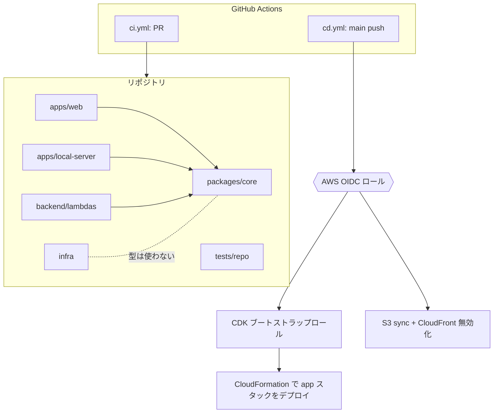
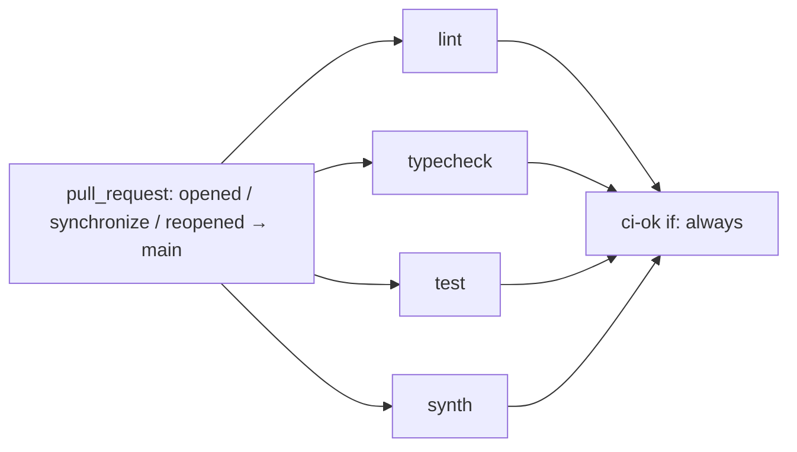
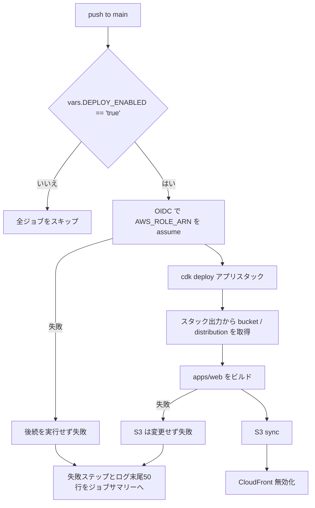
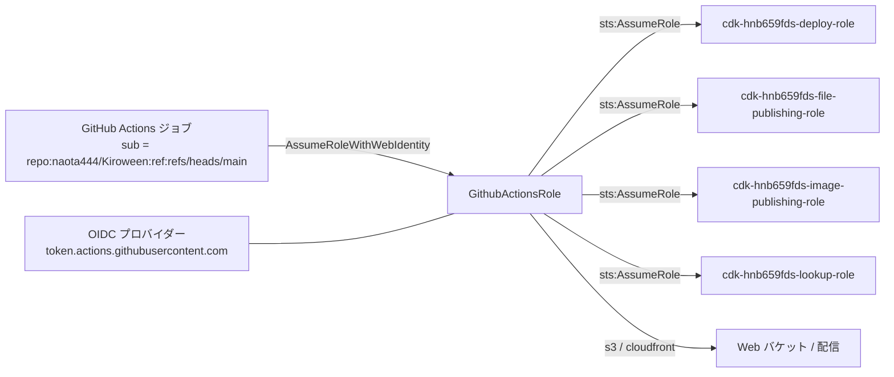

# Design Document

## Overview

この Spec は、3人が並行して開発できる npm workspaces モノレポの土台を作る。範囲は次のとおり。

- フォルダ構成とルート共通設定（TypeScript strict、ESLint、Prettier、Vitest）
- `packages/core` の WebSocket メッセージ型と、throw しないパーサー
- GitHub Actions の CI（Pull Request）と CD（main への push）
- AWS 認証用の `GithubOidcStack`（OIDC プロバイダーと IAM ロール）
- `.gitignore`、PR テンプレート、CODEOWNERS
- steering（`.kiro/steering/structure.md` と `tech.md`）への追記（命名規約と `tests/repo/`）

主な設計判断は次の5つ。

| 判断 | 結論 | 理由 |
|---|---|---|
| OIDC ロールの権限 | CDK ブートストラップロールを `sts:AssumeRole` する方式。直接付ける権限は、スタック出力の読み取り、Web 用 S3 バケット、CloudFront 無効化だけ | CDK のデプロイ権限は、ブートストラップロール側（CloudFormation 実行ロール）に集約される。OIDC ロール自体は小さく保てる |
| CI のジョブ分割 | lint / typecheck / test / synth の4ジョブを並列に走らせ、集約ジョブ `ci-ok` を必須チェックにする | 1つ失敗しても他のジョブは続行する（要件 4.6）。失敗箇所が一目で分かる |
| CD のジョブ | 1ジョブ `deploy` に `if: vars.DEPLOY_ENABLED == 'true'` を付ける。`environment:` は使わない | `environment:` を使うと OIDC の `sub` クレームが `repo:...:environment:...` に変わり、信頼ポリシーと一致しなくなる |
| `DrawingSubmit` の排他 | 2つの共用体メンバー（`imageData` 有り / `imageKey` 有り）の交差型で表す | 両方 null、両方非 null はコンパイルエラーになる |
| 検証 | `core` のパーサーと `.gitignore` はプロパティテスト（fast-check）。IaC、ワークフロー、静的ファイルはスナップショット・構造テスト・例示テスト | プロパティテストに向かない領域を無理に対象にしない |

### 調査で確認した事項

- GitHub OIDC のサブジェクトは、`environment:` を使うジョブでは `repo:OWNER/REPO:environment:NAME` になる。ブランチ push のジョブは `repo:OWNER/REPO:ref:refs/heads/main` になる（[GitHub Docs: OIDC in AWS](https://docs.github.com/en/actions/how-tos/secure-your-work/security-harden-deployments/oidc-in-aws)）。
- AWS アカウントには、同じ URL の IAM OIDC プロバイダーを1つしか作れない。既にある場合は ARN を指定して取り込む必要がある。
- CDK のブートストラップロール（deploy / file-publishing / image-publishing / lookup）は、同じアカウントのプリンシパルから引き受けられる。CDK CLI はこれらのロールを引き受けて動くため、呼び出し側のロールに `sts:AssumeRole` を許可すれば足りる（[AWS CDK Bootstrapping](https://docs.aws.amazon.com/cdk/v2/guide/bootstrapping.html)）。
- CDK には `iam.OidcProviderNative`（CloudFormation ネイティブの `AWS::IAM::OIDCProvider`）がある。カスタムリソースの Lambda を作らずに済む。実装時に使用中の `aws-cdk-lib` のバージョンで利用できることを確認し、使えない場合は `iam.OpenIdConnectProvider` に切り替える。
- `cdk synth --no-lookups` は、コンテキストのルックアップが必要な場合に AWS へ問い合わせず失敗する。CI で認証なしの synth を保証するのに使う。

## Architecture

### リポジトリ全体



### フォルダ構成

```
Kiroween/
├─ .github/
│  ├─ workflows/ci.yml, cd.yml
│  ├─ pull_request_template.md
│  └─ CODEOWNERS
├─ .kiro/                       # .gitignore に入れない
├─ apps/web/                    # Vite + React (TypeScript テンプレート)
├─ apps/local-server/           # src/index.ts, "start" スクリプト
├─ packages/core/               # src/index.ts のみが公開入口
├─ backend/lambdas/             # src/index.ts (今は空の入口)
├─ infra/                       # cdk.json, bin/infra.ts, lib/
├─ tests/repo/                  # リポジトリ全体の検査テスト (パッケージではない)
├─ tsconfig.json                # ルート共通 (strict) + references
├─ eslint.config.mjs
├─ .prettierrc.json, .prettierignore
├─ vitest.config.ts, vitest.shared.ts
├─ .gitignore
└─ package.json                 # workspaces
```

`tests/repo/` は `structure.md` のフォルダ構成にまだない追加ディレクトリである（この Spec で `structure.md` に追記する。「steering への追記」を参照）。`.gitignore`、ワークフロー、PR テンプレート、CODEOWNERS のように、どのパッケージにも属さないファイルを検査するために置く。`package.json` は持たず、依存はルートの `devDependencies` に置く。

### ルート共通設定

**package.json**

```json
{
  "private": true,
  "type": "module",
  "workspaces": [
    "packages/core",
    "backend/lambdas",
    "apps/local-server",
    "apps/web",
    "infra"
  ],
  "engines": { "node": ">=22" },
  "scripts": {
    "build": "tsc -b && npm run build --workspaces --if-present",
    "typecheck": "tsc -b",
    "lint": "eslint . && prettier --check .",
    "format": "prettier --write .",
    "test": "vitest run"
  }
}
```

- **ビルド順序**: ルート `tsconfig.json` の `references` が `core` を最初に置き、`tsc -b` が依存順に型チェックと出力を行う。`core` を使う各パッケージの `tsconfig.json` は `references: [{ "path": "../../packages/core" }]` を持つ。npm の `--workspaces` は `workspaces` 配列の順（`core` が先頭）に実行する。
- **型エラー（要件 1.13）**: `tsc` は `path(line,col): error TSxxxx` を標準エラーまたは標準出力に出し、非ゼロで終了する。`pretty` は `false` にして CI ログでも同じ形式にする。
- **`npm install`（要件 1.6）**: ルートで1回実行すれば、workspaces の依存がまとめて入る。
- **`npm test`（要件 1.8）**: 失敗したテストがあれば Vitest が非ゼロで終了する。

**tsconfig.json（ルート）**

```jsonc
{
  "compilerOptions": {
    "strict": true,
    "target": "ES2022",
    "module": "NodeNext",
    "moduleResolution": "NodeNext",
    "lib": ["ES2022"],
    "declaration": true,
    "composite": true,
    "skipLibCheck": true,
    "noUncheckedIndexedAccess": true,
    "forceConsistentCasingInFileNames": true,
    "pretty": false
  },
  "files": [],
  "references": [
    { "path": "packages/core" },
    { "path": "backend/lambdas" },
    { "path": "apps/local-server" },
    { "path": "apps/web" },
    { "path": "infra" }
  ]
}
```

各パッケージの `tsconfig.json` は `"extends": "../../tsconfig.json"` と `include`、`outDir: "dist"`、`rootDir` を持つ。`extends` は `references` を継承しないため、再帰は起きない。`apps/web` だけ、Vite の慣習に合わせて `module: ESNext`、`moduleResolution: Bundler`、`jsx: react-jsx`、`lib` に `DOM` を足す。`apps/web` と `infra` の出力は型チェック用で、使わない（`tsc -b` が `dist/` を作るだけ）。

`core` の内部 import は NodeNext のため `./messages.js` のように `.js` 拡張子を付ける。Vitest と tsx は `.js` を `.ts` に解決できる。これで `dist/index.js` が Node でもそのまま読める。

**ESLint（`eslint.config.mjs`、flat config）**

- `typescript-eslint` の recommended。型情報を使う規則は有効にしない（`core` のビルド前でも lint できるようにする）。
- `apps/web/**` にだけ `eslint-plugin-react-hooks` を足す。
- `ignores`: `**/dist`, `**/cdk.out`, `**/node_modules`, `.kiro`。
- 各パッケージに個別の ESLint 設定は置かない。ルートで `eslint .` を1回実行する。

**Prettier**: `.prettierrc.json`（`singleQuote`、`semi`、`printWidth: 100`）と `.prettierignore`（`dist`, `cdk.out`, `package-lock.json`, `.kiro`）をルートに1つ置く。個別設定は置かない。

**Vitest**

```ts
// vitest.config.ts
import { defineConfig } from 'vitest/config';
export default defineConfig({
  test: {
    projects: ['apps/*', 'packages/*', 'backend/*', 'infra', 'tests'],
  },
});
```

```ts
// vitest.shared.ts: ビルド前でも core を src から解決する
export const coreAlias = {
  '@doodle-nearby/core': new URL('./packages/core/src/index.ts', import.meta.url).pathname,
};
```

各パッケージは自分の `vitest.config.ts`（要件 1.5 の上書き）を持ち、`resolve.alias` に `coreAlias` を使う。`apps/web` は `environment: 'jsdom'`。Vitest は、テストファイルが1つも見つからないと失敗する（`--passWithNoTests` を使わない）ため、すべてのパッケージに最低1つのテスト（骨組みの確認）を置く。これが要件 4.4 の「少なくとも1つのテストファイルがある」を満たす。

### 各パッケージの骨組み

| パッケージ | 名前 | 主なファイル | スクリプト |
|---|---|---|---|
| `packages/core` | `@doodle-nearby/core` | `src/index.ts`, `src/messages.ts`, `src/parser.ts`, `src/room-list.ts`, `README.md` | `build: tsc -b`。`main: dist/index.js`、`types: dist/index.d.ts`、`exports: { ".": ... }` |
| `backend/lambdas` | `@doodle-nearby/lambdas` | `src/index.ts`（今は `core` を import するだけ） | `build: tsc -b` |
| `apps/local-server` | `@doodle-nearby/local-server` | `src/index.ts` | `start: tsx src/index.ts`, `build: tsc -b` |
| `apps/web` | `@doodle-nearby/web` | Vite React-TS テンプレート | `dev: vite`, `build: tsc -b && vite build` |
| `infra` | `@doodle-nearby/infra` | `cdk.json`, `bin/infra.ts`, `lib/github-oidc-stack.ts`, `lib/constants.ts` | `build: tsc -b`, `synth: cdk synth --no-lookups` |

`packages/core` の公開入口は `src/index.ts` だけで、`export *` で `messages`、`parser`、`room-list` を再エクスポートする。

### CI（`.github/workflows/ci.yml`）



- トリガー: `pull_request` の `branches: [main]`、`types: [opened, synchronize, reopened]`。
- `permissions: contents: read`。
- ワークフロー最上部に `defaults: run: shell: bash` を置く。`shell` を指定しない `run` は `bash -e {0}` で動き、`pipefail` が付かない。`shell: bash` を明示したときだけ `bash --noprofile --norc -eo pipefail {0}` になる。

```yaml
name: CI
on:
  pull_request:
    branches: [main]
    types: [opened, synchronize, reopened]
permissions:
  contents: read
defaults:
  run:
    shell: bash
```
- `concurrency`: `group: ci-${{ github.ref }}`、`cancel-in-progress: true`。
- 4つの検査ジョブ（`lint`、`typecheck`、`test`、`synth`）は並列で、`needs` を持たない。1つが失敗しても他は止まらない（要件 4.6）。各ジョブに `timeout-minutes: 15`（要件 4.8）。
- 共通の準備ステップ（4ジョブで同じ内容を書く。composite action にはしない。ファイルを増やさず、各ジョブの内容を読みやすくするため）:

```yaml
- uses: actions/checkout@v4
- uses: actions/setup-node@v4
  with: { node-version: 22 }
- id: cache
  uses: actions/cache@v4
  with:
    path: |
      node_modules
      */*/node_modules
    key: node-modules-${{ runner.os }}-${{ hashFiles('package-lock.json') }}
- if: steps.cache.outputs.cache-hit != 'true'
  run: npm ci
```

- キャッシュはヒット時に `npm ci` を飛ばす（`npm ci` は `node_modules` を消すため、ヒット時に実行しない）。
- 各ジョブの実行ステップ:

| ジョブ | コマンド | 備考 |
|---|---|---|
| `lint` | `npm run lint` | ESLint と Prettier の確認 |
| `typecheck` | `npm run typecheck` | `tsc -b`。strict は共通設定で有効 |
| `test` | `npm test` | `vitest run`。ウォッチなし |
| `synth` | `npm run synth -w infra` | 下記の認証なし synth |

- **認証なしの `cdk synth`**: `cdk synth --no-lookups` を使い、`AWS_EC2_METADATA_DISABLED=true` と `CDK_DISABLE_VERSION_CHECK=1` を設定する。スタックは `Vpc.fromLookup` や `HostedZone.fromLookup` などの環境依存ルックアップを使わない（使うと `--no-lookups` で失敗する）。`bin/infra.ts` は `process.env.CDK_DEFAULT_ACCOUNT` と `CDK_DEFAULT_REGION` が未設定なら `env` を渡さず、環境非依存のスタックにする（アカウントや Region は `Aws.ACCOUNT_ID` などのトークンになる）。
- `ci-ok` ジョブ: `needs: [lint, typecheck, test, synth]`、`if: always()`。`contains(needs.*.result, 'failure') || contains(needs.*.result, 'cancelled')` のとき `exit 1`。ブランチ保護（ruleset）の必須チェックは `ci-ok` だけにする。これでマージが止まる（要件 4.6）。スキップされたジョブを成功として扱わないよう、結果が `success` 以外なら失敗にする。

### CD（`.github/workflows/cd.yml`）



**リポジトリ変数**（Settings → Secrets and variables → Actions → Variables。秘密情報ではない）:

| 変数 | 役割 | 初期状態 |
|---|---|---|
| `DEPLOY_ENABLED` | CD の入切。`'true'` のときだけ動く | 未設定（要件 5.10） |
| `AWS_ROLE_ARN` | `GithubOidcStack` の出力 `GithubActionsRoleArn` を貼る | 未設定 |
| `AWS_REGION` | プロジェクトの選択 Region | 未設定 |

`DEPLOY_ENABLED` を `'true'` にするだけで、ワークフローを編集せずに次の push から動く（要件 5.9）。

**有効化の前提**: この Spec が作るスタックは `GithubOidcStack` だけで、CD が `cdk deploy 'DoodleNearby*'` で対象にするアプリスタックは別 Spec で作る。一致するスタックがない状態で `DEPLOY_ENABLED` を `'true'` にすると、`cdk deploy` が失敗する。そのため、`DoodleNearby*` に一致するアプリスタックが `main` に入るまでは、`DEPLOY_ENABLED` を未設定のままにする。ワークフローはこの状況を判定せず、運用ルールとして守る。

**ワークフローの形**

```yaml
name: CD
on:
  push:
    branches: [main]
permissions:
  id-token: write      # OIDC トークン取得に必要
  contents: read
defaults:
  run:
    shell: bash        # -eo pipefail で動かす (未指定だと pipefail が付かない)
concurrency:
  group: cd
  cancel-in-progress: false
jobs:
  deploy:
    if: vars.DEPLOY_ENABLED == 'true'   # 全ジョブに付ける (要件 5.7)
    runs-on: ubuntu-latest
    timeout-minutes: 30
    # environment: は指定しない (sub クレームが変わるため)
    steps:
      - uses: actions/checkout@v4
      - uses: actions/setup-node@v4
        with: { node-version: 22 }
      - uses: actions/cache@v4      # CI と同じ node_modules キャッシュ
        id: cache
        with: { path: "node_modules\n*/*/node_modules", key: "node-modules-${{ runner.os }}-${{ hashFiles('package-lock.json') }}" }
      - if: steps.cache.outputs.cache-hit != 'true'
        run: npm ci
      - id: auth
        uses: aws-actions/configure-aws-credentials@v6
        with:
          role-to-assume: ${{ vars.AWS_ROLE_ARN }}
          aws-region: ${{ vars.AWS_REGION }}
          role-duration-seconds: 3600
      - id: cdk_deploy
        run: |
          mkdir -p "$RUNNER_TEMP/logs"
          npx cdk deploy 'DoodleNearby*' --require-approval never 2>&1 | tee "$RUNNER_TEMP/logs/cdk_deploy.log"
        working-directory: infra
      - id: outputs   # スタック出力から値を読む
        run: ...
      - id: web_build
        run: (npx tsc -b packages/core && npm run build -w apps/web) 2>&1 | tee "$RUNNER_TEMP/logs/web_build.log"
      - id: s3_sync
        run: aws s3 sync apps/web/dist "s3://$BUCKET" --delete 2>&1 | tee "$RUNNER_TEMP/logs/s3_sync.log"
      - id: invalidate
        run: aws cloudfront create-invalidation --distribution-id "$DIST_ID" --paths '/*' 2>&1 | tee "$RUNNER_TEMP/logs/invalidate.log"
      - if: failure()
        env:
          STEPS_JSON: ${{ toJSON(steps) }}
        run: bash .github/scripts/job-summary.sh
```

- **長期キーを使わない**: `secrets.AWS_ACCESS_KEY_ID` などは参照しない。認証は `configure-aws-credentials` が OIDC トークンで行う（要件 5.2）。
- **assume に失敗した場合**: 後続ステップは `failure` のため実行されず、`cdk deploy` まで進まない。AWS リソースは変わらない（要件 5.3）。
- **デプロイ対象**: アプリスタックは名前が `DoodleNearby` で始まる規約にする（この Spec で `tech.md` に追記する）。`'DoodleNearby*'` で指定するため、`GithubOidcStack` は CD から更新されない。これは意図的で、CD 用ロールが自分自身の権限を書き換えられないようにする。Region は `configure-aws-credentials` が `AWS_DEFAULT_REGION` を設定するため、CDK の `CDK_DEFAULT_REGION` はこの Region になる（要件 5.4、us-east-1 に Lambda などを作らない）。
- **出力の読み取り**: アプリスタックは CloudFormation 出力 `WebBucketName`、`WebDistributionId`（必要なら `WebSocketUrl`）を持つ規約にする（この Spec で `tech.md` に追記する。実際のスタックは別 Spec で作り、その Spec は追記された規約に従う）。`outputs` ステップが `aws cloudformation describe-stacks --stack-name DoodleNearbyWebStack --query` で値を取り、`$GITHUB_ENV` に書く。
- **ビルド失敗時（要件 5.6）**: `web_build` が失敗すると `s3_sync` 以降は実行されない。バケットは変わらない。デプロイ済みのスタックはロールバックしない。
- **失敗サマリー（要件 5.11）**: `.github/scripts/job-summary.sh` が `STEPS_JSON` から `outcome == "failure"` のステップ ID を `jq` で取り、`$RUNNER_TEMP/logs/<id>.log` の末尾50行を `$GITHUB_STEP_SUMMARY` に書く。ステップ名も併記する。ログを `tee` していない `auth` ステップは、ステップ ID と「ログなし」を書く。ワークフロー最上部の `defaults.run.shell: bash` により各 `run` は `-eo pipefail` で動くため、`| tee` に流しても元コマンドの失敗が伝わる。`shell` を指定しないと `bash -e {0}` になり、`pipefail` が付かず、`tee` の成功で失敗が隠れる。
- 並行実行は `concurrency: group: cd` で直列化し、実行中のデプロイを途中で止めない（`cancel-in-progress: false`）。

### GithubOidcStack

**構成**



- `infra/bin/infra.ts` は `GithubOidcStack` を1つ作る。ほかのスタックを参照せず、ほかのスタックからも参照されない（要件 6.7）。`npx cdk deploy GithubOidcStack` で単独にデプロイできる。
- `env` は `CDK_DEFAULT_ACCOUNT` と `CDK_DEFAULT_REGION`（`aws login` の選択 Region）から取る。未設定なら環境非依存になる。Region は固定値を書かない。
- このスタックは、所有者が**自分の認証情報で最初に1回、手動でデプロイする**。出力のロール ARN を `AWS_ROLE_ARN` に貼ってから `DEPLOY_ENABLED` を `'true'` にする。CDK のブートストラップ（`cdk bootstrap`）も事前に1回必要。手順は `docs/` のセットアップ手順と README に書く。

**プロバイダーが既にある場合**

アカウントに同じ URL のプロバイダーがあると、作成は `EntityAlreadyExists` で失敗する。そこでコンテキスト `githubOidcProviderArn` で切り替える。

```ts
const existingArn = this.node.tryGetContext('githubOidcProviderArn') as string | undefined;
const provider = existingArn
  ? iam.OidcProviderNative.fromOidcProviderArn(this, 'GithubOidc', existingArn)
  : new iam.OidcProviderNative(this, 'GithubOidc', {
      url: 'https://token.actions.githubusercontent.com',
      clientIds: ['sts.amazonaws.com'],
    });
```

- 既存の場合は `npx cdk deploy GithubOidcStack -c githubOidcProviderArn=arn:aws:iam::<ACCOUNT>:oidc-provider/token.actions.githubusercontent.com` とする。ARN は `aws iam list-open-id-connect-providers` で確認する。
- どちらの場合も、このスタックが参照するプロバイダーはちょうど1つ。既存プロバイダーを取り込んだ場合、そのリソースはこのスタックの管理外になり、スタック削除でも消えない。

**ロール**

```ts
const role = new iam.Role(this, 'GithubActionsRole', {
  assumedBy: new iam.FederatedPrincipal(
    provider.oidcProviderArn,
    {
      StringEquals: {
        'token.actions.githubusercontent.com:aud': 'sts.amazonaws.com',
        'token.actions.githubusercontent.com:sub': `repo:${repo}:ref:refs/heads/${branch}`,
      },
    },
    'sts:AssumeRoleWithWebIdentity',
  ),
  maxSessionDuration: Duration.seconds(3600),
});
```

- `repo = 'naota444/Kiroween'`、`branch = 'main'` は `infra/lib/constants.ts` の定数。`sub` は `StringEquals` で完全一致にし、ワイルドカードを含めない（要件 6.3）。`StringLike` は使わない。
- 信頼ポリシーの Action は `sts:AssumeRoleWithWebIdentity` のみ、プリンシパルはこのプロバイダーのみ（要件 6.2）。
- 別ブランチ、フォーク、Pull Request の `sub` は一致せず、STS が拒否する。ワークフローは認証ステップで失敗し、認証情報を受け取らない（要件 6.8）。CI ワークフローには AWS 認証ステップを置かない。
- `maxSessionDuration` は 3600 秒（要件 6.4）。

**権限（要件 6.5）**

マネージドポリシーは付けない。インラインの `PolicyStatement` を次の4つだけ持つ。

| # | Action | Resource | 用途 |
|---|---|---|---|
| 1 | `sts:AssumeRole` | `arn:aws:iam::<account>:role/cdk-hnb659fds-{deploy,file-publishing,image-publishing,lookup}-role-<account>-<region>` | `cdk deploy` がブートストラップロール経由で CloudFormation を実行する |
| 2 | `cloudformation:DescribeStacks` | `arn:aws:cloudformation:<region>:<account>:stack/DoodleNearby*/*` | スタック出力（バケット名、配信 ID）の読み取り |
| 3 | `s3:ListBucket`（バケット）、`s3:PutObject`, `s3:DeleteObject`, `s3:GetObject`（オブジェクト） | `arn:aws:s3:::doodle-nearby-web-*` と `.../*` | ビルド成果物のアップロード（`sync --delete`） |
| 4 | `cloudfront:CreateInvalidation` | `arn:aws:cloudfront::<account>:distribution/*` | 配信キャッシュの無効化 |

- 直接付ける案と比べて、ブートストラップロール方式は IAM 権限が小さく、広い権限（IAM、Lambda、API Gateway の作成）を OIDC ロールに持たせずに済む。CDK 側の権限はブートストラップ時に決まる `CloudFormationExecutionRole` に集約される。この方式の注意点は、ブートストラップロールが同アカウントの任意のプリンシパルに引き受けられうること。ただし OIDC ロール以外のプリンシパルはこの Spec の対象外で、`sub` を `main` に固定した信頼ポリシーが入口を絞る。
- `*` は `DoodleNearby*` と `doodle-nearby-web-*` の名前接頭辞、および CloudFront の配信 ID（ARN にアカウントを固定）にだけ使う。`Action: "*"` と `Resource: "*"` の組み合わせはない。
- バケット名は `infra/lib/constants.ts` の `WEB_BUCKET_PREFIX = 'doodle-nearby-web-'` を使う規約にする。この規約は、この Spec で `tech.md` に追記する。CloudFront の ARN にはリージョンが入らないため、グローバルサービスだが us-east-1 のリソースは作らない。
- Lambda の `UpdateFunctionCode` などは、CloudFormation 実行ロール（ブートストラップ側）が行う。OIDC ロールに付けない。

**出力**

```ts
new CfnOutput(this, 'GithubActionsRoleArn', {
  value: role.roleArn,
  description: 'Copy into the GitHub repository variable AWS_ROLE_ARN',
});
```

プロバイダー ARN も `GithubOidcProviderArn` として出力する。

### `.gitignore`

ルートに1つだけ置く。

```gitignore
node_modules/
dist/
cdk.out/
coverage/
*.tsbuildinfo
.env
.env.*
!.env.example
.DS_Store
Thumbs.db
.vscode/
.idea/
```

- `.kiro` に一致しうる語（`.kiro`、`.*`、`.k*`）は書かない（要件 3.3）。`.env.*` は `.env.example` にも一致するため、後ろに `!.env.example` を置く（要件 3.8）。
- `cdk.context.json` は再現性のためコミットする。無視しない。
- `.vscode/` を無視するため、共有したい設定が出たときは別途、例外を足す（今は無し）。

### steering への追記

（要件 8.1〜8.4 に対応）

この Spec で、既存の steering に次の内容を追記する。既存の文面は変更せず、該当する箇所に足す。`.kiro/steering/` は CODEOWNERS の対象なので、変更は PR でレビューされる。

| ファイル | 追記内容 |
|---|---|
| `.kiro/steering/tech.md` | 命名規約: アプリスタック名は `DoodleNearby*`、Web 用バケット名は `doodle-nearby-web-*`、スタック出力は `WebBucketName` / `WebDistributionId`（必要なら `WebSocketUrl`）。「重要なルール」の後に「命名規約（AWS リソース）」の節として足す |
| `.kiro/steering/structure.md` | フォルダ構成の図に `tests/` 行（`repo/` はどのパッケージにも属さない、リポジトリ全体の検査用テスト）を足し、説明を1〜2行付ける |

確認方法は `tests/repo/steering.test.ts` の例示テスト。`tech.md` に `DoodleNearby*`、`doodle-nearby-web-*`、`WebBucketName`、`WebDistributionId` の文字列が含まれること、`structure.md` に `tests/repo` が含まれることを確かめる。CODEOWNERS 経由のレビューは手動で確認する。

### PR テンプレートと CODEOWNERS

`.github/pull_request_template.md`。見出しはちょうど3つ。

```markdown
## What changed

## Spec and task

<!-- Spec name and task number, e.g. repo-and-ci / 3.2 -->

## How it was verified
```

`.github/CODEOWNERS`:

```
/packages/core/   @naota444 @takakisae @JTakahashi03
/.kiro/steering/  @naota444 @takakisae @JTakahashi03
```

- 1人の承認でよい設定（要件 7.6）は、ファイルでは表せない。`main` の ruleset で「Require a pull request（承認数 1）」「Require review from Code Owners」「必須チェック `ci-ok`」を設定する。手順は `docs/` に書く。
- 3人のユーザー名（`@naota444`、`@takakisae`、`@JTakahashi03`）は確定済み。いずれも対象リポジトリへの書き込み権限が必要で、権限がないと CODEOWNERS エラーになり、そのオーナーは無視される（要件 7.7）。招待と権限付与は手動で行う。

## Components and Interfaces

### `packages/core` のメッセージ型（`src/messages.ts`）

```ts
export const MAX_MESSAGE_BYTES = 32_768;
export const MAX_ROOMS = 50;
export const GEOHASH_ALPHABET = '0123456789bcdefghjkmnpqrstuvwxyz'; // a, i, l, o を含まない
export const GEOHASH_LENGTH = 6;
export const MAX_AI_TEXT_LENGTH = 40; // 文字数 (コードポイント)
export const MAX_ERROR_MESSAGE_LENGTH = 200;

export type ErrorCode =
  | 'invalid_json'
  | 'unknown_type'
  | 'missing_field'
  | 'invalid_field'
  | 'message_too_large'
  | 'room_not_found'
  | 'room_full'
  | 'internal_error';

// ---- Client → Server ----
export type Join = {
  type: 'join';
  roomId: string | null;
  geohash: string; // 6 文字、GEOHASH_ALPHABET のみ
  roomCode: string | null; // 4 桁の数字
};
export type Leave = { type: 'leave'; roomId: string };

type DrawingSubmitBase = { type: 'drawing_submit'; roomId: string };
export type DrawingSubmit = DrawingSubmitBase &
  (
    | { imageData: string; imageKey: null } // base64 PNG をそのまま送る
    | { imageData: null; imageKey: string } // 大きい画像は S3 キーだけ送る
  );

export type ClientMessage = Join | Leave | DrawingSubmit;

// ---- Server → Client ----
export type RoomSummary = {
  roomId: string;
  roomCode: string;
  geohash: string;
  participantCount: number; // 0 以上の整数
  sameHash: boolean;
};
export type RoomList = { type: 'room_list'; rooms: RoomSummary[] }; // 最大 50 件
export type AiComment = { type: 'ai_comment'; roomId: string; text: string };
export type AiPrompt = { type: 'ai_prompt'; roomId: string; text: string };
export type AiCard = { type: 'ai_card'; roomId: string; text: string; imageKey: string };
export type ErrorMessage = { type: 'error'; code: ErrorCode; message: string };

export type ServerMessage = RoomList | AiComment | AiPrompt | AiCard | ErrorMessage;
```

- **`DrawingSubmit` の排他（要件 2.11）**: 交差型の右辺が2つのメンバーの共用体なので、`{ imageData: null, imageKey: null }` と、両方が文字列の値は代入できない。strict で `@ts-expect-error` を使った型テスト（`expectTypeOf`）で確認する。実行時は、パーサーが同じ条件を検査する。
- **`ErrorCode`**: `ErrorMessage.code` の固定集合（要件 2.10）。パーサーが返すエラーの `code` にも同じ型を使う。
- **`type` の文字列値**: 型名は `Join`、`DrawingSubmit` のように PascalCase、ワイヤー上の `type` は snake_case（`join`、`drawing_submit`、`room_list`、`ai_comment`、`ai_prompt`、`ai_card`、`error`）。

### パーサー（`src/parser.ts`）

```ts
export type ParseResult<T> =
  | { ok: true; value: T }
  | { ok: false; error: { code: ErrorCode; message: string } };

export function parseClientMessage(raw: string): ParseResult<ClientMessage>;
export function parseServerMessage(raw: string): ParseResult<ServerMessage>;
```

- **throw しない（要件 2.12）**: 入口で `try { JSON.parse } catch` を使い、`{ ok: false, error: { code: 'invalid_json', ... } }` を返す。以降の検査は例外を投げない書き方（`typeof` と配列・オブジェクトの判定）にする。サーバーは `ok: false` のとき `ErrorMessage` を送り、接続は閉じない。
- **検査の順序と `code`**:
  1. UTF-8 でのバイト長が `MAX_MESSAGE_BYTES` を超えたら `message_too_large`（`TextEncoder` で計測する。ブラウザと Node の両方で動く）。クライアントメッセージ（`parseClientMessage`）だけに適用する。32KB は WebSocket の1メッセージの制限で、他のフィールドも含めた JSON 全体が対象（要件 2.5）。
  2. JSON として不正、またはオブジェクトでない → `invalid_json`。
  3. `type` フィールドがない → `missing_field`。`type` はあるが方向ごとの共用体にない → `unknown_type`（たとえばクライアント側で `room_list` を受けた場合）。
  4. 必須フィールドがない → `missing_field`。キーがないことと値が `null` であることは区別する。`DrawingSubmit` で `imageData` と `imageKey` のどちらかのキーがない場合は `missing_field`、両方のキーがあって両方 `null`、または両方非 null の場合は `invalid_field`。
  5. 型・範囲・形式が違う → `invalid_field`。
- **フィールドの検査**:
  - `geohash`: 長さ6、全文字が `GEOHASH_ALPHABET`。`roomCode`: `^\d{4}$` または `null`。
  - `DrawingSubmit`: `imageData` と `imageKey` のちょうど一方が非 null の文字列。
  - AI の `text`: 1〜40 文字。数え方は `[...text].length`（コードポイント）。`ErrorMessage.message`: 1〜200 文字。
  - `RoomList.rooms`: 最大 `MAX_ROOMS` 件。`participantCount` は `Number.isInteger` かつ 0 以上。
- **余分なフィールド**: 取り除く（出力は既知のフィールドだけ）。ラウンドトリップが厳密に成り立つ。
- 検査関数は小さく分け（`isGeohash`、`isRoomCode`、`codePointLength`）、メンバーごとに1つの検証関数にする。スキーマライブラリは使わず、`core` の依存を増やさない（Lambda のバンドルを小さく保つ）。

### 部屋一覧の並べ替え（`src/room-list.ts`）

要件 2.6 の順序（`sameHash: true` を先、次に近い順）は、送る側が守る。これを1か所に集めて検証できるよう、小さな純関数を置く。

```ts
export type RoomCandidate = { summary: RoomSummary; distance: number }; // 自分のマスからのマス単位の距離

export function orderRoomSummaries(candidates: RoomCandidate[]): RoomSummary[];
```

- `sameHash` が `true` のものを先に、その中と外のそれぞれを `distance` の昇順に並べ、先頭 `MAX_ROOMS` 件を返す。同じ `distance` では入力順を保つ（安定ソート）。
- geohash の距離計算や近傍マスの求め方は、別 Spec（部屋ロジック）の責任。この関数は計算済みの `distance` を受け取るだけ。

### メッセージ一覧とレジストリ（`src/message-specs.ts`）

README の表と型を結びつけるため、型ごとのメタデータを持つ配列を `core` に置く。

```ts
export type MessageSpec = {
  typeName: string; // 'Join'
  wireType: string; // 'join'
  direction: 'Client→Server' | 'Server→Client';
  fields: string[]; // ['type', 'roomId', 'geohash', 'roomCode']
};
export const MESSAGE_SPECS: readonly MessageSpec[];
```

- 型の共用体に新しいメンバーを足したとき、レジストリの更新を忘れるとコンパイルエラーになるよう、`wireType` を `ClientMessage['type'] | ServerMessage['type']` に束縛し、`satisfies Record<ClientMessage['type'] | ServerMessage['type'], MessageSpec>` 形式のオブジェクトから配列を作る。
- README の表（要件 2.13）:

```markdown
| Type | Direction | Fields |
|---|---|---|
| Join | Client→Server | type, roomId, geohash, roomCode |
...
```

- テスト（要件 2.14）が README を読み、`MESSAGE_SPECS` の各行が表にあり、フィールド名が一致することを確認する。表にない型があれば失敗する。

## Data Models

### ワイヤーフォーマット

JSON テキスト（UTF-8）を WebSocket のテキストフレームで送る。

```json
{ "type": "join", "roomId": null, "geohash": "xn774c", "roomCode": null }
{ "type": "drawing_submit", "roomId": "r1", "imageData": "iVBOR...", "imageKey": null }
{ "type": "drawing_submit", "roomId": "r1", "imageData": null, "imageKey": "drawings/r1/abc.png" }
{ "type": "room_list", "rooms": [{ "roomId": "r1", "roomCode": "0427", "geohash": "xn774c", "participantCount": 2, "sameHash": true }] }
{ "type": "ai_comment", "roomId": "r1", "text": "2人とも猫を描いていますね!" }
{ "type": "error", "code": "invalid_field", "message": "geohash must be 6 characters" }
```

- 画像は PNG（512px 以下）を base64 にして `imageData` に入れる。メッセージ全体が 32,768 バイトを超える見込みのときは、S3 の署名付き URL へアップロードし、キーだけを `imageKey` で送る。署名付き URL の発行は別 Spec で、この Spec は型とサイズ検査だけを持つ。
- 位置は geohash 6 文字だけを送る。緯度経度の型は作らない。

### CI/CD の設定値

| 名前 | 種類 | 場所 |
|---|---|---|
| `DEPLOY_ENABLED` | リポジトリ変数 | CD の `jobs.deploy.if` |
| `AWS_ROLE_ARN` | リポジトリ変数 | `configure-aws-credentials` の `role-to-assume` |
| `AWS_REGION` | リポジトリ変数 | `configure-aws-credentials` の `aws-region` |
| `githubOidcProviderArn` | CDK コンテキスト | 既存プロバイダーの取り込み |
| `GithubActionsRoleArn` | CloudFormation 出力 | `AWS_ROLE_ARN` に貼る値 |
| `WebBucketName`, `WebDistributionId` | CloudFormation 出力（アプリスタック、別 Spec） | CD の S3・CloudFront ステップ |

## Correctness Properties

*A property is a characteristic or behavior that should hold true across all valid executions of a system-essentially, a formal statement about what the system should do. Properties serve as the bridge between human-readable specifications and machine-verifiable correctness guarantees.*

**重複の整理（Reflection）**

事前分析（prework）で、プロパティとして書けるものを洗い出した。重複を整理した結果は次のとおり。

- メッセージ型ごとのフィールド形式（要件 2.3〜2.10）は、型ごとにプロパティを分けず、「有効なメッセージのラウンドトリップ」（Property 1）と「無効なメッセージの拒否」（Property 3）の2つにまとめた。
- 「パーサーは throw しない」（要件 2.12）は、任意の入力文字列に対する性質（Property 2）にした。Property 3 は、拒否の理由（`code`）まで確認する点で別の価値がある。
- サイズ制限（要件 2.5）は、受理と拒否の境界を確認する性質で、Property 3 の拒否例とは別にした（Property 4）。
- `.gitignore` は、「`.kiro` は無視されない」（Property 6）と、「除外対象は無視される」（Property 7）の2つにした。
- README と型の対応（要件 2.13、2.14）、`DrawingSubmit` の型レベルの排他（要件 2.11）、ワークフローの構造、OIDC スタック、PR テンプレート、CODEOWNERS は、入力による変化がないため、プロパティにしない。例示テスト・スナップショットテストで確認する。

### Property 1: メッセージのラウンドトリップ

*For any* 有効な `ClientMessage`、`parseClientMessage(JSON.stringify(m))` は `{ ok: true, value }` を返し、`value` は `m` と深く等しい。*For any* 有効な `ServerMessage` についても、`parseServerMessage` で同じことが成り立つ。

**Validates: Requirements 2.1, 2.2, 2.3, 2.4, 2.5, 2.6, 2.7, 2.8, 2.9, 2.10**

### Property 2: パーサーは throw せず、結果を返す

*For any* 文字列（任意の Unicode、壊れた JSON、JSON の値として有効だがオブジェクトでないもの、深い入れ子を含む）、`parseClientMessage` と `parseServerMessage` は例外を投げず、`ok` が真偽値の結果を返す。`ok: true` のとき、`value.type` は、その方向の共用体の `type` のどれかである。

**Validates: Requirements 2.12**

### Property 3: 無効なメッセージは理由つきで拒否される

*For any* 有効なメッセージに、次のうちいずれか1つの変更を加えたもの、パーサーは `ok: false` を返し、`error.code` はその変更に対応する値になる。

- 必須フィールドの削除（`type` の削除、`DrawingSubmit` の `imageData` または `imageKey` のキーの削除を含む。値を `null` にするのとは別） → `missing_field`
- 方向の共用体にない `type`（反対方向の `type` を含む） → `unknown_type`
- 6 文字でない、または英数字が `GEOHASH_ALPHABET` にない `geohash`、4 桁の数字でない `roomCode` → `invalid_field`
- 1〜40 文字の範囲外の AI テキスト、1〜200 文字の範囲外の `ErrorMessage.message` → `invalid_field`
- 0 未満または整数でない `participantCount`、51 件以上の `rooms` → `invalid_field`
- `DrawingSubmit` で `imageData` と `imageKey` が両方 null、または両方非 null → `invalid_field`

**Validates: Requirements 2.3, 2.5, 2.6, 2.7, 2.8, 2.9, 2.10, 2.11, 2.12**

### Property 4: クライアントメッセージのサイズ上限

*For any* `DrawingSubmit`（`imageData` の長さを変えて生成）、シリアライズした JSON の UTF-8 バイト長が 32,768 以下なら `parseClientMessage` は受理し、32,768 を超えるなら `message_too_large` で拒否する。

**Validates: Requirements 2.5**

### Property 5: 部屋一覧の順序

*For any* `RoomCandidate` の配列、`orderRoomSummaries` の結果は次を満たす。(a) 長さは入力の長さと 50 の小さい方。(b) `sameHash: true` の要素はすべて `false` の要素より前にある。(c) 同じ `sameHash` の中では、対応する `distance` が昇順。(d) 結果の要素は入力の部分集合である。

**Validates: Requirements 2.6**

### Property 6: `.kiro` は無視されない

*For any* `.kiro/` の下のパス（任意の深さ、任意の英数字・ハイフン・ドットのファイル名とディレクトリ名）、リポジトリの `.gitignore` に対して `git check-ignore` は、そのパスを無視対象としない（終了コード 1、出力なし）。

**Validates: Requirements 3.3, 3.5, 3.6**

### Property 7: 除外対象は無視され、例外は無視されない

*For any* パス接尾辞、`node_modules/`、`dist/`、`cdk.out/`、`.vscode/`、`.idea/` の下のパス、および `.env`、`.env.<任意の名前>`（`.env.example` を除く）、`.DS_Store`、`Thumbs.db` は `git check-ignore` で無視対象になる。`.env.example` は無視対象にならない。

**Validates: Requirements 3.2, 3.4, 3.7, 3.8**

## Error Handling

| 場面 | 動作 |
|---|---|
| 受信メッセージが不正（JSON、型、フィールド、サイズ） | パーサーが `ok: false` と `code`、`message` を返す。呼び出し側（local-server、Lambda）が `ErrorMessage` を送り、接続は閉じない |
| `type` が反対方向の値 | `unknown_type` |
| `npm run build` で型エラー | `tsc` が `path(line,col)` つきのメッセージを出し、非ゼロで終了 |
| CI のいずれかのジョブが失敗 | ほかのジョブは続行し、`ci-ok` が失敗してマージが止まる |
| CI が 15 分を超える | ジョブが `timeout-minutes: 15` で打ち切られ、失敗扱い |
| CD: `DEPLOY_ENABLED` が `'true'` 以外 | `deploy` ジョブがスキップされ、AWS には何もしない |
| CD: ロールを引き受けられない | 認証ステップで失敗。以降は実行されず、AWS リソースは変わらない |
| CD: `cdk deploy` の失敗 | CloudFormation が自動でロールバックする。以降の Web 関連ステップは実行されない |
| CD: Web のビルド失敗 | S3 は変更しない。ジョブは失敗 |
| CD: 失敗したステップ | `if: failure()` のステップが、ステップ名とログ末尾50行を `$GITHUB_STEP_SUMMARY` に書く |
| OIDC プロバイダーが既にある | `-c githubOidcProviderArn=...` を付けて取り込む。付けずにデプロイすると CloudFormation が `EntityAlreadyExists` で失敗する |
| 他ブランチ、フォーク、PR からの assume | `sub` が一致せず STS が拒否する |
| CODEOWNERS のユーザーが存在しない、または書き込み権限がない | GitHub がエラーを表示し、そのオーナーは無視される。権限が付与されるまで続く |
| `GithubOidcStack` のデプロイ失敗後に再実行 | 同じコマンドで再デプロイできる（CDK のスタックは冪等） |

## Testing Strategy

### 方針

**プロパティテストの対象**は、入力によって結果が変わる `packages/core` のパーサー、並べ替え関数、`.gitignore` の挙動に絞る。ワークフロー、CDK スタック、README、PR テンプレートは、設定や静的ファイルなので、プロパティテストの対象にしない。例示テストとスナップショットテストを使う。

**ライブラリ**: `vitest` と `fast-check`（自前のプロパティテスト基盤は作らない）。

**プロパティテストの設定**:

- 各プロパティは1つのプロパティテストで実装する。
- 反復回数は最低 100（`fc.assert(..., { numRuns: 100 })`）。Property 6 と 7 は `git check-ignore` を子プロセスで呼ぶため、`numRuns` は 100 のまま、1回の呼び出しで複数パスを `--stdin` で渡して実行時間を抑える。
- 各テストにタグコメントを付ける。形式: `// Feature: repo-and-ci, Property N: <性質の文>`

**ジェネレーター**: `core` に `arbitrary` を使ったジェネレーターを `src/test-arbitraries.ts`（テスト専用、`index.ts` から公開しない）として置く。有効な `Join`、`Leave`、`DrawingSubmit`（`imageData` 版と `imageKey` 版）、`RoomList`、`AiComment`、`AiPrompt`、`AiCard`、`ErrorMessage` を生成する。日本語テキストは `fc.string({ unit: 'binary' })` ではなく、ひらがな・カタカナ・漢字とサロゲートペアの絵文字を含む範囲から作り、コードポイント数で 1〜40 を保証する。

### テスト一覧

| 対象 | 種類 | 場所 | 内容 |
|---|---|---|---|
| Property 1〜4 | プロパティ | `packages/core/src/parser.test.ts` | 上記のとおり |
| Property 5 | プロパティ | `packages/core/src/room-list.test.ts` | 並べ替えの不変条件 |
| Property 6, 7 | プロパティ | `tests/repo/gitignore.test.ts` | 一時ディレクトリで `git init` し、リポジトリの `.gitignore` をコピーして `git check-ignore --no-index` を実行 |
| 型の排他（2.1, 2.2, 2.11） | 型テスト | `packages/core/src/messages.test-d.ts` または `messages.test.ts` の `expectTypeOf` と `@ts-expect-error` | 共用体のメンバーが厳密、`DrawingSubmit` の両方 null と両方非 null がコンパイルエラー |
| README の表（2.13, 2.14） | 例示 | `packages/core/src/readme.test.ts` | README の表を読み、`MESSAGE_SPECS` の全行と全フィールドがあること。型を足してレジストリだけ更新漏れがあればコンパイルエラー、README の更新漏れはテスト失敗 |
| `GithubOidcStack`（6.1〜6.7） | スナップショット + 細かいアサーション | `infra/lib/github-oidc-stack.test.ts` | `Template.fromStack`。プロバイダー1つ（URL、`ClientIdList`）、ロール1つ、信頼ポリシーの `StringEquals` が `aud` と `sub` の完全一致でワイルドカードなし、`MaxSessionDuration: 3600`、マネージドポリシーなし、どの文にも `Action: '*'` がない、Output `GithubActionsRoleArn`。`githubOidcProviderArn` コンテキストありではプロバイダーを作らない |
| 他スタックへの非依存（6.7） | 例示 | 同上 | `GithubOidcStack` を単独の `App` で synth できる |
| CI ワークフロー（4.x） | 構造テスト | `tests/repo/workflows.test.ts` | YAML を読み、トリガー、4ジョブが並列（`needs` なし）、`timeout-minutes <= 15`、`actions/cache` と `hashFiles('package-lock.json')`、`ci-ok` が `if: always()`、`--no-lookups` の使用 |
| CD ワークフロー（5.x） | 構造テスト | 同上 | 全ジョブに `if: vars.DEPLOY_ENABLED == 'true'`、`permissions.id-token: write`、`secrets.AWS_ACCESS_KEY_ID` などを参照しない、`environment:` がない、`s3_sync` が `web_build` の後にある |
| ワークフローの shell（4.x, 5.x） | 構造テスト | 同上 | `ci.yml` と `cd.yml` のトップレベルに `defaults.run.shell == 'bash'` がある（`pipefail` を有効にするため） |
| steering の追記（8.1〜8.4） | 例示 | `tests/repo/steering.test.ts` | `tech.md` に命名規約の文字列（`DoodleNearby*`、`doodle-nearby-web-*`、`WebBucketName`、`WebDistributionId`）、`structure.md` に `tests/repo` が含まれる |
| ワークフロー構文 | 静的検査 | CI（任意） | `actionlint` |
| PR テンプレート（7.1） | 例示 | `tests/repo/templates.test.ts` | 見出し（`## `）がちょうど3つ |
| CODEOWNERS（7.3〜7.5） | 例示 | 同上 | `packages/core/` と `.kiro/steering/` の2行、それぞれの所有者が3人 |
| 骨組み（1.x） | スモーク | 各パッケージの `*.test.ts` と CI | 各パッケージに最低1つのテスト。ルートで `npm ci`、`npm run build`、`npm run typecheck`、`npm test` が通ること |
| `.gitignore` の個別確認（3.1） | 例示 | `tests/repo/gitignore.test.ts` | `.gitignore` がルートに1つだけ。ほかの階層に存在しない |

### 自動化できない確認

次の項目は、GitHub 側の設定や AWS の実環境に依存する。実装後に手動で確認し、結果を `docs/` の手順に記録する。

- `main` の ruleset（承認 1 人、Code Owner のレビュー必須、必須チェック `ci-ok`）（要件 4.6、7.6）
- `DEPLOY_ENABLED` が未設定の状態で `main` に push し、`deploy` がスキップされる（要件 5.8、5.10）
- `GithubOidcStack` のデプロイ後、`AWS_ROLE_ARN` を設定して CD が認証に成功する（要件 5.2）
- 別ブランチからの assume が拒否される（要件 6.8）
- CODEOWNERS に GitHub のエラー表示が出ていないこと（3人とも書き込み権限があること）（要件 7.7）
- PR 作成時にテンプレートが自動入力される（要件 7.2）

### 要件との対応

| 要件 | 設計の箇所 |
|---|---|
| 1 モノレポ骨組み | Architecture（ルート共通設定、各パッケージの骨組み） |
| 2 メッセージ型 | Components and Interfaces、Property 1〜5 |
| 3 .gitignore | Architecture（`.gitignore`）、Property 6, 7 |
| 4 CI | Architecture（CI） |
| 5 CD | Architecture（CD） |
| 6 OIDC スタック | Architecture（GithubOidcStack） |
| 7 補助ファイル | Architecture（PR テンプレートと CODEOWNERS） |
| 8 steering への追記 | Architecture（steering への追記） |
